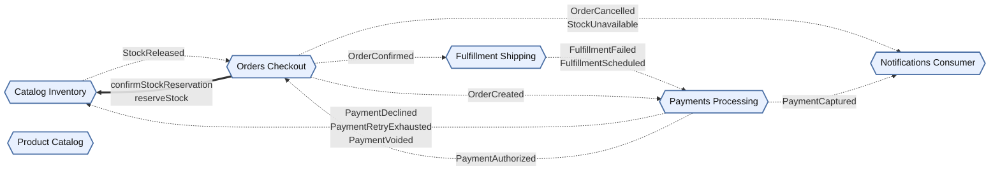

<!-- Generated by dsl-docs. Do not edit: changes are overwritten. -->
<!-- Source: catalog-inventory-domain-model.zdl sha256:5a73058c0b94d4e6a7a195c694957d97a9ccf233f2bbc243f1e340f1f35da28f -->
<!-- Source: catalog-products-domain-model.zdl sha256:baece12c0bef930d08f4103a941d15858e572f7b29653420fbf96e92afa3140f -->
<!-- Source: fulfillment-shipping-domain-model.zdl sha256:a05c21802aa81cbb31ac591446c8d69a857773789c4846e12bd8e62e2204dcd6 -->
<!-- Source: notifications-consumer-domain-model.zdl sha256:02500c3b281fc0e51142660393ec3cdd85bc586c5c56d89299d6be265d3df5d4 -->
<!-- Source: orders-checkout-domain-model.zdl sha256:2bcf402624596e153c97fde086d2d421d0c401bea41c21ab26246d80304bef29 -->
<!-- Source: payments-processing-domain-model.zdl sha256:874b4c3fee2456d375efa391f27537269d92e130d77051f6d67629ccc43e19bd -->

# Architecture

6 modules declaring 25 events (25 internal, 0 external). Generated from the ZDL files: edit the models, not this page.

## Overview

Each module with its services, the commands they handle and the events they emit.

```mermaid
flowchart LR
  classDef command fill:#a7c7f2,stroke:#3b6fb6,color:#111
  classDef service fill:#fbd3ee,stroke:#c2569b,color:#111
  classDef event fill:#ffb76b,stroke:#d9822b,color:#111
  subgraph sg_CatalogInventory["Catalog Inventory"]
    direction LR
    CatalogInventory_reserveStock["reserveStock"] --> CatalogInventory_InventoryService
    CatalogInventory_releaseStock["releaseStock"] --> CatalogInventory_InventoryService
    CatalogInventory_confirmStockReservation["confirmStockReservation"] --> CatalogInventory_InventoryService
    CatalogInventory_InventoryService(["InventoryService"])
    CatalogInventory_InventoryService --> CatalogInventory_StockReleased["StockReleased"]
    CatalogInventory_InventoryService --> CatalogInventory_StockReservationConfirmed["StockReservationConfirmed"]
    CatalogInventory_receiveStock["receiveStock"] --> CatalogInventory_InventoryBackofficeService
    CatalogInventory_adjustStock["adjustStock"] --> CatalogInventory_InventoryBackofficeService
    CatalogInventory_InventoryBackofficeService(["InventoryBackofficeService"])
    CatalogInventory_InventoryBackofficeService --> CatalogInventory_StockReceived["StockReceived"]
    CatalogInventory_InventoryBackofficeService --> CatalogInventory_StockAdjusted["StockAdjusted"]
  end
  subgraph sg_CatalogProducts["Product Catalog"]
    direction LR
    CatalogProducts_createProduct["createProduct"] --> CatalogProducts_ProductCatalogService
    CatalogProducts_updateProduct["updateProduct"] --> CatalogProducts_ProductCatalogService
    CatalogProducts_publishProduct["publishProduct"] --> CatalogProducts_ProductCatalogService
    CatalogProducts_retireProduct["retireProduct"] --> CatalogProducts_ProductCatalogService
    CatalogProducts_ProductCatalogService(["ProductCatalogService"])
    CatalogProducts_ProductCatalogService --> CatalogProducts_ProductPublished["ProductPublished"]
    CatalogProducts_ProductCatalogService --> CatalogProducts_ProductRetired["ProductRetired"]
  end
  subgraph sg_FulfillmentShipping["Fulfillment Shipping"]
    direction LR
    FulfillmentShipping_scheduleFulfillment["scheduleFulfillment"] --> FulfillmentShipping_FulfillmentShippingService
    FulfillmentShipping_markReadyToShip["markReadyToShip"] --> FulfillmentShipping_FulfillmentShippingService
    FulfillmentShipping_FulfillmentShippingService(["FulfillmentShippingService"])
    FulfillmentShipping_FulfillmentShippingService --> FulfillmentShipping_FulfillmentScheduled["FulfillmentScheduled"]
    FulfillmentShipping_FulfillmentShippingService --> FulfillmentShipping_FulfillmentFailed["FulfillmentFailed"]
    FulfillmentShipping_FulfillmentShippingService --> FulfillmentShipping_FulfillmentReadyToShip["FulfillmentReadyToShip"]
  end
  subgraph sg_NotificationsConsumer["Notifications Consumer"]
    direction LR
    NotificationsConsumer_sendOrderConfirmation["sendOrderConfirmation"] --> NotificationsConsumer_NotificationsConsumerService
    NotificationsConsumer_sendStockUnavailableNotification["sendStockUnavailableNotification"] --> NotificationsConsumer_NotificationsConsumerService
    NotificationsConsumer_sendOrderCancelledNotification["sendOrderCancelledNotification"] --> NotificationsConsumer_NotificationsConsumerService
    NotificationsConsumer_NotificationsConsumerService(["NotificationsConsumerService"])
    NotificationsConsumer_NotificationsConsumerService --> NotificationsConsumer_OrderConfirmationSent["OrderConfirmationSent"]
    NotificationsConsumer_NotificationsConsumerService --> NotificationsConsumer_NotificationDeliveryFailed["NotificationDeliveryFailed"]
    NotificationsConsumer_NotificationsConsumerService --> NotificationsConsumer_StockUnavailableNotificationSent["StockUnavailableNotificationSent"]
    NotificationsConsumer_NotificationsConsumerService --> NotificationsConsumer_OrderCancelledNotificationSent["OrderCancelledNotificationSent"]
  end
  subgraph sg_OrdersCheckout["Orders Checkout"]
    direction LR
    OrdersCheckout_startOrderCheckout["startOrderCheckout"] --> OrdersCheckout_OrdersCheckoutService
    OrdersCheckout_confirmOrder["confirmOrder"] --> OrdersCheckout_OrdersCheckoutService
    OrdersCheckout_cancelOrder["cancelOrder"] --> OrdersCheckout_OrdersCheckoutService
    OrdersCheckout_OrdersCheckoutService(["OrdersCheckoutService"])
    OrdersCheckout_OrdersCheckoutService --> OrdersCheckout_OrderCreated["OrderCreated"]
    OrdersCheckout_OrdersCheckoutService --> OrdersCheckout_StockUnavailable["StockUnavailable"]
    OrdersCheckout_OrdersCheckoutService --> OrdersCheckout_OrderConfirmed["OrderConfirmed"]
    OrdersCheckout_OrdersCheckoutService --> OrdersCheckout_OrderCancelled["OrderCancelled"]
  end
  subgraph sg_PaymentsProcessing["Payments Processing"]
    direction LR
    PaymentsProcessing_authorizePayment["authorizePayment"] --> PaymentsProcessing_PaymentsProcessingService
    PaymentsProcessing_retryPayment["retryPayment"] --> PaymentsProcessing_PaymentsProcessingService
    PaymentsProcessing_capturePayment["capturePayment"] --> PaymentsProcessing_PaymentsProcessingService
    PaymentsProcessing_voidPayment["voidPayment"] --> PaymentsProcessing_PaymentsProcessingService
    PaymentsProcessing_PaymentsProcessingService(["PaymentsProcessingService"])
    PaymentsProcessing_PaymentsProcessingService --> PaymentsProcessing_PaymentAuthorized["PaymentAuthorized"]
    PaymentsProcessing_PaymentsProcessingService --> PaymentsProcessing_PaymentDeclined["PaymentDeclined"]
    PaymentsProcessing_PaymentsProcessingService --> PaymentsProcessing_PaymentFailed["PaymentFailed"]
    PaymentsProcessing_PaymentsProcessingService --> PaymentsProcessing_PaymentRetried["PaymentRetried"]
    PaymentsProcessing_PaymentsProcessingService --> PaymentsProcessing_PaymentRetryExhausted["PaymentRetryExhausted"]
    PaymentsProcessing_PaymentsProcessingService --> PaymentsProcessing_PaymentCaptured["PaymentCaptured"]
    PaymentsProcessing_PaymentsProcessingService --> PaymentsProcessing_PaymentCaptureFailed["PaymentCaptureFailed"]
    PaymentsProcessing_PaymentsProcessingService --> PaymentsProcessing_PaymentVoided["PaymentVoided"]
  end
  class CatalogInventory_reserveStock,CatalogInventory_releaseStock,CatalogInventory_confirmStockReservation,CatalogInventory_receiveStock,CatalogInventory_adjustStock,CatalogProducts_createProduct,CatalogProducts_updateProduct,CatalogProducts_publishProduct,CatalogProducts_retireProduct,FulfillmentShipping_scheduleFulfillment,FulfillmentShipping_markReadyToShip,NotificationsConsumer_sendOrderConfirmation,NotificationsConsumer_sendStockUnavailableNotification,NotificationsConsumer_sendOrderCancelledNotification,OrdersCheckout_startOrderCheckout,OrdersCheckout_confirmOrder,OrdersCheckout_cancelOrder,PaymentsProcessing_authorizePayment,PaymentsProcessing_retryPayment,PaymentsProcessing_capturePayment,PaymentsProcessing_voidPayment command
  class CatalogInventory_InventoryService,CatalogInventory_InventoryBackofficeService,CatalogProducts_ProductCatalogService,FulfillmentShipping_FulfillmentShippingService,NotificationsConsumer_NotificationsConsumerService,OrdersCheckout_OrdersCheckoutService,PaymentsProcessing_PaymentsProcessingService service
  class CatalogInventory_StockReleased,CatalogInventory_StockReservationConfirmed,CatalogInventory_StockReceived,CatalogInventory_StockAdjusted,CatalogProducts_ProductPublished,CatalogProducts_ProductRetired,FulfillmentShipping_FulfillmentScheduled,FulfillmentShipping_FulfillmentFailed,FulfillmentShipping_FulfillmentReadyToShip,NotificationsConsumer_OrderConfirmationSent,NotificationsConsumer_NotificationDeliveryFailed,NotificationsConsumer_StockUnavailableNotificationSent,NotificationsConsumer_OrderCancelledNotificationSent,OrdersCheckout_OrderCreated,OrdersCheckout_StockUnavailable,OrdersCheckout_OrderConfirmed,OrdersCheckout_OrderCancelled,PaymentsProcessing_PaymentAuthorized,PaymentsProcessing_PaymentDeclined,PaymentsProcessing_PaymentFailed,PaymentsProcessing_PaymentRetried,PaymentsProcessing_PaymentRetryExhausted,PaymentsProcessing_PaymentCaptured,PaymentsProcessing_PaymentCaptureFailed,PaymentsProcessing_PaymentVoided event
  style sg_CatalogInventory fill:#ffffff,stroke:#999999,stroke-dasharray:4 3,color:#333333
  style sg_CatalogProducts fill:#ffffff,stroke:#999999,stroke-dasharray:4 3,color:#333333
  style sg_FulfillmentShipping fill:#ffffff,stroke:#999999,stroke-dasharray:4 3,color:#333333
  style sg_NotificationsConsumer fill:#ffffff,stroke:#999999,stroke-dasharray:4 3,color:#333333
  style sg_OrdersCheckout fill:#ffffff,stroke:#999999,stroke-dasharray:4 3,color:#333333
  style sg_PaymentsProcessing fill:#ffffff,stroke:#999999,stroke-dasharray:4 3,color:#333333
```

Dashed box = module. Blue = command, handled by the pink service, which emits the orange events.

## Modules

One module per ZDL file, each with its own page.

| Module | Package | ZDL | Page |
| --- | --- | --- | --- |
| Catalog Inventory | `com.arcadiaeditions.catalog.inventory` | [`catalog-inventory-domain-model.zdl`](../catalog-inventory-domain-model.zdl) | [modules/catalog-inventory.md](modules/catalog-inventory.md) |
| Product Catalog | `com.arcadiaeditions.catalog.products` | [`catalog-products-domain-model.zdl`](../catalog-products-domain-model.zdl) | [modules/catalog-products.md](modules/catalog-products.md) |
| Fulfillment Shipping | `com.arcadiaeditions.fulfillment.shipping` | [`fulfillment-shipping-domain-model.zdl`](../fulfillment-shipping-domain-model.zdl) | [modules/fulfillment-shipping.md](modules/fulfillment-shipping.md) |
| Notifications Consumer | `com.arcadiaeditions.notifications.consumer` | [`notifications-consumer-domain-model.zdl`](../notifications-consumer-domain-model.zdl) | [modules/notifications-consumer.md](modules/notifications-consumer.md) |
| Orders Checkout | `com.arcadiaeditions.orders.checkout` | [`orders-checkout-domain-model.zdl`](../orders-checkout-domain-model.zdl) | [modules/orders-checkout.md](modules/orders-checkout.md) |
| Payments Processing | `com.arcadiaeditions.payments.processing` | [`payments-processing-domain-model.zdl`](../payments-processing-domain-model.zdl) | [modules/payments-processing.md](modules/payments-processing.md) |

## Dependencies

The system has too many modules or events for one diagram, so this one shows modules only. Each module page has the diagram of that module.

Hexagon = module. Rectangle inside a box = internal event owned by that module. Pipe outside boxes = external event (has a topic). Solid = published by. Dashed = consumed by. Thick = direct call.

## Direct calls

Calls from one module to a command of another, declared with `@calls`. The caller waits for the answer, unlike an event.

| Caller | Callee | Command | Called from |
| --- | --- | --- | --- |
| [Orders Checkout](modules/orders-checkout.md) | [Catalog Inventory](modules/catalog-inventory.md) | `confirmStockReservation` | `OrdersCheckoutService.confirmOrder` |
| [Orders Checkout](modules/orders-checkout.md) | [Catalog Inventory](modules/catalog-inventory.md) | `reserveStock` | `OrdersCheckoutService.startOrderCheckout` |

## Events

Every event with the module that owns it and the modules that consume it. An event is external when it has an `@asyncapi` topic and internal otherwise. Consumers come from `@listener` and `@asyncapi` on service methods.

| Event | Kind | Owner | Topic | Defined in | Consumers |
| --- | --- | --- | --- | --- | --- |
| StockAdjusted | internal | [Catalog Inventory](modules/catalog-inventory.md) |  | [`catalog-inventory-domain-model.zdl`](../catalog-inventory-domain-model.zdl) |  |
| StockReceived | internal | [Catalog Inventory](modules/catalog-inventory.md) |  | [`catalog-inventory-domain-model.zdl`](../catalog-inventory-domain-model.zdl) |  |
| StockReleased | internal | [Catalog Inventory](modules/catalog-inventory.md) |  | [`catalog-inventory-domain-model.zdl`](../catalog-inventory-domain-model.zdl) | [Orders Checkout](modules/orders-checkout.md) |
| StockReservationConfirmed | internal | [Catalog Inventory](modules/catalog-inventory.md) |  | [`catalog-inventory-domain-model.zdl`](../catalog-inventory-domain-model.zdl) |  |
| ProductPublished | internal | [Product Catalog](modules/catalog-products.md) |  | [`catalog-products-domain-model.zdl`](../catalog-products-domain-model.zdl) |  |
| ProductRetired | internal | [Product Catalog](modules/catalog-products.md) |  | [`catalog-products-domain-model.zdl`](../catalog-products-domain-model.zdl) |  |
| FulfillmentFailed | internal | [Fulfillment Shipping](modules/fulfillment-shipping.md) |  | [`fulfillment-shipping-domain-model.zdl`](../fulfillment-shipping-domain-model.zdl) | [Payments Processing](modules/payments-processing.md) |
| FulfillmentReadyToShip | internal | [Fulfillment Shipping](modules/fulfillment-shipping.md) |  | [`fulfillment-shipping-domain-model.zdl`](../fulfillment-shipping-domain-model.zdl) |  |
| FulfillmentScheduled | internal | [Fulfillment Shipping](modules/fulfillment-shipping.md) |  | [`fulfillment-shipping-domain-model.zdl`](../fulfillment-shipping-domain-model.zdl) | [Payments Processing](modules/payments-processing.md) |
| NotificationDeliveryFailed | internal | [Notifications Consumer](modules/notifications-consumer.md) |  | [`notifications-consumer-domain-model.zdl`](../notifications-consumer-domain-model.zdl) |  |
| OrderCancelledNotificationSent | internal | [Notifications Consumer](modules/notifications-consumer.md) |  | [`notifications-consumer-domain-model.zdl`](../notifications-consumer-domain-model.zdl) |  |
| OrderConfirmationSent | internal | [Notifications Consumer](modules/notifications-consumer.md) |  | [`notifications-consumer-domain-model.zdl`](../notifications-consumer-domain-model.zdl) |  |
| StockUnavailableNotificationSent | internal | [Notifications Consumer](modules/notifications-consumer.md) |  | [`notifications-consumer-domain-model.zdl`](../notifications-consumer-domain-model.zdl) |  |
| OrderCancelled | internal | [Orders Checkout](modules/orders-checkout.md) |  | [`orders-checkout-domain-model.zdl`](../orders-checkout-domain-model.zdl) | [Notifications Consumer](modules/notifications-consumer.md) |
| OrderConfirmed | internal | [Orders Checkout](modules/orders-checkout.md) |  | [`orders-checkout-domain-model.zdl`](../orders-checkout-domain-model.zdl) | [Fulfillment Shipping](modules/fulfillment-shipping.md) |
| OrderCreated | internal | [Orders Checkout](modules/orders-checkout.md) |  | [`orders-checkout-domain-model.zdl`](../orders-checkout-domain-model.zdl) | [Payments Processing](modules/payments-processing.md) |
| StockUnavailable | internal | [Orders Checkout](modules/orders-checkout.md) |  | [`orders-checkout-domain-model.zdl`](../orders-checkout-domain-model.zdl) | [Notifications Consumer](modules/notifications-consumer.md) |
| PaymentAuthorized | internal | [Payments Processing](modules/payments-processing.md) |  | [`payments-processing-domain-model.zdl`](../payments-processing-domain-model.zdl) | [Orders Checkout](modules/orders-checkout.md) |
| PaymentCaptureFailed | internal | [Payments Processing](modules/payments-processing.md) |  | [`payments-processing-domain-model.zdl`](../payments-processing-domain-model.zdl) | [Payments Processing](modules/payments-processing.md) |
| PaymentCaptured | internal | [Payments Processing](modules/payments-processing.md) |  | [`payments-processing-domain-model.zdl`](../payments-processing-domain-model.zdl) | [Notifications Consumer](modules/notifications-consumer.md) |
| PaymentDeclined | internal | [Payments Processing](modules/payments-processing.md) |  | [`payments-processing-domain-model.zdl`](../payments-processing-domain-model.zdl) | [Catalog Inventory](modules/catalog-inventory.md) |
| PaymentFailed | internal | [Payments Processing](modules/payments-processing.md) |  | [`payments-processing-domain-model.zdl`](../payments-processing-domain-model.zdl) | [Payments Processing](modules/payments-processing.md) |
| PaymentRetried | internal | [Payments Processing](modules/payments-processing.md) |  | [`payments-processing-domain-model.zdl`](../payments-processing-domain-model.zdl) |  |
| PaymentRetryExhausted | internal | [Payments Processing](modules/payments-processing.md) |  | [`payments-processing-domain-model.zdl`](../payments-processing-domain-model.zdl) | [Catalog Inventory](modules/catalog-inventory.md) |
| PaymentVoided | internal | [Payments Processing](modules/payments-processing.md) |  | [`payments-processing-domain-model.zdl`](../payments-processing-domain-model.zdl) | [Catalog Inventory](modules/catalog-inventory.md) |

### Events with no consumers

No service method in these files listens to them. An external event may be an integration point for other systems.

- StockAdjusted (Catalog Inventory, internal)
- StockReceived (Catalog Inventory, internal)
- StockReservationConfirmed (Catalog Inventory, internal)
- ProductPublished (Product Catalog, internal)
- ProductRetired (Product Catalog, internal)
- FulfillmentReadyToShip (Fulfillment Shipping, internal)
- NotificationDeliveryFailed (Notifications Consumer, internal)
- OrderCancelledNotificationSent (Notifications Consumer, internal)
- OrderConfirmationSent (Notifications Consumer, internal)
- StockUnavailableNotificationSent (Notifications Consumer, internal)
- PaymentRetried (Payments Processing, internal)

