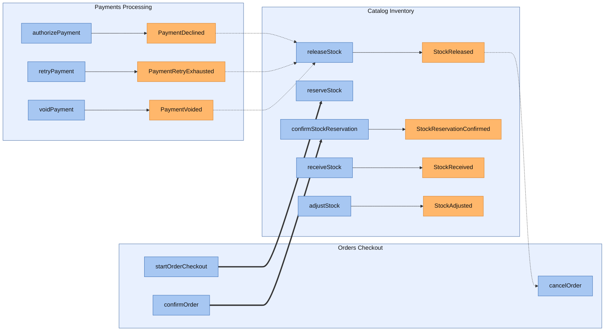
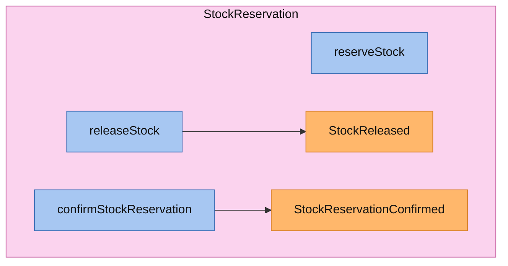
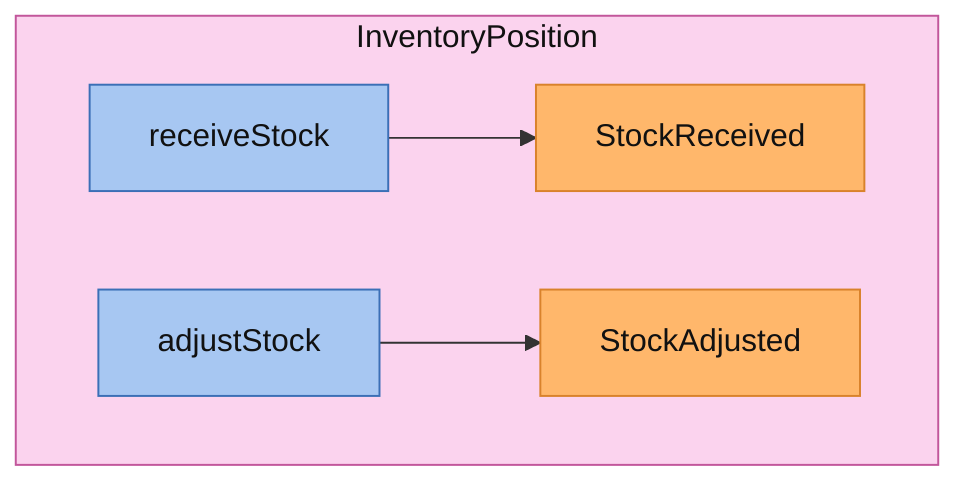
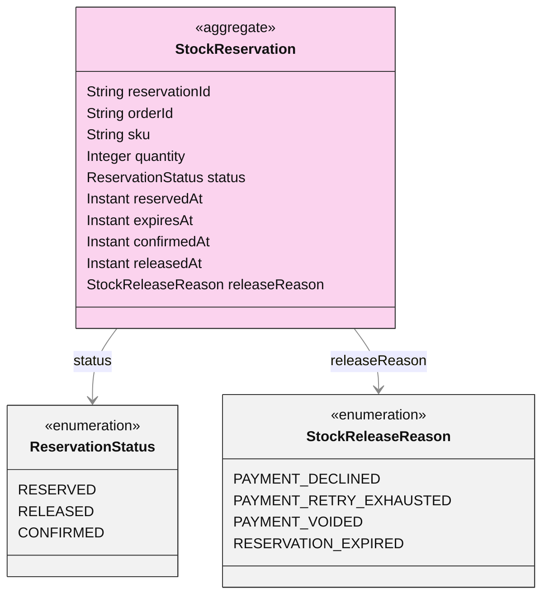
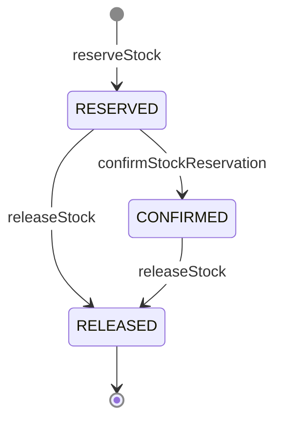
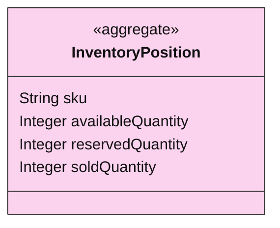
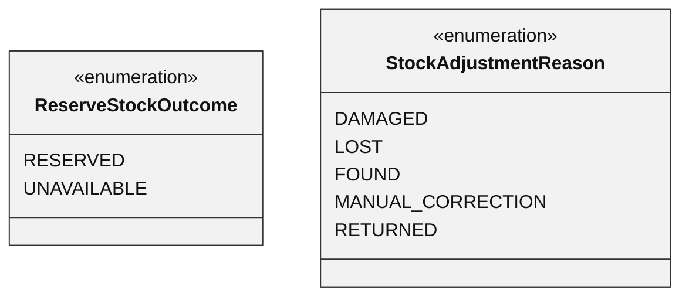

<!-- Generated by dsl-docs. Do not edit: changes are overwritten. -->
<!-- Source: catalog-inventory-domain-model.zdl sha256:5a73058c0b94d4e6a7a195c694957d97a9ccf233f2bbc243f1e340f1f35da28f -->

# Catalog Inventory

Arcadia Editions - Catalog Inventory

Source: `catalog-inventory-domain-model.zdl`

Back to the [architecture](../architecture.md).

## Architecture

This module's commands and events, and the commands and events of other modules that connect to them.

Box = module. Blue = command. Orange = event; a pipe outside the boxes is an external event (has a topic). Solid = emits. Dashed = consumed by. Thick = direct call.

## Services

Each service with its commands (blue) and the events they emit (orange), inside the aggregate it works on.

### InventoryService

### InventoryBackofficeService

Queries: `createInventoryPosition`.

## Aggregates

Each aggregate root with the entities and enums it owns, and how they relate.

### StockReservation

#### Lifecycle

Field `status`, initial `RESERVED`.

### InventoryPosition

### Other entities

Entities and enums that no aggregate reaches.

## Commands

The methods of the module's services and the events each one emits.

| Service | Command | Input | Returns | Events | Description |
| --- | --- | --- | --- | --- | --- |
| InventoryService | reserveStock | [ReserveStockInput](#reservestockinput) | [ReserveStockResult](#reservestockresult) |  |  |
| InventoryService | releaseStock | [ReleaseStockInput](#releasestockinput) | [StockReservation](#stockreservation-1)[] | [StockReleased](#stockreleased) |  |
| InventoryService | confirmStockReservation | id | [StockReservation](#stockreservation-1)[] | [StockReservationConfirmed](#stockreservationconfirmed) |  |
| InventoryBackofficeService | createInventoryPosition | [CreateInventoryPositionInput](#createinventorypositioninput) | [InventoryPosition](#inventoryposition-1) |  |  |
| InventoryBackofficeService | receiveStock | [ReceiveStockInput](#receivestockinput) | [InventoryPosition](#inventoryposition-1) | [StockReceived](#stockreceived) |  |
| InventoryBackofficeService | adjustStock | [AdjustStockInput](#adjuststockinput) | [InventoryPosition](#inventoryposition-1) | [StockAdjusted](#stockadjusted) |  |

## Events

Events declared by this module, with their fields. Fields copied with `@copy` are included.

### StockReleased

| Field | Type | Description |
| --- | --- | --- |
| orderId | String |  |
| reason | [StockReleaseReason](#stockreleasereason) |  |
| releasedAt | Instant |  |
| items | [StockReleasedItem](#stockreleaseditem)[] |  |

#### StockReleasedItem

| Field | Type | Description |
| --- | --- | --- |
| reservationId | String |  |
| sku | String |  |
| quantity | Integer |  |

### StockReservationConfirmed

| Field | Type | Description |
| --- | --- | --- |
| orderId | String |  |
| confirmedAt | Instant |  |
| items | [StockReservationConfirmedItem](#stockreservationconfirmeditem)[] |  |

#### StockReservationConfirmedItem

| Field | Type | Description |
| --- | --- | --- |
| reservationId | String |  |
| sku | String |  |
| quantity | Integer |  |

### StockReceived

| Field | Type | Description |
| --- | --- | --- |
| sku | String |  |
| quantity | Integer |  |
| availableQuantity | Integer |  |
| reservedQuantity | Integer |  |
| soldQuantity | Integer |  |
| reason | String |  |
| reference | String |  |
| receivedAt | Instant |  |

### StockAdjusted

| Field | Type | Description |
| --- | --- | --- |
| sku | String |  |
| quantityDelta | Integer |  |
| availableQuantity | Integer |  |
| reservedQuantity | Integer |  |
| soldQuantity | Integer |  |
| reason | [StockAdjustmentReason](#stockadjustmentreason) |  |
| reference | String |  |
| adjustedAt | Instant |  |

## Consumes

Events from other modules or systems that this module reacts to, and the method that handles each one.

| Event | Owner | Handled by | Via |
| --- | --- | --- | --- |
| PaymentDeclined | [Payments Processing](payments-processing.md) | `InventoryService.releaseStock` | @listener |
| PaymentRetryExhausted | [Payments Processing](payments-processing.md) | `InventoryService.releaseStock` | @listener |
| PaymentVoided | [Payments Processing](payments-processing.md) | `InventoryService.releaseStock` | @listener |

## Consumed by

Who reacts to the events this module owns.

| Event | Consumer | Handled by | Via |
| --- | --- | --- | --- |
| StockReleased | [Orders Checkout](orders-checkout.md) | `OrdersCheckoutService.cancelOrder` | @listener |

## Called by

Other modules that call commands of this module directly.

| Caller | Command | Called from |
| --- | --- | --- |
| [Orders Checkout](orders-checkout.md) | `confirmStockReservation` | `OrdersCheckoutService.confirmOrder` |
| [Orders Checkout](orders-checkout.md) | `reserveStock` | `OrdersCheckoutService.startOrderCheckout` |

## Glossary

Every named type of this module, by kind. Events are described under Events.

### Aggregates

#### StockReservation

Aggregate root

| Field | Type | Description |
| --- | --- | --- |
| reservationId | String |  |
| orderId | String | One reservation per order line: an order has as many reservations as items. |
| sku | String |  |
| quantity | Integer |  |
| status | [ReservationStatus](#reservationstatus) |  |
| reservedAt | Instant |  |
| expiresAt | Instant |  |
| confirmedAt | Instant |  |
| releasedAt | Instant |  |
| releaseReason | [StockReleaseReason](#stockreleasereason) |  |

#### InventoryPosition

Aggregate root

| Field | Type | Description |
| --- | --- | --- |
| sku | String |  |
| availableQuantity | Integer |  |
| reservedQuantity | Integer |  |
| soldQuantity | Integer |  |

### Enums

#### ReservationStatus

| Value | Description |
| --- | --- |
| RESERVED |  |
| RELEASED |  |
| CONFIRMED |  |

#### StockReleaseReason

| Value | Description |
| --- | --- |
| PAYMENT_DECLINED |  |
| PAYMENT_RETRY_EXHAUSTED |  |
| PAYMENT_VOIDED |  |
| RESERVATION_EXPIRED |  |

#### ReserveStockOutcome

| Value | Description |
| --- | --- |
| RESERVED |  |
| UNAVAILABLE |  |

#### StockAdjustmentReason

| Value | Description |
| --- | --- |
| DAMAGED |  |
| LOST |  |
| FOUND |  |
| MANUAL_CORRECTION |  |
| RETURNED |  |

### Inputs

#### ReserveStockInput

| Field | Type | Description |
| --- | --- | --- |
| orderId | String |  |
| items | [ReserveStockItemInput](#reservestockiteminput)[] |  |

#### ReserveStockItemInput

| Field | Type | Description |
| --- | --- | --- |
| sku | String |  |
| quantity | Integer |  |

#### ReleaseStockInput

Releases every reservation of the order.

| Field | Type | Description |
| --- | --- | --- |
| orderId | String |  |
| reason | [StockReleaseReason](#stockreleasereason) |  |

#### CreateInventoryPositionInput

| Field | Type | Description |
| --- | --- | --- |
| sku | String |  |
| initialQuantity | Integer |  |

#### ReceiveStockInput

| Field | Type | Description |
| --- | --- | --- |
| sku | String |  |
| quantity | Integer |  |
| reason | String |  |
| reference | String |  |

#### AdjustStockInput

| Field | Type | Description |
| --- | --- | --- |
| sku | String |  |
| quantityDelta | Integer |  |
| reason | [StockAdjustmentReason](#stockadjustmentreason) |  |
| reference | String |  |

### Outputs

#### ReserveStockResult

Wrapper for the two ZFL responses of reserveStock (ZDL has no union return type). Exactly one of `reserved` / `unavailable` is set, according to `outcome`.

| Field | Type | Description |
| --- | --- | --- |
| outcome | [ReserveStockOutcome](#reservestockoutcome) |  |
| reserved | [StockReservedResult](#stockreservedresult) |  |
| unavailable | [StockUnavailableResult](#stockunavailableresult) |  |

#### StockReservedResult

| Field | Type | Description |
| --- | --- | --- |
| orderId | String |  |
| expiresAt | Instant |  |
| reservations | [StockReservedLine](#stockreservedline)[] |  |

#### StockReservedLine

| Field | Type | Description |
| --- | --- | --- |
| reservationId | String |  |
| sku | String |  |
| quantity | Integer |  |
| reservedAt | Instant |  |

#### StockUnavailableResult

| Field | Type | Description |
| --- | --- | --- |
| orderId | String |  |
| unavailableItems | [StockUnavailableLine](#stockunavailableline)[] |  |

#### StockUnavailableLine

| Field | Type | Description |
| --- | --- | --- |
| sku | String |  |
| requestedQuantity | Integer |  |
| availableQuantity | Integer |  |

