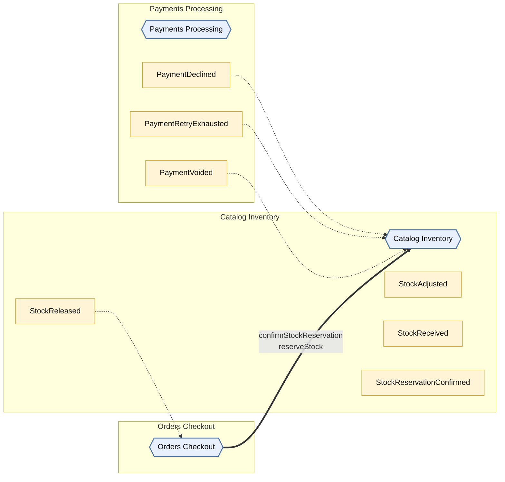

<!-- Generated by dsl-docs. Do not edit: changes are overwritten. -->
<!-- Source: catalog-inventory-domain-model.zdl sha256:5a73058c0b94d4e6a7a195c694957d97a9ccf233f2bbc243f1e340f1f35da28f -->

# Arcadia Editions - Catalog Inventory

Source: `catalog-inventory-domain-model.zdl`

Back to the [architecture](../architecture.md).

## Architecture

This module, the events it owns and consumes, and the modules it talks to.

Hexagon = module. Rectangle inside a box = internal event owned by that module. Pipe outside boxes = external event (has a topic). Solid = published by. Dashed = consumed by. Thick = direct call.

## Class diagram

Aggregates, entities and enums of this module and how they relate.

```mermaid
classDiagram
    class StockReservation {
        <<aggregate>>
        String reservationId
        String orderId
        String sku
        Integer quantity
        ReservationStatus status
        Instant reservedAt
        Instant expiresAt
        Instant confirmedAt
        Instant releasedAt
        StockReleaseReason releaseReason
    }
    class InventoryPosition {
        <<aggregate>>
        String sku
        Integer availableQuantity
        Integer reservedQuantity
        Integer soldQuantity
    }
    class ReservationStatus {
        <<enumeration>>
        RESERVED
        RELEASED
        CONFIRMED
    }
    class StockReleaseReason {
        <<enumeration>>
        PAYMENT_DECLINED
        PAYMENT_RETRY_EXHAUSTED
        PAYMENT_VOIDED
        RESERVATION_EXPIRED
    }
    class ReserveStockOutcome {
        <<enumeration>>
        RESERVED
        UNAVAILABLE
    }
    class StockAdjustmentReason {
        <<enumeration>>
        DAMAGED
        LOST
        FOUND
        MANUAL_CORRECTION
        RETURNED
    }
    class ReserveStockInput {
        <<input>>
        String orderId
        ReserveStockItemInput[] items
    }
    class ReserveStockItemInput {
        <<input>>
        String sku
        Integer quantity
    }
    class ReleaseStockInput {
        <<input>>
        String orderId
        StockReleaseReason reason
    }
    class CreateInventoryPositionInput {
        <<input>>
        String sku
        Integer initialQuantity
    }
    class ReceiveStockInput {
        <<input>>
        String sku
        Integer quantity
        String reason
        String reference
    }
    class AdjustStockInput {
        <<input>>
        String sku
        Integer quantityDelta
        StockAdjustmentReason reason
        String reference
    }
    class ReserveStockResult {
        <<output>>
        ReserveStockOutcome outcome
        StockReservedResult reserved
        StockUnavailableResult unavailable
    }
    class StockReservedResult {
        <<output>>
        String orderId
        Instant expiresAt
        StockReservedLine[] reservations
    }
    class StockReservedLine {
        <<output>>
        String reservationId
        String sku
        Integer quantity
        Instant reservedAt
    }
    class StockUnavailableResult {
        <<output>>
        String orderId
        StockUnavailableLine[] unavailableItems
    }
    class StockUnavailableLine {
        <<output>>
        String sku
        Integer requestedQuantity
        Integer availableQuantity
    }
    class StockReleased {
        <<event>>
        String orderId
        StockReleaseReason reason
        Instant releasedAt
        StockReleasedItem[] items
    }
    class StockReleasedItem {
        <<event>>
        String reservationId
        String sku
        Integer quantity
    }
    class StockReservationConfirmed {
        <<event>>
        String orderId
        Instant confirmedAt
        StockReservationConfirmedItem[] items
    }
    class StockReservationConfirmedItem {
        <<event>>
        String reservationId
        String sku
        Integer quantity
    }
    class StockReceived {
        <<event>>
        String sku
        Integer quantity
        Integer availableQuantity
        Integer reservedQuantity
        Integer soldQuantity
        String reason
        String reference
        Instant receivedAt
    }
    class StockAdjusted {
        <<event>>
        String sku
        Integer quantityDelta
        Integer availableQuantity
        Integer reservedQuantity
        Integer soldQuantity
        StockAdjustmentReason reason
        String reference
        Instant adjustedAt
    }
    class InventoryService {
        <<service>>
        reserveStock(ReserveStockInput) ReserveStockResult
        releaseStock(ReleaseStockInput) StockReservation[] withEvents StockReleased
        confirmStockReservation(id) StockReservation[] withEvents StockReservationConfirmed
    }
    class InventoryBackofficeService {
        <<service>>
        createInventoryPosition(CreateInventoryPositionInput) InventoryPosition
        receiveStock(ReceiveStockInput) InventoryPosition withEvents StockReceived
        adjustStock(AdjustStockInput) InventoryPosition withEvents StockAdjusted
    }
    StockReservation --> ReservationStatus : status
    StockReservation --> StockReleaseReason : releaseReason
    ReserveStockInput *-- "*" ReserveStockItemInput : items
    ReleaseStockInput --> StockReleaseReason : reason
    AdjustStockInput --> StockAdjustmentReason : reason
    ReserveStockResult --> ReserveStockOutcome : outcome
    ReserveStockResult --> StockReservedResult : reserved
    ReserveStockResult --> StockUnavailableResult : unavailable
    StockReservedResult *-- "*" StockReservedLine : reservations
    StockUnavailableResult *-- "*" StockUnavailableLine : unavailableItems
    StockReleased --> StockReleaseReason : reason
    StockReleased *-- "*" StockReleasedItem : items
    StockReservationConfirmed *-- "*" StockReservationConfirmedItem : items
    StockAdjusted --> StockAdjustmentReason : reason
    InventoryService ..> StockReservation
    InventoryService ..> ReserveStockInput
    InventoryService ..> ReserveStockResult
    InventoryService ..> ReleaseStockInput
    InventoryService ..> StockReleased
    InventoryService ..> StockReservationConfirmed
    InventoryBackofficeService ..> InventoryPosition
    InventoryBackofficeService ..> CreateInventoryPositionInput
    InventoryBackofficeService ..> ReceiveStockInput
    InventoryBackofficeService ..> StockReceived
    InventoryBackofficeService ..> AdjustStockInput
    InventoryBackofficeService ..> StockAdjusted
```

## Glossary

Every named type and service of this module.

| Term | Kind | Description |
| --- | --- | --- |
| AdjustStockInput | Input |  |
| CreateInventoryPositionInput | Input |  |
| InventoryBackofficeService | Service |  |
| InventoryPosition | Aggregate root |  |
| InventoryService | Service |  |
| ReceiveStockInput | Input |  |
| ReleaseStockInput | Input | Releases every reservation of the order. |
| ReservationStatus | Enum |  |
| ReserveStockInput | Input |  |
| ReserveStockItemInput | Input |  |
| ReserveStockOutcome | Enum |  |
| ReserveStockResult | Output | Wrapper for the two ZFL responses of reserveStock (ZDL has no union return type). Exactly one of `reserved` / `unavailable` is set, according to `outcome`. |
| StockAdjusted | Event |  |
| StockAdjustmentReason | Enum |  |
| StockReceived | Event |  |
| StockReleased | Event |  |
| StockReleasedItem | Event |  |
| StockReleaseReason | Enum |  |
| StockReservation | Aggregate root |  |
| StockReservationConfirmed | Event |  |
| StockReservationConfirmedItem | Event |  |
| StockReservedLine | Output |  |
| StockReservedResult | Output |  |
| StockUnavailableLine | Output |  |
| StockUnavailableResult | Output |  |

## Commands

The methods of the module's services and the events each one emits.

| Service | Command | Input | Returns | Events | Description |
| --- | --- | --- | --- | --- | --- |
| InventoryService | reserveStock | ReserveStockInput | ReserveStockResult |  |  |
| InventoryService | releaseStock | ReleaseStockInput | StockReservation[] | StockReleased |  |
| InventoryService | confirmStockReservation | id | StockReservation[] | StockReservationConfirmed |  |
| InventoryBackofficeService | createInventoryPosition | CreateInventoryPositionInput | InventoryPosition |  |  |
| InventoryBackofficeService | receiveStock | ReceiveStockInput | InventoryPosition | StockReceived |  |
| InventoryBackofficeService | adjustStock | AdjustStockInput | InventoryPosition | StockAdjusted |  |

## Events

Events declared by this module and their fields.

| Event | Fields | Description |
| --- | --- | --- |
| StockReleased | orderId: String, reason: StockReleaseReason, releasedAt: Instant, items: StockReleasedItem[] |  |
| StockReleasedItem | reservationId: String, sku: String, quantity: Integer |  |
| StockReservationConfirmed | orderId: String, confirmedAt: Instant, items: StockReservationConfirmedItem[] |  |
| StockReservationConfirmedItem | reservationId: String, sku: String, quantity: Integer |  |
| StockReceived | sku: String, quantity: Integer, availableQuantity: Integer, reservedQuantity: Integer, soldQuantity: Integer, reason: String, reference: String, receivedAt: Instant |  |
| StockAdjusted | sku: String, quantityDelta: Integer, availableQuantity: Integer, reservedQuantity: Integer, soldQuantity: Integer, reason: StockAdjustmentReason, reference: String, adjustedAt: Instant |  |

## Consumes

Events from other modules or systems that this module reacts to, and the method that handles each one.

| Event | Owner | Handled by | Via |
| --- | --- | --- | --- |
| PaymentDeclined | [Payments Processing](payments-processing.md) | `InventoryService.releaseStock` | @listener |
| PaymentRetryExhausted | [Payments Processing](payments-processing.md) | `InventoryService.releaseStock` | @listener |
| PaymentVoided | [Payments Processing](payments-processing.md) | `InventoryService.releaseStock` | @listener |

## Consumed by

Who reacts to the events this module owns.

| Event | Consumer | Handled by | Via |
| --- | --- | --- | --- |
| StockReleased | [Orders Checkout](orders-checkout.md) | `OrdersCheckoutService.cancelOrder` | @listener |

## Called by

Other modules that call commands of this module directly.

| Caller | Command | Called from |
| --- | --- | --- |
| [Orders Checkout](orders-checkout.md) | `confirmStockReservation` | `OrdersCheckoutService.confirmOrder` |
| [Orders Checkout](orders-checkout.md) | `reserveStock` | `OrdersCheckoutService.startOrderCheckout` |

