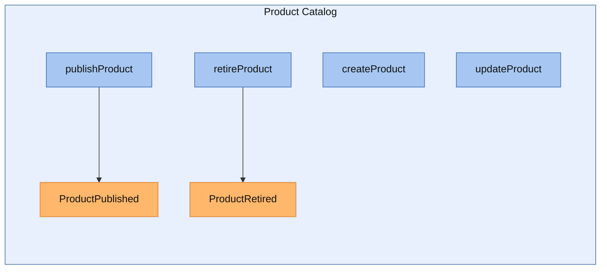
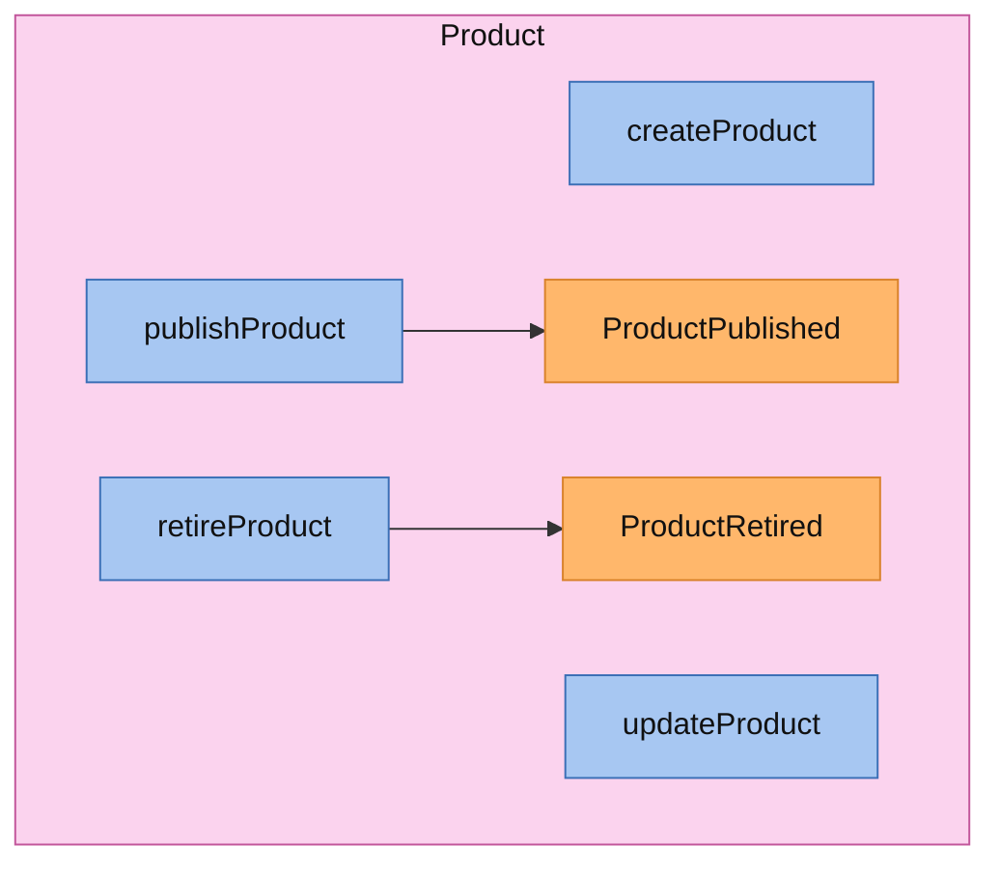
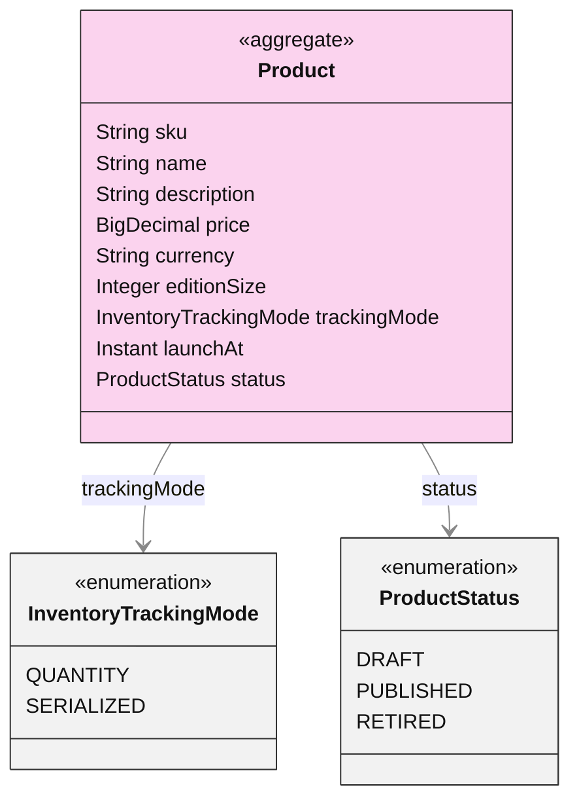
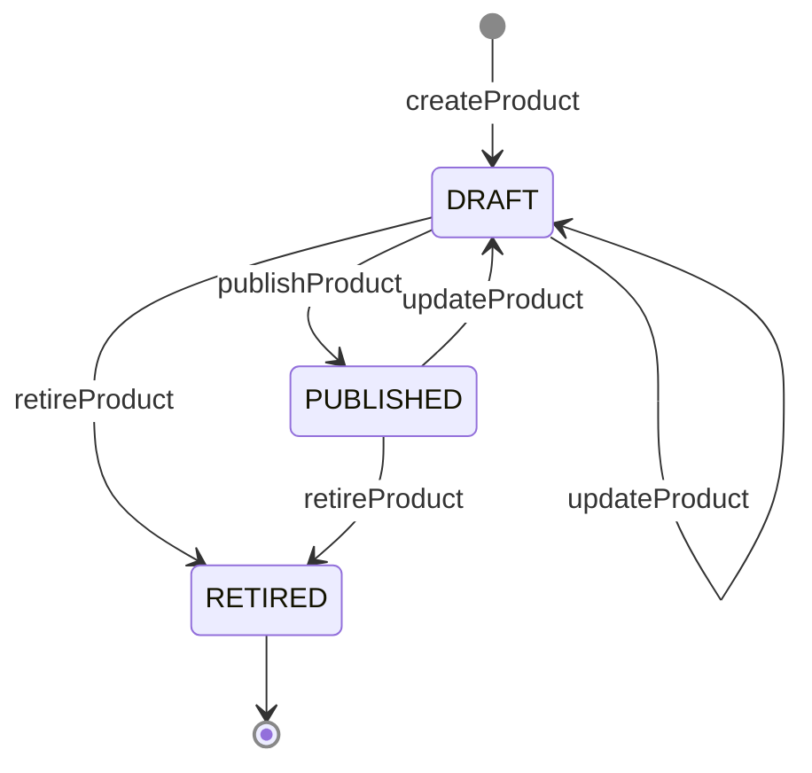

<!-- Generated by dsl-docs. Do not edit: changes are overwritten. -->
<!-- Source: catalog-products-domain-model.zdl sha256:baece12c0bef930d08f4103a941d15858e572f7b29653420fbf96e92afa3140f -->

# Product Catalog

Arcadia Editions - Product Catalog

Source: `catalog-products-domain-model.zdl`

Back to the [architecture](../architecture.md).

## Architecture

This module's commands and events, and the commands and events of other modules that connect to them.

Box = module. Blue = command. Orange = event; a pipe outside the boxes is an external event (has a topic). Solid = emits. Dashed = consumed by. Thick = direct call.

## Services

Each service with its commands (blue) and the events they emit (orange), inside the aggregate it works on.

### ProductCatalogService

## Aggregates

Each aggregate root with the entities and enums it owns, and how they relate.

### Product

#### Lifecycle

Field `status`, initial `DRAFT`.

## Commands

The methods of the module's services and the events each one emits.

| Service | Command | Input | Returns | Events | Description |
| --- | --- | --- | --- | --- | --- |
| ProductCatalogService | createProduct | [CreateProductInput](#createproductinput) | [Product](#product-1) |  |  |
| ProductCatalogService | updateProduct | id, [UpdateProductInput](#updateproductinput) | [Product](#product-1) |  |  |
| ProductCatalogService | publishProduct | id | [Product](#product-1) | [ProductPublished](#productpublished) |  |
| ProductCatalogService | retireProduct | id | [Product](#product-1) | [ProductRetired](#productretired) |  |

## Events

Events declared by this module, with their fields. Fields copied with `@copy` are included.

### ProductPublished

| Field | Type | Description |
| --- | --- | --- |
| productId | String |  |
| sku | String |  |
| name | String |  |
| price | BigDecimal |  |
| currency | String |  |
| editionSize | Integer |  |
| trackingMode | [InventoryTrackingMode](#inventorytrackingmode) |  |
| launchAt | Instant |  |
| publishedAt | Instant |  |

### ProductRetired

| Field | Type | Description |
| --- | --- | --- |
| productId | String |  |
| sku | String |  |
| retiredAt | Instant |  |

## Glossary

Every named type of this module, by kind. Events are described under Events.

### Aggregates

#### Product

Aggregate root

| Field | Type | Description |
| --- | --- | --- |
| sku | String |  |
| name | String |  |
| description | String |  |
| price | BigDecimal |  |
| currency | String |  |
| editionSize | Integer |  |
| trackingMode | [InventoryTrackingMode](#inventorytrackingmode) |  |
| launchAt | Instant |  |
| status | [ProductStatus](#productstatus) |  |

### Enums

#### ProductStatus

| Value | Description |
| --- | --- |
| DRAFT |  |
| PUBLISHED |  |
| RETIRED |  |

#### InventoryTrackingMode

| Value | Description |
| --- | --- |
| QUANTITY |  |
| SERIALIZED |  |

### Inputs

#### CreateProductInput

| Field | Type | Description |
| --- | --- | --- |
| sku | String |  |
| name | String |  |
| description | String |  |
| price | BigDecimal |  |
| currency | String |  |
| editionSize | Integer |  |
| trackingMode | [InventoryTrackingMode](#inventorytrackingmode) |  |
| launchAt | Instant |  |

#### UpdateProductInput

| Field | Type | Description |
| --- | --- | --- |
| name | String |  |
| description | String |  |
| price | BigDecimal |  |
| currency | String |  |
| launchAt | Instant |  |

### Outputs

#### ProductPublishedResponse

| Field | Type | Description |
| --- | --- | --- |
| productId | String |  |
| sku | String |  |
| publishedAt | Instant |  |

