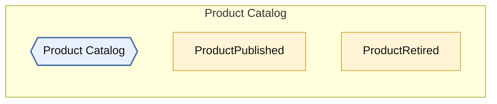

<!-- Generated by dsl-docs. Do not edit: changes are overwritten. -->
<!-- Source: catalog-products-domain-model.zdl sha256:baece12c0bef930d08f4103a941d15858e572f7b29653420fbf96e92afa3140f -->

# Product Catalog

Arcadia Editions - Product Catalog

Source: `catalog-products-domain-model.zdl`

Back to the [architecture](../architecture.md).

## Architecture

This module, the events it owns and consumes, and the modules it talks to.

Hexagon = module. Rectangle inside a box = internal event owned by that module. Pipe outside boxes = external event (has a topic). Solid = published by. Dashed = consumed by. Thick = direct call.

## Class diagram

Aggregates, entities and enums of this module and how they relate.

```mermaid
classDiagram
    class Product {
        <<aggregate>>
        String sku
        String name
        String description
        BigDecimal price
        String currency
        Integer editionSize
        InventoryTrackingMode trackingMode
        Instant launchAt
        ProductStatus status
    }
    class ProductStatus {
        <<enumeration>>
        DRAFT
        PUBLISHED
        RETIRED
    }
    class InventoryTrackingMode {
        <<enumeration>>
        QUANTITY
        SERIALIZED
    }
    class CreateProductInput {
        <<input>>
        String sku
        String name
        String description
        BigDecimal price
        String currency
        Integer editionSize
        InventoryTrackingMode trackingMode
        Instant launchAt
    }
    class UpdateProductInput {
        <<input>>
        String name
        String description
        BigDecimal price
        String currency
        Instant launchAt
    }
    class ProductPublishedResponse {
        <<output>>
        String productId
        String sku
        Instant publishedAt
    }
    class ProductPublished {
        <<event>>
        String productId
        String sku
        String name
        BigDecimal price
        String currency
        Integer editionSize
        InventoryTrackingMode trackingMode
        Instant launchAt
        Instant publishedAt
    }
    class ProductRetired {
        <<event>>
        String productId
        String sku
        Instant retiredAt
    }
    class ProductCatalogService {
        <<service>>
        createProduct(CreateProductInput) Product
        updateProduct(id, UpdateProductInput) Product
        publishProduct(id) Product withEvents ProductPublished
        retireProduct(id) Product withEvents ProductRetired
    }
    Product --> InventoryTrackingMode : trackingMode
    Product --> ProductStatus : status
    CreateProductInput --> InventoryTrackingMode : trackingMode
    ProductPublished --> InventoryTrackingMode : trackingMode
    ProductCatalogService ..> Product
    ProductCatalogService ..> CreateProductInput
    ProductCatalogService ..> UpdateProductInput
    ProductCatalogService ..> ProductPublished
    ProductCatalogService ..> ProductRetired
```

## Glossary

Every named type and service of this module.

| Term | Kind | Description |
| --- | --- | --- |
| CreateProductInput | Input |  |
| InventoryTrackingMode | Enum |  |
| Product | Aggregate root |  |
| ProductCatalogService | Service |  |
| ProductPublished | Event |  |
| ProductPublishedResponse | Output |  |
| ProductRetired | Event |  |
| ProductStatus | Enum |  |
| UpdateProductInput | Input |  |

## Commands

The methods of the module's services and the events each one emits.

| Service | Command | Input | Returns | Events | Description |
| --- | --- | --- | --- | --- | --- |
| ProductCatalogService | createProduct | CreateProductInput | Product |  |  |
| ProductCatalogService | updateProduct | id, UpdateProductInput | Product |  |  |
| ProductCatalogService | publishProduct | id | Product | ProductPublished |  |
| ProductCatalogService | retireProduct | id | Product | ProductRetired |  |

## Events

Events declared by this module and their fields.

| Event | Fields | Description |
| --- | --- | --- |
| ProductPublished | productId: String, sku: String, name: String, price: BigDecimal, currency: String, editionSize: Integer, trackingMode: InventoryTrackingMode, launchAt: Instant, publishedAt: Instant |  |
| ProductRetired | productId: String, sku: String, retiredAt: Instant |  |

