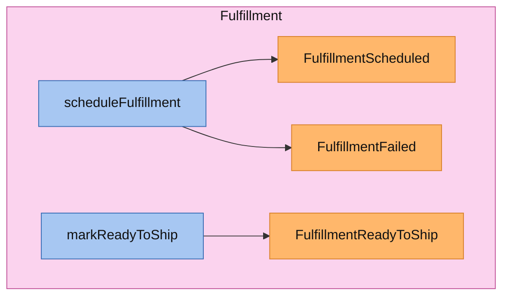
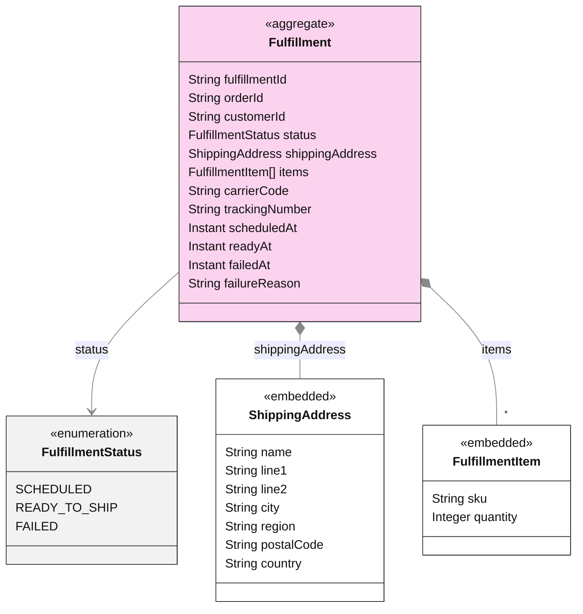
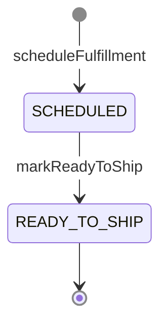

<!-- Generated by dsl-docs. Do not edit: changes are overwritten. -->
<!-- Source: fulfillment-shipping-domain-model.zdl sha256:a05c21802aa81cbb31ac591446c8d69a857773789c4846e12bd8e62e2204dcd6 -->

# Fulfillment Shipping

Arcadia Editions - Fulfillment Shipping

Source: `fulfillment-shipping-domain-model.zdl`

Back to the [architecture](../architecture.md).

## Architecture

This module's commands and events, and the commands and events of other modules that connect to them.

```mermaid
flowchart LR
  classDef module fill:#e8f0fe,stroke:#4a6fa5,color:#111
  classDef command fill:#a7c7f2,stroke:#3b6fb6,color:#111
  classDef event fill:#ffb76b,stroke:#d9822b,color:#111

  subgraph sg_FulfillmentShipping["Fulfillment Shipping"]
    subgraph sg_FulfillmentShipping_cmd[" "]
      FulfillmentShipping__FulfillmentShippingService__scheduleFulfillment["scheduleFulfillment"]
      FulfillmentShipping__FulfillmentShippingService__markReadyToShip["markReadyToShip"]
    end
    subgraph sg_FulfillmentShipping_evt[" "]
      FulfillmentShipping__FulfillmentFailed["FulfillmentFailed"]
      FulfillmentShipping__FulfillmentReadyToShip["FulfillmentReadyToShip"]
      FulfillmentShipping__FulfillmentScheduled["FulfillmentScheduled"]
    end
  end

  subgraph sg_OrdersCheckout["Orders Checkout"]
    subgraph sg_OrdersCheckout_cmd[" "]
      OrdersCheckout__OrdersCheckoutService__confirmOrder["confirmOrder"]
    end
    subgraph sg_OrdersCheckout_evt[" "]
      OrdersCheckout__OrderConfirmed["OrderConfirmed"]
    end
  end

  subgraph sg_PaymentsProcessing["Payments Processing"]
    PaymentsProcessing__PaymentsProcessingService__capturePayment["capturePayment"]
    PaymentsProcessing__PaymentsProcessingService__voidPayment["voidPayment"]
  end

  class sg_FulfillmentShipping,sg_OrdersCheckout,sg_PaymentsProcessing module
  class FulfillmentShipping__FulfillmentShippingService__markReadyToShip,FulfillmentShipping__FulfillmentShippingService__scheduleFulfillment,OrdersCheckout__OrdersCheckoutService__confirmOrder,PaymentsProcessing__PaymentsProcessingService__capturePayment,PaymentsProcessing__PaymentsProcessingService__voidPayment command
  class FulfillmentShipping__FulfillmentFailed,FulfillmentShipping__FulfillmentReadyToShip,FulfillmentShipping__FulfillmentScheduled,OrdersCheckout__OrderConfirmed event
  style sg_FulfillmentShipping_cmd fill:none,stroke:none
  style sg_FulfillmentShipping_evt fill:none,stroke:none
  style sg_OrdersCheckout_cmd fill:none,stroke:none
  style sg_OrdersCheckout_evt fill:none,stroke:none

  FulfillmentShipping__FulfillmentShippingService__markReadyToShip --> FulfillmentShipping__FulfillmentReadyToShip
  FulfillmentShipping__FulfillmentShippingService__scheduleFulfillment --> FulfillmentShipping__FulfillmentFailed
  FulfillmentShipping__FulfillmentShippingService__scheduleFulfillment --> FulfillmentShipping__FulfillmentScheduled
  OrdersCheckout__OrdersCheckoutService__confirmOrder --> OrdersCheckout__OrderConfirmed
  FulfillmentShipping__FulfillmentFailed -.-> PaymentsProcessing__PaymentsProcessingService__voidPayment
  FulfillmentShipping__FulfillmentScheduled -.-> PaymentsProcessing__PaymentsProcessingService__capturePayment
  OrdersCheckout__OrderConfirmed -.-> FulfillmentShipping__FulfillmentShippingService__scheduleFulfillment
```

Box = module. Blue = command. Orange = event; a pipe outside the boxes is an external event (has a topic). Solid = emits. Dashed = consumed by. Thick = direct call.

## Services

Each service with its commands (blue) and the events they emit (orange), inside the aggregate it works on.

### FulfillmentShippingService

## Aggregates

Each aggregate root with the entities and enums it owns, and how they relate.

### Fulfillment

#### Lifecycle

Field `status`, initial `SCHEDULED`.

## Commands

The methods of the module's services and the events each one emits.

| Service | Command | Input | Returns | Events | Description |
| --- | --- | --- | --- | --- | --- |
| FulfillmentShippingService | scheduleFulfillment | [ScheduleFulfillmentInput](#schedulefulfillmentinput) | [Fulfillment](#fulfillment-1) | [FulfillmentScheduled](#fulfillmentscheduled) \| [FulfillmentFailed](#fulfillmentfailed) |  |
| FulfillmentShippingService | markReadyToShip | id | [Fulfillment](#fulfillment-1) | [FulfillmentReadyToShip](#fulfillmentreadytoship) |  |

## Events

Events declared by this module, with their fields. Fields copied with `@copy` are included.

### FulfillmentScheduled

| Field | Type | Description |
| --- | --- | --- |
| fulfillmentId | String |  |
| orderId | String |  |
| customerId | String |  |
| scheduledAt | Instant |  |

### FulfillmentFailed

| Field | Type | Description |
| --- | --- | --- |
| fulfillmentId | String |  |
| orderId | String |  |
| customerId | String |  |
| reason | String |  |
| failedAt | Instant |  |

### FulfillmentReadyToShip

| Field | Type | Description |
| --- | --- | --- |
| fulfillmentId | String |  |
| orderId | String |  |
| customerId | String |  |
| carrierCode | String |  |
| trackingNumber | String |  |
| readyAt | Instant |  |

## Consumes

Events from other modules or systems that this module reacts to, and the method that handles each one.

| Event | Owner | Handled by | Via |
| --- | --- | --- | --- |
| OrderConfirmed | [Orders Checkout](orders-checkout.md) | `FulfillmentShippingService.scheduleFulfillment` | @listener |

## Consumed by

Who reacts to the events this module owns.

| Event | Consumer | Handled by | Via |
| --- | --- | --- | --- |
| FulfillmentFailed | [Payments Processing](payments-processing.md) | `PaymentsProcessingService.voidPayment` | @listener |
| FulfillmentScheduled | [Payments Processing](payments-processing.md) | `PaymentsProcessingService.capturePayment` | @listener |

## Glossary

Every named type of this module, by kind. Events are described under Events.

### Aggregates

#### Fulfillment

Aggregate root

| Field | Type | Description |
| --- | --- | --- |
| fulfillmentId | String |  |
| orderId | String |  |
| customerId | String |  |
| status | [FulfillmentStatus](#fulfillmentstatus) |  |
| shippingAddress | [ShippingAddress](#shippingaddress) |  |
| items | [FulfillmentItem](#fulfillmentitem)[] |  |
| carrierCode | String |  |
| trackingNumber | String |  |
| scheduledAt | Instant |  |
| readyAt | Instant |  |
| failedAt | Instant |  |
| failureReason | String |  |

#### ShippingAddress

Embedded entity of `Fulfillment`

| Field | Type | Description |
| --- | --- | --- |
| name | String |  |
| line1 | String |  |
| line2 | String |  |
| city | String |  |
| region | String |  |
| postalCode | String |  |
| country | String |  |

#### FulfillmentItem

Embedded entity of `Fulfillment`

| Field | Type | Description |
| --- | --- | --- |
| sku | String |  |
| quantity | Integer |  |

### Enums

#### FulfillmentStatus

| Value | Description |
| --- | --- |
| SCHEDULED |  |
| READY_TO_SHIP |  |
| FAILED |  |

### Inputs

#### ScheduleFulfillmentInput

| Field | Type | Description |
| --- | --- | --- |
| orderId | String |  |
| customerId | String |  |
| shippingAddress | [ShippingAddressInput](#shippingaddressinput) |  |
| items | [FulfillmentItemInput](#fulfillmentiteminput)[] |  |

#### ShippingAddressInput

| Field | Type | Description |
| --- | --- | --- |
| name | String |  |
| line1 | String |  |
| line2 | String |  |
| city | String |  |
| region | String |  |
| postalCode | String |  |
| country | String |  |

#### FulfillmentItemInput

| Field | Type | Description |
| --- | --- | --- |
| sku | String |  |
| quantity | Integer |  |

