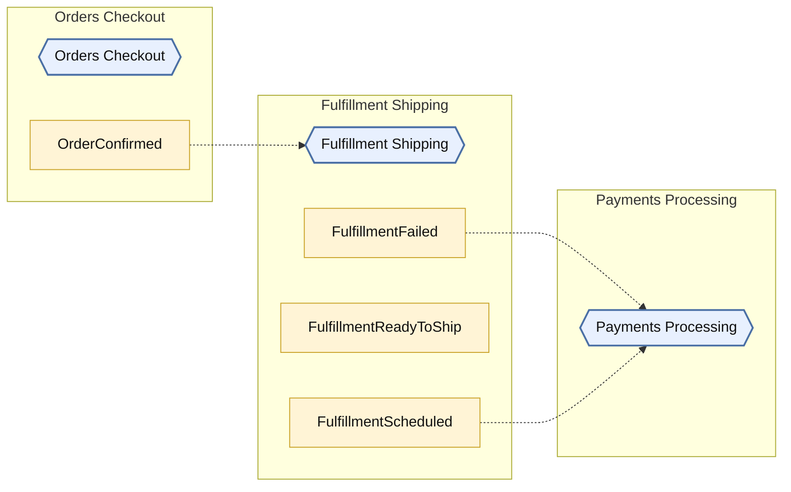

<!-- Generated by dsl-docs. Do not edit: changes are overwritten. -->
<!-- Source: fulfillment-shipping-domain-model.zdl sha256:a05c21802aa81cbb31ac591446c8d69a857773789c4846e12bd8e62e2204dcd6 -->

# Fulfillment Shipping

Arcadia Editions - Fulfillment Shipping

Source: `fulfillment-shipping-domain-model.zdl`

Back to the [architecture](../architecture.md).

## Architecture

This module, the events it owns and consumes, and the modules it talks to.

Hexagon = module. Rectangle inside a box = internal event owned by that module. Pipe outside boxes = external event (has a topic). Solid = published by. Dashed = consumed by. Thick = direct call.

## Class diagram

Aggregates, entities and enums of this module and how they relate.

```mermaid
classDiagram
    class Fulfillment {
        <<aggregate>>
        String fulfillmentId
        String orderId
        String customerId
        FulfillmentStatus status
        ShippingAddress shippingAddress
        FulfillmentItem[] items
        String carrierCode
        String trackingNumber
        Instant scheduledAt
        Instant readyAt
        Instant failedAt
        String failureReason
    }
    class ShippingAddress {
        <<embedded>>
        String name
        String line1
        String line2
        String city
        String region
        String postalCode
        String country
    }
    class FulfillmentItem {
        <<embedded>>
        String sku
        Integer quantity
    }
    class FulfillmentStatus {
        <<enumeration>>
        SCHEDULED
        READY_TO_SHIP
        FAILED
    }
    class ScheduleFulfillmentInput {
        <<input>>
        String orderId
        String customerId
        ShippingAddressInput shippingAddress
        FulfillmentItemInput[] items
    }
    class ShippingAddressInput {
        <<input>>
        String name
        String line1
        String line2
        String city
        String region
        String postalCode
        String country
    }
    class FulfillmentItemInput {
        <<input>>
        String sku
        Integer quantity
    }
    class FulfillmentScheduled {
        <<event>>
        String fulfillmentId
        String orderId
        String customerId
        Instant scheduledAt
    }
    class FulfillmentFailed {
        <<event>>
        String fulfillmentId
        String orderId
        String customerId
        String reason
        Instant failedAt
    }
    class FulfillmentReadyToShip {
        <<event>>
        String fulfillmentId
        String orderId
        String customerId
        String carrierCode
        String trackingNumber
        Instant readyAt
    }
    class FulfillmentShippingService {
        <<service>>
        scheduleFulfillment(ScheduleFulfillmentInput) Fulfillment withEvents FulfillmentScheduled or FulfillmentFailed
        markReadyToShip(id) Fulfillment withEvents FulfillmentReadyToShip
    }
    Fulfillment --> FulfillmentStatus : status
    Fulfillment *-- ShippingAddress : shippingAddress
    Fulfillment *-- "*" FulfillmentItem : items
    ScheduleFulfillmentInput --> ShippingAddressInput : shippingAddress
    ScheduleFulfillmentInput --> "*" FulfillmentItemInput : items
    FulfillmentShippingService ..> Fulfillment
    FulfillmentShippingService ..> ScheduleFulfillmentInput
    FulfillmentShippingService ..> FulfillmentScheduled
    FulfillmentShippingService ..> FulfillmentFailed
    FulfillmentShippingService ..> FulfillmentReadyToShip
```

## Glossary

Every named type and service of this module.

| Term | Kind | Description |
| --- | --- | --- |
| Fulfillment | Aggregate root |  |
| FulfillmentFailed | Event |  |
| FulfillmentItem | Embedded entity |  |
| FulfillmentItemInput | Input |  |
| FulfillmentReadyToShip | Event |  |
| FulfillmentScheduled | Event |  |
| FulfillmentShippingService | Service |  |
| FulfillmentStatus | Enum |  |
| ScheduleFulfillmentInput | Input |  |
| ShippingAddress | Embedded entity |  |
| ShippingAddressInput | Input |  |

## Commands

The methods of the module's services and the events each one emits.

| Service | Command | Input | Returns | Events | Description |
| --- | --- | --- | --- | --- | --- |
| FulfillmentShippingService | scheduleFulfillment | ScheduleFulfillmentInput | Fulfillment | FulfillmentScheduled \| FulfillmentFailed |  |
| FulfillmentShippingService | markReadyToShip | id | Fulfillment | FulfillmentReadyToShip |  |

## Events

Events declared by this module and their fields.

| Event | Fields | Description |
| --- | --- | --- |
| FulfillmentScheduled | fulfillmentId: String, orderId: String, customerId: String, scheduledAt: Instant |  |
| FulfillmentFailed | fulfillmentId: String, orderId: String, customerId: String, reason: String, failedAt: Instant |  |
| FulfillmentReadyToShip | fulfillmentId: String, orderId: String, customerId: String, carrierCode: String, trackingNumber: String, readyAt: Instant |  |

## Consumes

Events from other modules or systems that this module reacts to, and the method that handles each one.

| Event | Owner | Handled by | Via |
| --- | --- | --- | --- |
| OrderConfirmed | [Orders Checkout](orders-checkout.md) | `FulfillmentShippingService.scheduleFulfillment` | @listener |

## Consumed by

Who reacts to the events this module owns.

| Event | Consumer | Handled by | Via |
| --- | --- | --- | --- |
| FulfillmentFailed | [Payments Processing](payments-processing.md) | `PaymentsProcessingService.voidPayment` | @listener |
| FulfillmentScheduled | [Payments Processing](payments-processing.md) | `PaymentsProcessingService.capturePayment` | @listener |

