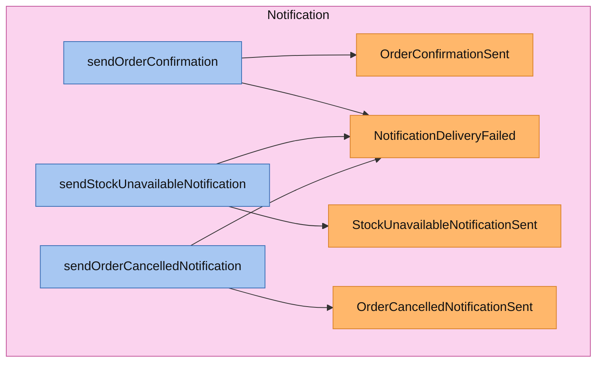
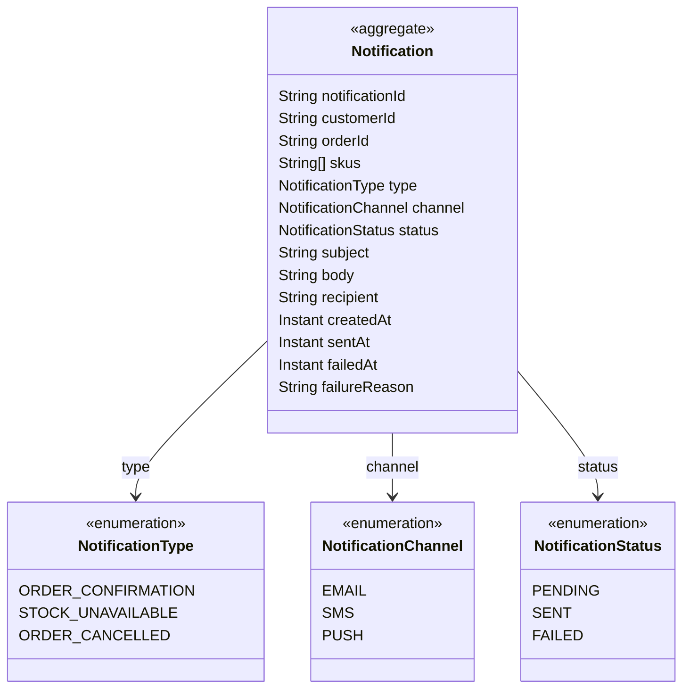
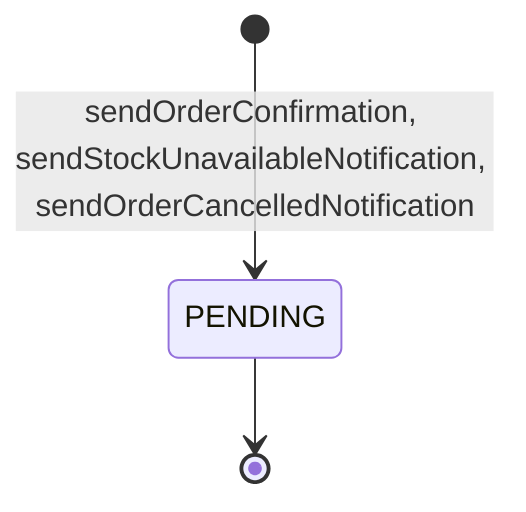

<!-- Generated by dsl-docs. Do not edit: changes are overwritten. -->
<!-- Source: notifications-consumer-domain-model.zdl sha256:02500c3b281fc0e51142660393ec3cdd85bc586c5c56d89299d6be265d3df5d4 -->

# Notifications Consumer

Arcadia Editions - Notifications Consumer

Source: `notifications-consumer-domain-model.zdl`

Back to the [architecture](../architecture.md).

## Architecture

This module's commands and events, and the commands and events of other modules that connect to them.

```mermaid
flowchart LR
  classDef module fill:#e8f0fe,stroke:#4a6fa5,color:#111
  classDef command fill:#a7c7f2,stroke:#3b6fb6,color:#111
  classDef event fill:#ffb76b,stroke:#d9822b,color:#111

  subgraph sg_NotificationsConsumer["Notifications Consumer"]
    NotificationsConsumer__NotificationsConsumerService__sendOrderConfirmation["sendOrderConfirmation"]
    NotificationsConsumer__NotificationsConsumerService__sendStockUnavailableNotification["sendStockUnavailableNotification"]
    NotificationsConsumer__NotificationsConsumerService__sendOrderCancelledNotification["sendOrderCancelledNotification"]
    NotificationsConsumer__NotificationDeliveryFailed["NotificationDeliveryFailed"]
    NotificationsConsumer__OrderCancelledNotificationSent["OrderCancelledNotificationSent"]
    NotificationsConsumer__OrderConfirmationSent["OrderConfirmationSent"]
    NotificationsConsumer__StockUnavailableNotificationSent["StockUnavailableNotificationSent"]
  end

  subgraph sg_OrdersCheckout["Orders Checkout"]
    OrdersCheckout__OrdersCheckoutService__startOrderCheckout["startOrderCheckout"]
    OrdersCheckout__OrdersCheckoutService__cancelOrder["cancelOrder"]
    OrdersCheckout__OrderCancelled["OrderCancelled"]
    OrdersCheckout__StockUnavailable["StockUnavailable"]
  end

  subgraph sg_PaymentsProcessing["Payments Processing"]
    PaymentsProcessing__PaymentsProcessingService__capturePayment["capturePayment"]
    PaymentsProcessing__PaymentCaptured["PaymentCaptured"]
  end

  class sg_NotificationsConsumer,sg_OrdersCheckout,sg_PaymentsProcessing module
  class NotificationsConsumer__NotificationsConsumerService__sendOrderCancelledNotification,NotificationsConsumer__NotificationsConsumerService__sendOrderConfirmation,NotificationsConsumer__NotificationsConsumerService__sendStockUnavailableNotification,OrdersCheckout__OrdersCheckoutService__cancelOrder,OrdersCheckout__OrdersCheckoutService__startOrderCheckout,PaymentsProcessing__PaymentsProcessingService__capturePayment command
  class NotificationsConsumer__NotificationDeliveryFailed,NotificationsConsumer__OrderCancelledNotificationSent,NotificationsConsumer__OrderConfirmationSent,NotificationsConsumer__StockUnavailableNotificationSent,OrdersCheckout__OrderCancelled,OrdersCheckout__StockUnavailable,PaymentsProcessing__PaymentCaptured event

  NotificationsConsumer__NotificationsConsumerService__sendOrderCancelledNotification --> NotificationsConsumer__NotificationDeliveryFailed
  NotificationsConsumer__NotificationsConsumerService__sendOrderCancelledNotification --> NotificationsConsumer__OrderCancelledNotificationSent
  NotificationsConsumer__NotificationsConsumerService__sendOrderConfirmation --> NotificationsConsumer__NotificationDeliveryFailed
  NotificationsConsumer__NotificationsConsumerService__sendOrderConfirmation --> NotificationsConsumer__OrderConfirmationSent
  NotificationsConsumer__NotificationsConsumerService__sendStockUnavailableNotification --> NotificationsConsumer__NotificationDeliveryFailed
  NotificationsConsumer__NotificationsConsumerService__sendStockUnavailableNotification --> NotificationsConsumer__StockUnavailableNotificationSent
  OrdersCheckout__OrdersCheckoutService__cancelOrder --> OrdersCheckout__OrderCancelled
  OrdersCheckout__OrdersCheckoutService__startOrderCheckout --> OrdersCheckout__StockUnavailable
  PaymentsProcessing__PaymentsProcessingService__capturePayment --> PaymentsProcessing__PaymentCaptured
  OrdersCheckout__OrderCancelled -.-> NotificationsConsumer__NotificationsConsumerService__sendOrderCancelledNotification
  OrdersCheckout__StockUnavailable -.-> NotificationsConsumer__NotificationsConsumerService__sendStockUnavailableNotification
  PaymentsProcessing__PaymentCaptured -.-> NotificationsConsumer__NotificationsConsumerService__sendOrderConfirmation
```

Box = module. Blue = command. Orange = event; a pipe outside the boxes is an external event (has a topic). Solid = emits. Dashed = consumed by. Thick = direct call.

## Services

Each service with its commands (blue) and the events they emit (orange), inside the aggregate it works on.

### NotificationsConsumerService

## Aggregates

Each aggregate root with the entities and enums it owns, and how they relate.

### Notification

#### Lifecycle

Field `status`, initial `PENDING`.

## Commands

The methods of the module's services and the events each one emits.

| Service | Command | Input | Returns | Events | Description |
| --- | --- | --- | --- | --- | --- |
| NotificationsConsumerService | sendOrderConfirmation | [SendOrderConfirmationInput](#sendorderconfirmationinput) | [Notification](#notification-1) | [OrderConfirmationSent](#orderconfirmationsent) \| [NotificationDeliveryFailed](#notificationdeliveryfailed) |  |
| NotificationsConsumerService | sendStockUnavailableNotification | [SendStockUnavailableNotificationInput](#sendstockunavailablenotificationinput) | [Notification](#notification-1) | [StockUnavailableNotificationSent](#stockunavailablenotificationsent) \| [NotificationDeliveryFailed](#notificationdeliveryfailed) |  |
| NotificationsConsumerService | sendOrderCancelledNotification | [SendOrderCancelledNotificationInput](#sendordercancellednotificationinput) | [Notification](#notification-1) | [OrderCancelledNotificationSent](#ordercancellednotificationsent) \| [NotificationDeliveryFailed](#notificationdeliveryfailed) |  |

## Events

Events declared by this module, with their fields. Fields copied with `@copy` are included.

### OrderConfirmationSent

| Field | Type | Description |
| --- | --- | --- |
| notificationId | String |  |
| orderId | String |  |
| customerId | String |  |
| channel | [NotificationChannel](#notificationchannel) |  |
| recipient | String |  |
| sentAt | Instant |  |

### StockUnavailableNotificationSent

| Field | Type | Description |
| --- | --- | --- |
| notificationId | String |  |
| orderId | String |  |
| customerId | String |  |
| skus | String[] |  |
| channel | [NotificationChannel](#notificationchannel) |  |
| recipient | String |  |
| sentAt | Instant |  |

### OrderCancelledNotificationSent

| Field | Type | Description |
| --- | --- | --- |
| notificationId | String |  |
| orderId | String |  |
| customerId | String |  |
| reason | String |  |
| channel | [NotificationChannel](#notificationchannel) |  |
| recipient | String |  |
| sentAt | Instant |  |

### NotificationDeliveryFailed

| Field | Type | Description |
| --- | --- | --- |
| notificationId | String |  |
| orderId | String |  |
| customerId | String |  |
| skus | String[] |  |
| type | [NotificationType](#notificationtype) |  |
| channel | [NotificationChannel](#notificationchannel) |  |
| recipient | String |  |
| reason | String |  |
| failedAt | Instant |  |

## Consumes

Events from other modules or systems that this module reacts to, and the method that handles each one.

| Event | Owner | Handled by | Via |
| --- | --- | --- | --- |
| OrderCancelled | [Orders Checkout](orders-checkout.md) | `NotificationsConsumerService.sendOrderCancelledNotification` | @listener |
| StockUnavailable | [Orders Checkout](orders-checkout.md) | `NotificationsConsumerService.sendStockUnavailableNotification` | @listener |
| PaymentCaptured | [Payments Processing](payments-processing.md) | `NotificationsConsumerService.sendOrderConfirmation` | @listener |

## Glossary

Every named type of this module, by kind. Events are described under Events.

### Aggregates

#### Notification

Aggregate root

| Field | Type | Description |
| --- | --- | --- |
| notificationId | String |  |
| customerId | String |  |
| orderId | String |  |
| skus | String[] |  |
| type | [NotificationType](#notificationtype) |  |
| channel | [NotificationChannel](#notificationchannel) |  |
| status | [NotificationStatus](#notificationstatus) |  |
| subject | String |  |
| body | String |  |
| recipient | String |  |
| createdAt | Instant |  |
| sentAt | Instant |  |
| failedAt | Instant |  |
| failureReason | String |  |

### Enums

#### NotificationType

| Value | Description |
| --- | --- |
| ORDER_CONFIRMATION |  |
| STOCK_UNAVAILABLE |  |
| ORDER_CANCELLED |  |

#### NotificationChannel

| Value | Description |
| --- | --- |
| EMAIL |  |
| SMS |  |
| PUSH |  |

#### NotificationStatus

| Value | Description |
| --- | --- |
| PENDING |  |
| SENT |  |
| FAILED |  |

### Inputs

#### SendOrderConfirmationInput

| Field | Type | Description |
| --- | --- | --- |
| orderId | String |  |
| customerId | String |  |
| customerEmail | String |  |

#### SendStockUnavailableNotificationInput

| Field | Type | Description |
| --- | --- | --- |
| orderId | String |  |
| customerId | String |  |
| customerEmail | String |  |
| unavailableItems | [StockUnavailableItemInput](#stockunavailableiteminput)[] |  |

#### StockUnavailableItemInput

| Field | Type | Description |
| --- | --- | --- |
| sku | String |  |
| requestedQuantity | Integer |  |
| availableQuantity | Integer |  |

#### SendOrderCancelledNotificationInput

| Field | Type | Description |
| --- | --- | --- |
| orderId | String |  |
| customerId | String |  |
| reason | String |  |
| customerEmail | String |  |

