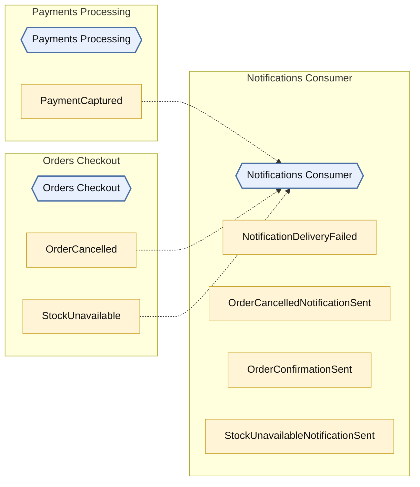

<!-- Generated by dsl-docs. Do not edit: changes are overwritten. -->
<!-- Source: notifications-consumer-domain-model.zdl sha256:02500c3b281fc0e51142660393ec3cdd85bc586c5c56d89299d6be265d3df5d4 -->

# Notifications Consumer

Arcadia Editions - Notifications Consumer

Source: `notifications-consumer-domain-model.zdl`

Back to the [architecture](../architecture.md).

## Architecture

This module, the events it owns and consumes, and the modules it talks to.

Hexagon = module. Rectangle inside a box = internal event owned by that module. Pipe outside boxes = external event (has a topic). Solid = published by. Dashed = consumed by. Thick = direct call.

## Class diagram

Aggregates, entities and enums of this module and how they relate.

```mermaid
classDiagram
    class Notification {
        <<aggregate>>
        String notificationId
        String customerId
        String orderId
        String[] skus
        NotificationType type
        NotificationChannel channel
        NotificationStatus status
        String subject
        String body
        String recipient
        Instant createdAt
        Instant sentAt
        Instant failedAt
        String failureReason
    }
    class NotificationType {
        <<enumeration>>
        ORDER_CONFIRMATION
        STOCK_UNAVAILABLE
        ORDER_CANCELLED
    }
    class NotificationChannel {
        <<enumeration>>
        EMAIL
        SMS
        PUSH
    }
    class NotificationStatus {
        <<enumeration>>
        PENDING
        SENT
        FAILED
    }
    class SendOrderConfirmationInput {
        <<input>>
        String orderId
        String customerId
        String customerEmail
    }
    class SendStockUnavailableNotificationInput {
        <<input>>
        String orderId
        String customerId
        String customerEmail
        StockUnavailableItemInput[] unavailableItems
    }
    class StockUnavailableItemInput {
        <<input>>
        String sku
        Integer requestedQuantity
        Integer availableQuantity
    }
    class SendOrderCancelledNotificationInput {
        <<input>>
        String orderId
        String customerId
        String reason
        String customerEmail
    }
    class OrderConfirmationSent {
        <<event>>
        String notificationId
        String orderId
        String customerId
        NotificationChannel channel
        String recipient
        Instant sentAt
    }
    class StockUnavailableNotificationSent {
        <<event>>
        String notificationId
        String orderId
        String customerId
        String[] skus
        NotificationChannel channel
        String recipient
        Instant sentAt
    }
    class OrderCancelledNotificationSent {
        <<event>>
        String notificationId
        String orderId
        String customerId
        String reason
        NotificationChannel channel
        String recipient
        Instant sentAt
    }
    class NotificationDeliveryFailed {
        <<event>>
        String notificationId
        String orderId
        String customerId
        String[] skus
        NotificationType type
        NotificationChannel channel
        String recipient
        String reason
        Instant failedAt
    }
    class NotificationsConsumerService {
        <<service>>
        sendOrderConfirmation(SendOrderConfirmationInput) Notification withEvents OrderConfirmationSent or NotificationDeliveryFailed
        sendStockUnavailableNotification(SendStockUnavailableNotificationInput) Notification withEvents StockUnavailableNotificationSent or NotificationDeliveryFailed
        sendOrderCancelledNotification(SendOrderCancelledNotificationInput) Notification withEvents OrderCancelledNotificationSent or NotificationDeliveryFailed
    }
    Notification --> NotificationType : type
    Notification --> NotificationChannel : channel
    Notification --> NotificationStatus : status
    SendStockUnavailableNotificationInput *-- "*" StockUnavailableItemInput : unavailableItems
    OrderConfirmationSent --> NotificationChannel : channel
    StockUnavailableNotificationSent --> NotificationChannel : channel
    OrderCancelledNotificationSent --> NotificationChannel : channel
    NotificationDeliveryFailed --> NotificationType : type
    NotificationDeliveryFailed --> NotificationChannel : channel
    NotificationsConsumerService ..> Notification
    NotificationsConsumerService ..> SendOrderConfirmationInput
    NotificationsConsumerService ..> OrderConfirmationSent
    NotificationsConsumerService ..> NotificationDeliveryFailed
    NotificationsConsumerService ..> SendStockUnavailableNotificationInput
    NotificationsConsumerService ..> StockUnavailableNotificationSent
    NotificationsConsumerService ..> SendOrderCancelledNotificationInput
    NotificationsConsumerService ..> OrderCancelledNotificationSent
```

## Glossary

Every named type and service of this module.

| Term | Kind | Description |
| --- | --- | --- |
| Notification | Aggregate root |  |
| NotificationChannel | Enum |  |
| NotificationDeliveryFailed | Event |  |
| NotificationsConsumerService | Service |  |
| NotificationStatus | Enum |  |
| NotificationType | Enum |  |
| OrderCancelledNotificationSent | Event |  |
| OrderConfirmationSent | Event |  |
| SendOrderCancelledNotificationInput | Input |  |
| SendOrderConfirmationInput | Input |  |
| SendStockUnavailableNotificationInput | Input |  |
| StockUnavailableItemInput | Input |  |
| StockUnavailableNotificationSent | Event |  |

## Commands

The methods of the module's services and the events each one emits.

| Service | Command | Input | Returns | Events | Description |
| --- | --- | --- | --- | --- | --- |
| NotificationsConsumerService | sendOrderConfirmation | SendOrderConfirmationInput | Notification | OrderConfirmationSent \| NotificationDeliveryFailed |  |
| NotificationsConsumerService | sendStockUnavailableNotification | SendStockUnavailableNotificationInput | Notification | StockUnavailableNotificationSent \| NotificationDeliveryFailed |  |
| NotificationsConsumerService | sendOrderCancelledNotification | SendOrderCancelledNotificationInput | Notification | OrderCancelledNotificationSent \| NotificationDeliveryFailed |  |

## Events

Events declared by this module and their fields.

| Event | Fields | Description |
| --- | --- | --- |
| OrderConfirmationSent | notificationId: String, orderId: String, customerId: String, channel: NotificationChannel, recipient: String, sentAt: Instant |  |
| StockUnavailableNotificationSent | notificationId: String, orderId: String, customerId: String, skus: String[], channel: NotificationChannel, recipient: String, sentAt: Instant |  |
| OrderCancelledNotificationSent | notificationId: String, orderId: String, customerId: String, reason: String, channel: NotificationChannel, recipient: String, sentAt: Instant |  |
| NotificationDeliveryFailed | notificationId: String, orderId: String, customerId: String, skus: String[], type: NotificationType, channel: NotificationChannel, recipient: String, reason: String, failedAt: Instant |  |

## Consumes

Events from other modules or systems that this module reacts to, and the method that handles each one.

| Event | Owner | Handled by | Via |
| --- | --- | --- | --- |
| OrderCancelled | [Orders Checkout](orders-checkout.md) | `NotificationsConsumerService.sendOrderCancelledNotification` | @listener |
| StockUnavailable | [Orders Checkout](orders-checkout.md) | `NotificationsConsumerService.sendStockUnavailableNotification` | @listener |
| PaymentCaptured | [Payments Processing](payments-processing.md) | `NotificationsConsumerService.sendOrderConfirmation` | @listener |

