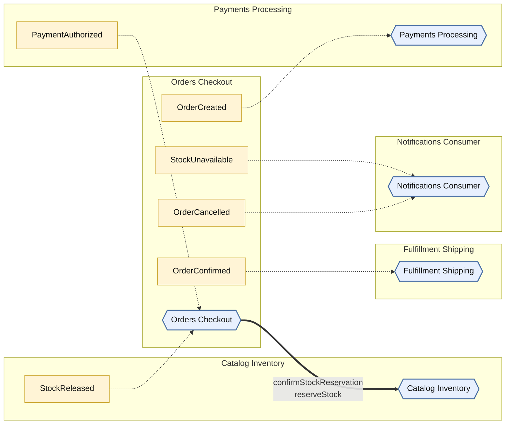

<!-- Generated by dsl-docs. Do not edit: changes are overwritten. -->
<!-- Source: orders-checkout-domain-model.zdl sha256:2bcf402624596e153c97fde086d2d421d0c401bea41c21ab26246d80304bef29 -->

# Orders Checkout

Arcadia Editions - Orders Checkout

Source: `orders-checkout-domain-model.zdl`

Back to the [architecture](../architecture.md).

## Architecture

This module, the events it owns and consumes, and the modules it talks to.

Hexagon = module. Rectangle inside a box = internal event owned by that module. Pipe outside boxes = external event (has a topic). Solid = published by. Dashed = consumed by. Thick = direct call.

## Class diagram

Aggregates, entities and enums of this module and how they relate.

```mermaid
classDiagram
    class Order {
        <<aggregate>>
        String orderId
        OrderStatus status
        String customerId
        String customerEmail
        String paymentMethodId
        OrderItem[] items
        ShippingAddress shippingAddress
        BigDecimal totalAmount
        String currency
        Instant createdAt
        Instant confirmedAt
        Instant cancelledAt
        String cancellationReason
    }
    class OrderItem {
        <<embedded>>
        String sku
        Integer quantity
        BigDecimal unitPrice
    }
    class ShippingAddress {
        <<embedded>>
        String name
        String line1
        String line2
        String city
        String region
        String postalCode
        String country
    }
    class OrderStatus {
        <<enumeration>>
        CREATED
        CONFIRMED
        CANCELLED
    }
    class StartOrderCheckoutInput {
        <<input>>
        String customerId
        String customerEmail
        String paymentMethodId
        String currency
        OrderItemInput[] items
        ShippingAddressInput shippingAddress
    }
    class OrderItemInput {
        <<input>>
        String sku
        Integer quantity
        BigDecimal unitPrice
    }
    class ShippingAddressInput {
        <<input>>
        String name
        String line1
        String line2
        String city
        String region
        String postalCode
        String country
    }
    class CancelOrderInput {
        <<input>>
        String reason
    }
    class OrderCreated {
        <<event>>
        String orderId
        Integer version
        String customerId
        String customerEmail
        String paymentMethodId
        BigDecimal amount
        String currency
    }
    class StockUnavailable {
        <<event>>
        String orderId
        String customerId
        String customerEmail
        StockUnavailableItem[] unavailableItems
    }
    class StockUnavailableItem {
        <<event>>
        String sku
        Integer requestedQuantity
        Integer availableQuantity
    }
    class OrderConfirmed {
        <<event>>
        String orderId
        Integer version
        String customerId
        Instant confirmedAt
        OrderConfirmedItem[] items
        OrderConfirmedShippingAddress shippingAddress
    }
    class OrderConfirmedItem {
        <<event>>
        String sku
        Integer quantity
    }
    class OrderConfirmedShippingAddress {
        <<event>>
        String name
        String line1
        String line2
        String city
        String region
        String postalCode
        String country
    }
    class OrderCancelled {
        <<event>>
        String orderId
        Integer version
        String customerId
        String customerEmail
        String reason
        Instant cancelledAt
    }
    class OrdersCheckoutService {
        <<service>>
        startOrderCheckout(StartOrderCheckoutInput) Order withEvents OrderCreated or StockUnavailable
        confirmOrder(id) Order withEvents OrderConfirmed
        cancelOrder(id, CancelOrderInput) Order withEvents OrderCancelled
    }
    Order --> OrderStatus : status
    Order *-- "*" OrderItem : items
    Order *-- ShippingAddress : shippingAddress
    StartOrderCheckoutInput *-- "*" OrderItemInput : items
    StartOrderCheckoutInput *-- ShippingAddressInput : shippingAddress
    StockUnavailable *-- "*" StockUnavailableItem : unavailableItems
    OrderConfirmed *-- "*" OrderConfirmedItem : items
    OrderConfirmed *-- OrderConfirmedShippingAddress : shippingAddress
    OrdersCheckoutService ..> Order
    OrdersCheckoutService ..> StartOrderCheckoutInput
    OrdersCheckoutService ..> OrderCreated
    OrdersCheckoutService ..> StockUnavailable
    OrdersCheckoutService ..> OrderConfirmed
    OrdersCheckoutService ..> CancelOrderInput
    OrdersCheckoutService ..> OrderCancelled
```

## Glossary

Every named type and service of this module.

| Term | Kind | Description |
| --- | --- | --- |
| CancelOrderInput | Input |  |
| Order | Aggregate root |  |
| OrderCancelled | Event |  |
| OrderConfirmed | Event |  |
| OrderConfirmedItem | Event |  |
| OrderConfirmedShippingAddress | Event |  |
| OrderCreated | Event |  |
| OrderItem | Embedded entity |  |
| OrderItemInput | Input |  |
| OrdersCheckoutService | Service |  |
| OrderStatus | Enum |  |
| ShippingAddress | Embedded entity |  |
| ShippingAddressInput | Input |  |
| StartOrderCheckoutInput | Input |  |
| StockUnavailable | Event |  |
| StockUnavailableItem | Event |  |

## Commands

The methods of the module's services and the events each one emits.

| Service | Command | Input | Returns | Events | Description |
| --- | --- | --- | --- | --- | --- |
| OrdersCheckoutService | startOrderCheckout | StartOrderCheckoutInput | Order | OrderCreated \| StockUnavailable |  |
| OrdersCheckoutService | confirmOrder | id | Order | OrderConfirmed |  |
| OrdersCheckoutService | cancelOrder | id, CancelOrderInput | Order | OrderCancelled |  |

## Events

Events declared by this module and their fields.

| Event | Fields | Description |
| --- | --- | --- |
| OrderCreated | orderId: String, version: Integer, customerId: String, customerEmail: String, paymentMethodId: String, amount: BigDecimal, currency: String |  |
| StockUnavailable | orderId: String, customerId: String, customerEmail: String, unavailableItems: StockUnavailableItem[] |  |
| StockUnavailableItem | sku: String, requestedQuantity: Integer, availableQuantity: Integer |  |
| OrderConfirmed | orderId: String, version: Integer, customerId: String, confirmedAt: Instant, items: OrderConfirmedItem[], shippingAddress: OrderConfirmedShippingAddress |  |
| OrderConfirmedItem | sku: String, quantity: Integer |  |
| OrderConfirmedShippingAddress | name: String, line1: String, line2: String, city: String, region: String, postalCode: String, country: String |  |
| OrderCancelled | orderId: String, version: Integer, customerId: String, customerEmail: String, reason: String, cancelledAt: Instant |  |

## Consumes

Events from other modules or systems that this module reacts to, and the method that handles each one.

| Event | Owner | Handled by | Via |
| --- | --- | --- | --- |
| StockReleased | [Catalog Inventory](catalog-inventory.md) | `OrdersCheckoutService.cancelOrder` | @listener |
| PaymentAuthorized | [Payments Processing](payments-processing.md) | `OrdersCheckoutService.confirmOrder` | @listener |

## Consumed by

Who reacts to the events this module owns.

| Event | Consumer | Handled by | Via |
| --- | --- | --- | --- |
| OrderCancelled | [Notifications Consumer](notifications-consumer.md) | `NotificationsConsumerService.sendOrderCancelledNotification` | @listener |
| OrderConfirmed | [Fulfillment Shipping](fulfillment-shipping.md) | `FulfillmentShippingService.scheduleFulfillment` | @listener |
| OrderCreated | [Payments Processing](payments-processing.md) | `PaymentsProcessingService.authorizePayment` | @listener |
| StockUnavailable | [Notifications Consumer](notifications-consumer.md) | `NotificationsConsumerService.sendStockUnavailableNotification` | @listener |

## Calls

Direct calls this module makes to commands of other modules.

| Callee | Command | Called from |
| --- | --- | --- |
| [Catalog Inventory](catalog-inventory.md) | `confirmStockReservation` | `OrdersCheckoutService.confirmOrder` |
| [Catalog Inventory](catalog-inventory.md) | `reserveStock` | `OrdersCheckoutService.startOrderCheckout` |

