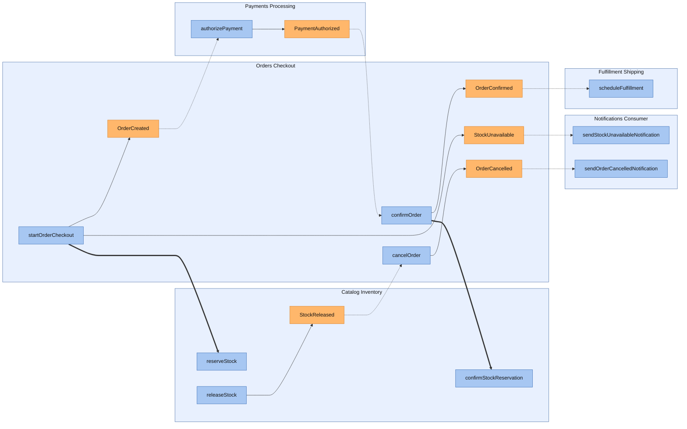
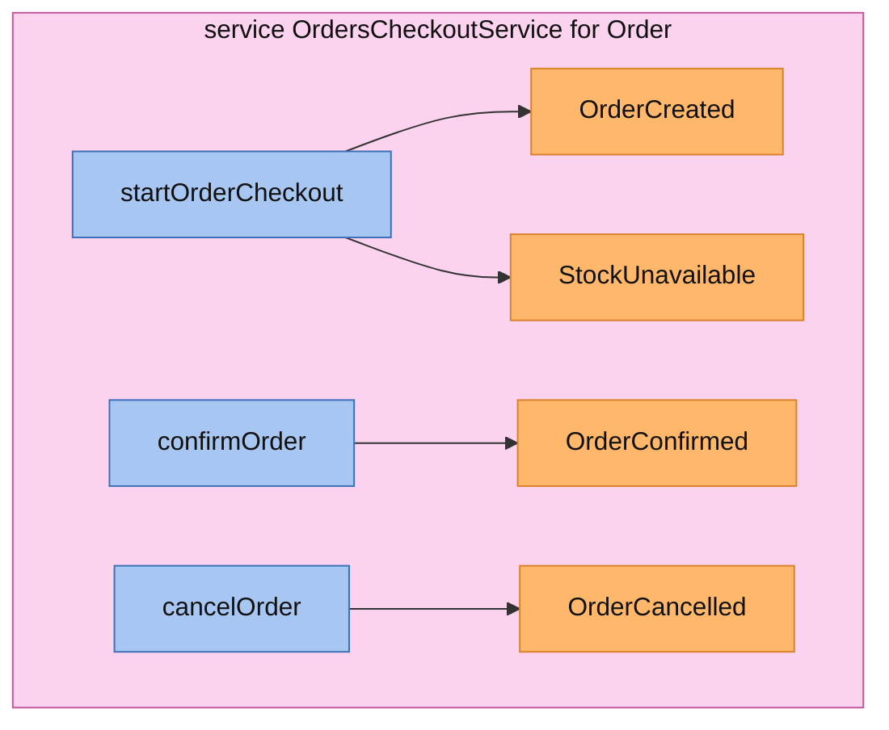
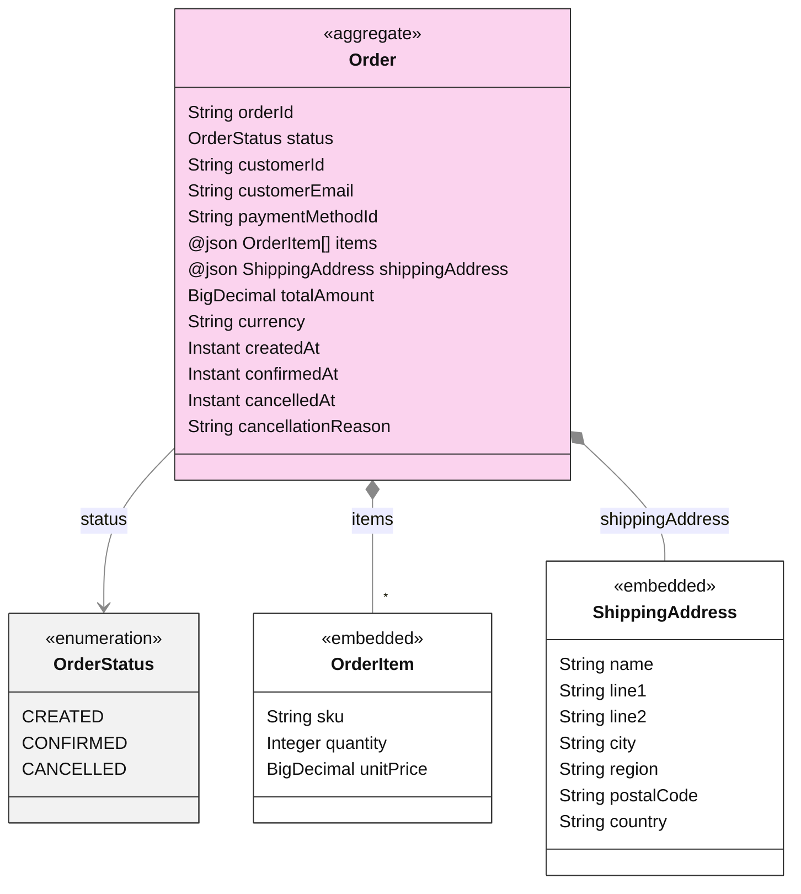
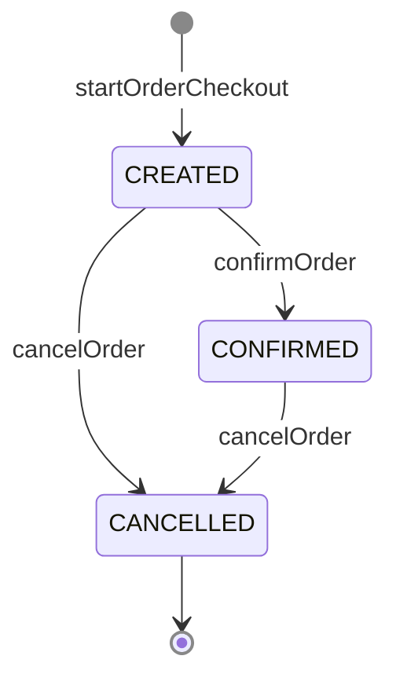
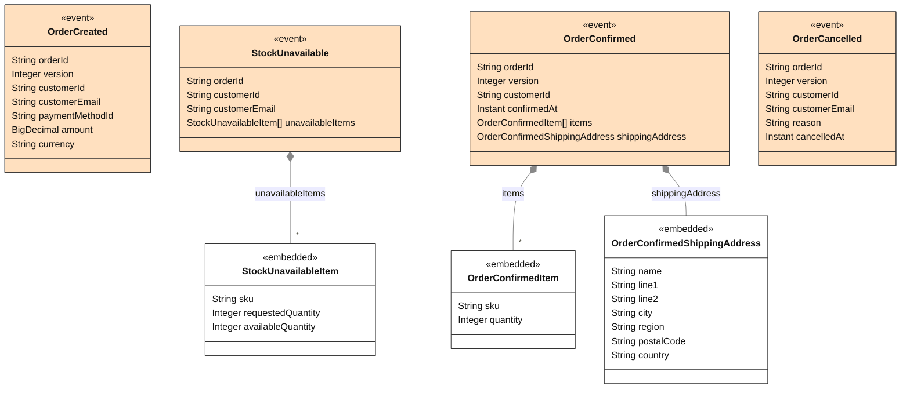

<!-- Generated by dsl-docs. Do not edit: changes are overwritten. -->
<!-- Source: orders-checkout-domain-model.zdl sha256:2bcf402624596e153c97fde086d2d421d0c401bea41c21ab26246d80304bef29 -->

# Orders Checkout

Arcadia Editions - Orders Checkout

Source: `orders-checkout-domain-model.zdl`

Back to the [architecture](../architecture.md).

## Contents

- [Architecture](#architecture)
- [Services](#services)
  - [OrdersCheckoutService](#orderscheckoutservice)
- [Aggregates](#aggregates)
  - [Order](#order)
- [Domain events](#domain-events)
- [Commands](#commands)
- [Glossary](#glossary)
  - [Aggregates](#aggregates-1)
  - [Enums](#enums)
  - [Inputs](#inputs)
  - [Domain events](#domain-events-1)

## Architecture

This module's commands and events, and the commands and events of other modules that connect to them.

Box = module. Blue = command. Orange = event; a pipe outside the boxes is an external event (has a topic). Solid = emits. Dashed = consumed by. Thick = direct call.

## Services

Each service with its commands (blue) and the events they emit (orange), inside the aggregate it works on.

### OrdersCheckoutService

## Aggregates

Each aggregate root with the entities and enums it owns, and how they relate.

### Order

#### Lifecycle

Field `status`, initial `CREATED`.

## Domain events

The events this module declares, with their fields. Fields copied with `@copy` are included; field descriptions are in the glossary.

## Commands

The methods of the module's services, the events each one emits and what triggers it.

| Command | Input | Returns | Events | Triggered by | Description |
| --- | --- | --- | --- | --- | --- |
| startOrderCheckout | [StartOrderCheckoutInput](#startordercheckoutinput) | [Order](#order-1) | [OrderCreated](#ordercreated) \| [StockUnavailable](#stockunavailable) | `POST /orders/start-checkout` |  |
| confirmOrder | id | [Order](#order-1) | [OrderConfirmed](#orderconfirmed) | listener [PaymentAuthorized](payments-processing.md) |  |
| cancelOrder | id, [CancelOrderInput](#cancelorderinput) | [Order](#order-1) | [OrderCancelled](#ordercancelled) | listener [StockReleased](catalog-inventory.md) |  |

## Consumes

Events from other modules or systems that this module reacts to, and the method that handles each one.

| Event | Owner | Handled by | Via |
| --- | --- | --- | --- |
| StockReleased | [Catalog Inventory](catalog-inventory.md) | `OrdersCheckoutService.cancelOrder` | @listener |
| PaymentAuthorized | [Payments Processing](payments-processing.md) | `OrdersCheckoutService.confirmOrder` | @listener |

## Consumed by

Who reacts to the events this module owns.

| Event | Consumer | Handled by | Via |
| --- | --- | --- | --- |
| OrderCancelled | [Notifications Consumer](notifications-consumer.md) | `NotificationsConsumerService.sendOrderCancelledNotification` | @listener |
| OrderConfirmed | [Fulfillment Shipping](fulfillment-shipping.md) | `FulfillmentShippingService.scheduleFulfillment` | @listener |
| OrderCreated | [Payments Processing](payments-processing.md) | `PaymentsProcessingService.authorizePayment` | @listener |
| StockUnavailable | [Notifications Consumer](notifications-consumer.md) | `NotificationsConsumerService.sendStockUnavailableNotification` | @listener |

## Calls

Direct calls this module makes to commands of other modules.

| Callee | Command | Called from |
| --- | --- | --- |
| [Catalog Inventory](catalog-inventory.md) | `confirmStockReservation` | `OrdersCheckoutService.confirmOrder` |
| [Catalog Inventory](catalog-inventory.md) | `reserveStock` | `OrdersCheckoutService.startOrderCheckout` |

## Glossary

Every named type of this module, by kind.

### Aggregates

#### Order

Aggregate root

| Field | Type | Description |
| --- | --- | --- |
| orderId | String |  |
| status | [OrderStatus](#orderstatus) |  |
| customerId | String | Customer snapshot taken at checkout (there is no customers bounded context yet). |
| customerEmail | String |  |
| paymentMethodId | String |  |
| items | @json [OrderItem](#orderitem)[] |  |
| shippingAddress | @json [ShippingAddress](#shippingaddress) |  |
| totalAmount | BigDecimal |  |
| currency | String |  |
| createdAt | Instant |  |
| confirmedAt | Instant |  |
| cancelledAt | Instant |  |
| cancellationReason | String |  |

#### OrderItem

Embedded entity of `Order`

| Field | Type | Description |
| --- | --- | --- |
| sku | String |  |
| quantity | Integer |  |
| unitPrice | BigDecimal |  |

#### ShippingAddress

Embedded entity of `Order`

| Field | Type | Description |
| --- | --- | --- |
| name | String |  |
| line1 | String |  |
| line2 | String |  |
| city | String |  |
| region | String |  |
| postalCode | String |  |
| country | String |  |

### Enums

#### OrderStatus

| Value | Description |
| --- | --- |
| CREATED |  |
| CONFIRMED |  |
| CANCELLED |  |

### Inputs

#### StartOrderCheckoutInput

| Field | Type | Description |
| --- | --- | --- |
| customerId | String |  |
| customerEmail | String |  |
| paymentMethodId | String |  |
| currency | String |  |
| items | [OrderItemInput](#orderiteminput)[] |  |
| shippingAddress | [ShippingAddressInput](#shippingaddressinput) |  |

#### OrderItemInput

| Field | Type | Description |
| --- | --- | --- |
| sku | String |  |
| quantity | Integer |  |
| unitPrice | BigDecimal |  |

#### ShippingAddressInput

| Field | Type | Description |
| --- | --- | --- |
| name | String |  |
| line1 | String |  |
| line2 | String |  |
| city | String |  |
| region | String |  |
| postalCode | String |  |
| country | String |  |

#### CancelOrderInput

| Field | Type | Description |
| --- | --- | --- |
| reason | String | From StockReleased.reason (StockReleaseReason name). |

### Domain events

#### OrderCreated

| Field | Type | Description |
| --- | --- | --- |
| orderId | String |  |
| version | Integer |  |
| customerId | String |  |
| customerEmail | String |  |
| paymentMethodId | String |  |
| amount | BigDecimal | Order total (Order.totalAmount), named to match AuthorizePaymentInput. |
| currency | String |  |

#### StockUnavailable

| Field | Type | Description |
| --- | --- | --- |
| orderId | String |  |
| customerId | String |  |
| customerEmail | String |  |
| unavailableItems | [StockUnavailableItem](#stockunavailableitem)[] |  |

#### StockUnavailableItem

| Field | Type | Description |
| --- | --- | --- |
| sku | String |  |
| requestedQuantity | Integer |  |
| availableQuantity | Integer |  |

#### OrderConfirmed

| Field | Type | Description |
| --- | --- | --- |
| orderId | String |  |
| version | Integer |  |
| customerId | String |  |
| confirmedAt | Instant |  |
| items | [OrderConfirmedItem](#orderconfirmeditem)[] |  |
| shippingAddress | [OrderConfirmedShippingAddress](#orderconfirmedshippingaddress) |  |

#### OrderConfirmedItem

| Field | Type | Description |
| --- | --- | --- |
| sku | String |  |
| quantity | Integer |  |

#### OrderConfirmedShippingAddress

| Field | Type | Description |
| --- | --- | --- |
| name | String |  |
| line1 | String |  |
| line2 | String |  |
| city | String |  |
| region | String |  |
| postalCode | String |  |
| country | String |  |

#### OrderCancelled

| Field | Type | Description |
| --- | --- | --- |
| orderId | String |  |
| version | Integer |  |
| customerId | String |  |
| customerEmail | String |  |
| reason | String | Order.cancellationReason |
| cancelledAt | Instant |  |

