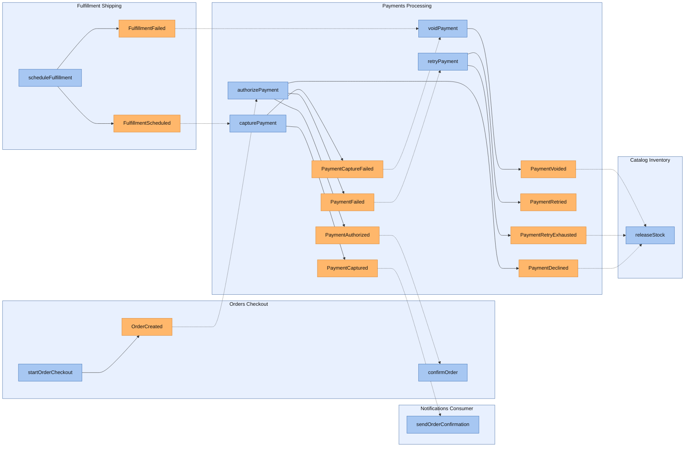
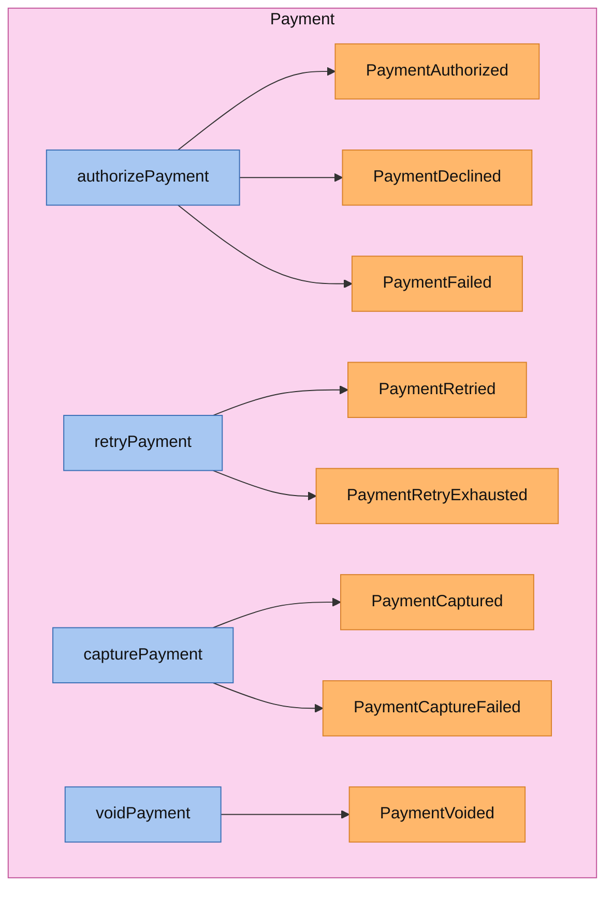
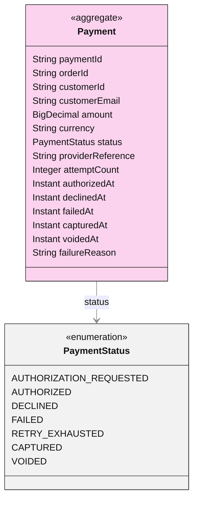
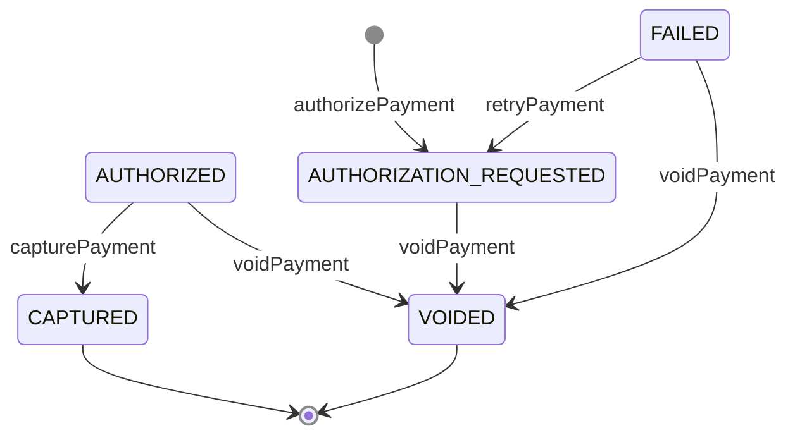

<!-- Generated by dsl-docs. Do not edit: changes are overwritten. -->
<!-- Source: payments-processing-domain-model.zdl sha256:874b4c3fee2456d375efa391f27537269d92e130d77051f6d67629ccc43e19bd -->

# Payments Processing

Arcadia Editions - Payments Processing

Source: `payments-processing-domain-model.zdl`

Back to the [architecture](../architecture.md).

## Contents

- [Architecture](#architecture)
- [Services](#services)
  - [PaymentsProcessingService](#paymentsprocessingservice)
- [Aggregates](#aggregates)
  - [Payment](#payment)
- [Domain events](#domain-events)
  - [PaymentsProcessingService](#paymentsprocessingservice-1)
- [Commands](#commands)
- [Glossary](#glossary)
  - [Aggregates](#aggregates-1)
  - [Enums](#enums)
  - [Inputs](#inputs)
  - [Domain events](#domain-events-1)

## Architecture

This module's commands and events, and the commands and events of other modules that connect to them.

Box = module. Blue = command. Orange = event; a pipe outside the boxes is an external event (has a topic). Solid = emits. Dashed = consumed by. Thick = direct call.

## Services

Each service with its commands (blue) and the events they emit (orange), inside the aggregate it works on.

### PaymentsProcessingService

## Aggregates

Each aggregate root with the entities and enums it owns, and how they relate.

### Payment

#### Lifecycle

Field `status`, initial `AUTHORIZATION_REQUESTED`.

## Domain events

The events each service emits, with their fields. Fields copied with `@copy` are included; field descriptions are in the glossary.

### PaymentsProcessingService

```mermaid
---
config:
  theme: default
  themeVariables:
    lineColor: "#888888"
    edgeLabelBackground: "#ffffff"
---
classDiagram
    class PaymentAuthorized {
        <<event>>
        String paymentId
        String orderId
        String customerId
        BigDecimal amount
        String currency
        String providerReference
        Instant authorizedAt
    }
    class PaymentDeclined {
        <<event>>
        String paymentId
        String orderId
        String customerId
        BigDecimal amount
        String currency
        String reason
        Instant declinedAt
    }
    class PaymentFailed {
        <<event>>
        String paymentId
        String orderId
        String customerId
        Integer attemptCount
        String reason
        Instant failedAt
    }
    class PaymentRetried {
        <<event>>
        String paymentId
        String orderId
        String customerId
        Integer attemptCount
        Instant retriedAt
    }
    class PaymentRetryExhausted {
        <<event>>
        String paymentId
        String orderId
        String customerId
        Integer attemptCount
        String reason
        Instant exhaustedAt
    }
    class PaymentCaptured {
        <<event>>
        String paymentId
        String orderId
        String customerId
        String customerEmail
        BigDecimal amount
        String currency
        String providerReference
        Instant capturedAt
    }
    class PaymentCaptureFailed {
        <<event>>
        String paymentId
        String orderId
        String customerId
        String reason
        Instant failedAt
    }
    class PaymentVoided {
        <<event>>
        String paymentId
        String orderId
        String customerId
        String providerReference
        String reason
        Instant voidedAt
    }
    style PaymentAuthorized fill:#ffe0bf,stroke:#333333,color:#111111
    style PaymentDeclined fill:#ffe0bf,stroke:#333333,color:#111111
    style PaymentFailed fill:#ffe0bf,stroke:#333333,color:#111111
    style PaymentRetried fill:#ffe0bf,stroke:#333333,color:#111111
    style PaymentRetryExhausted fill:#ffe0bf,stroke:#333333,color:#111111
    style PaymentCaptured fill:#ffe0bf,stroke:#333333,color:#111111
    style PaymentCaptureFailed fill:#ffe0bf,stroke:#333333,color:#111111
    style PaymentVoided fill:#ffe0bf,stroke:#333333,color:#111111
```

## Commands

The methods of the module's services, the events each one emits and what triggers it.

| Command | Input | Returns | Events | Triggered by | Description |
| --- | --- | --- | --- | --- | --- |
| authorizePayment | [AuthorizePaymentInput](#authorizepaymentinput) | [Payment](#payment-1) | [PaymentAuthorized](#paymentauthorized), [PaymentDeclined](#paymentdeclined), [PaymentFailed](#paymentfailed) | listener [OrderCreated](orders-checkout.md) |  |
| retryPayment | id, [RetryPaymentInput](#retrypaymentinput) | [Payment](#payment-1) | [PaymentRetried](#paymentretried), [PaymentRetryExhausted](#paymentretryexhausted) | listener [PaymentFailed](#paymentfailed) |  |
| capturePayment | id, [CapturePaymentInput](#capturepaymentinput) | [Payment](#payment-1) | [PaymentCaptured](#paymentcaptured), [PaymentCaptureFailed](#paymentcapturefailed) | listener [FulfillmentScheduled](fulfillment-shipping.md) |  |
| voidPayment | id, [VoidPaymentInput](#voidpaymentinput) | [Payment](#payment-1) | [PaymentVoided](#paymentvoided) | listener [FulfillmentFailed](fulfillment-shipping.md) listener [PaymentCaptureFailed](#paymentcapturefailed) |  |

## Consumes

Events from other modules or systems that this module reacts to, and the method that handles each one.

| Event | Owner | Handled by | Via |
| --- | --- | --- | --- |
| FulfillmentFailed | [Fulfillment Shipping](fulfillment-shipping.md) | `PaymentsProcessingService.voidPayment` | @listener |
| FulfillmentScheduled | [Fulfillment Shipping](fulfillment-shipping.md) | `PaymentsProcessingService.capturePayment` | @listener |
| OrderCreated | [Orders Checkout](orders-checkout.md) | `PaymentsProcessingService.authorizePayment` | @listener |
| PaymentCaptureFailed | [Payments Processing](payments-processing.md) | `PaymentsProcessingService.voidPayment` | @listener |
| PaymentFailed | [Payments Processing](payments-processing.md) | `PaymentsProcessingService.retryPayment` | @listener |

## Consumed by

Who reacts to the events this module owns.

| Event | Consumer | Handled by | Via |
| --- | --- | --- | --- |
| PaymentAuthorized | [Orders Checkout](orders-checkout.md) | `OrdersCheckoutService.confirmOrder` | @listener |
| PaymentCaptureFailed | [Payments Processing](payments-processing.md) | `PaymentsProcessingService.voidPayment` | @listener |
| PaymentCaptured | [Notifications Consumer](notifications-consumer.md) | `NotificationsConsumerService.sendOrderConfirmation` | @listener |
| PaymentDeclined | [Catalog Inventory](catalog-inventory.md) | `InventoryService.releaseStock` | @listener |
| PaymentFailed | [Payments Processing](payments-processing.md) | `PaymentsProcessingService.retryPayment` | @listener |
| PaymentRetryExhausted | [Catalog Inventory](catalog-inventory.md) | `InventoryService.releaseStock` | @listener |
| PaymentVoided | [Catalog Inventory](catalog-inventory.md) | `InventoryService.releaseStock` | @listener |

## Glossary

Every named type of this module, by kind.

### Aggregates

#### Payment

Aggregate root

| Field | Type | Description |
| --- | --- | --- |
| paymentId | String |  |
| orderId | String |  |
| customerId | String |  |
| customerEmail | String | Carried so PaymentCaptured can drive the order confirmation e-mail. |
| amount | BigDecimal |  |
| currency | String |  |
| status | [PaymentStatus](#paymentstatus) |  |
| providerReference | String |  |
| attemptCount | Integer |  |
| authorizedAt | Instant |  |
| declinedAt | Instant |  |
| failedAt | Instant |  |
| capturedAt | Instant |  |
| voidedAt | Instant |  |
| failureReason | String |  |

### Enums

#### PaymentStatus

| Value | Description |
| --- | --- |
| AUTHORIZATION_REQUESTED |  |
| AUTHORIZED |  |
| DECLINED |  |
| FAILED |  |
| RETRY_EXHAUSTED |  |
| CAPTURED |  |
| VOIDED |  |

### Inputs

#### AuthorizePaymentInput

| Field | Type | Description |
| --- | --- | --- |
| orderId | String |  |
| customerId | String |  |
| customerEmail | String |  |
| amount | BigDecimal |  |
| currency | String |  |
| paymentMethodId | String |  |

#### RetryPaymentInput

| Field | Type | Description |
| --- | --- | --- |
| orderId | String |  |

#### CapturePaymentInput

The payment is resolved by orderId (Payment.orderId is unique); fulfillment events carry no paymentId.

| Field | Type | Description |
| --- | --- | --- |
| orderId | String |  |

#### VoidPaymentInput

The payment is resolved by orderId (Payment.orderId is unique); fulfillment events carry no paymentId.

| Field | Type | Description |
| --- | --- | --- |
| reason | String |  |

### Domain events

#### PaymentAuthorized

| Field | Type | Description |
| --- | --- | --- |
| paymentId | String |  |
| orderId | String |  |
| customerId | String |  |
| amount | BigDecimal |  |
| currency | String |  |
| providerReference | String |  |
| authorizedAt | Instant |  |

#### PaymentDeclined

| Field | Type | Description |
| --- | --- | --- |
| paymentId | String |  |
| orderId | String |  |
| customerId | String |  |
| amount | BigDecimal |  |
| currency | String |  |
| reason | String |  |
| declinedAt | Instant |  |

#### PaymentFailed

| Field | Type | Description |
| --- | --- | --- |
| paymentId | String |  |
| orderId | String |  |
| customerId | String |  |
| attemptCount | Integer |  |
| reason | String |  |
| failedAt | Instant |  |

#### PaymentRetried

| Field | Type | Description |
| --- | --- | --- |
| paymentId | String |  |
| orderId | String |  |
| customerId | String |  |
| attemptCount | Integer |  |
| retriedAt | Instant |  |

#### PaymentRetryExhausted

| Field | Type | Description |
| --- | --- | --- |
| paymentId | String |  |
| orderId | String |  |
| customerId | String |  |
| attemptCount | Integer |  |
| reason | String |  |
| exhaustedAt | Instant |  |

#### PaymentCaptured

| Field | Type | Description |
| --- | --- | --- |
| paymentId | String |  |
| orderId | String |  |
| customerId | String |  |
| customerEmail | String |  |
| amount | BigDecimal |  |
| currency | String |  |
| providerReference | String |  |
| capturedAt | Instant |  |

#### PaymentCaptureFailed

| Field | Type | Description |
| --- | --- | --- |
| paymentId | String |  |
| orderId | String |  |
| customerId | String |  |
| reason | String |  |
| failedAt | Instant |  |

#### PaymentVoided

| Field | Type | Description |
| --- | --- | --- |
| paymentId | String |  |
| orderId | String |  |
| customerId | String |  |
| providerReference | String |  |
| reason | String |  |
| voidedAt | Instant |  |

