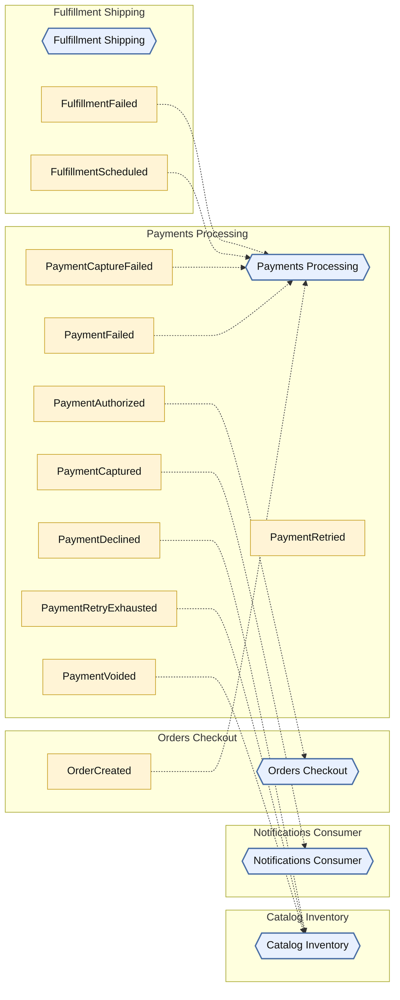

<!-- Generated by dsl-docs. Do not edit: changes are overwritten. -->
<!-- Source: payments-processing-domain-model.zdl sha256:874b4c3fee2456d375efa391f27537269d92e130d77051f6d67629ccc43e19bd -->

# Arcadia Editions - Payments Processing

Source: `payments-processing-domain-model.zdl`

Back to the [architecture](../architecture.md).

## Architecture

This module, the events it owns and consumes, and the modules it talks to.

Hexagon = module. Rectangle inside a box = internal event owned by that module. Pipe outside boxes = external event (has a topic). Solid = published by. Dashed = consumed by. Thick = direct call.

## Class diagram

Aggregates, entities and enums of this module and how they relate.

```mermaid
classDiagram
    class Payment {
        <<aggregate>>
        String paymentId
        String orderId
        String customerId
        String customerEmail
        BigDecimal amount
        String currency
        PaymentStatus status
        String providerReference
        Integer attemptCount
        Instant authorizedAt
        Instant declinedAt
        Instant failedAt
        Instant capturedAt
        Instant voidedAt
        String failureReason
    }
    class PaymentStatus {
        <<enumeration>>
        AUTHORIZATION_REQUESTED
        AUTHORIZED
        DECLINED
        FAILED
        RETRY_EXHAUSTED
        CAPTURED
        VOIDED
    }
    class AuthorizePaymentInput {
        <<input>>
        String orderId
        String customerId
        String customerEmail
        BigDecimal amount
        String currency
        String paymentMethodId
    }
    class RetryPaymentInput {
        <<input>>
        String orderId
    }
    class CapturePaymentInput {
        <<input>>
        String orderId
    }
    class VoidPaymentInput {
        <<input>>
        String reason
    }
    class PaymentAuthorized {
        <<event>>
        String paymentId
        String orderId
        String customerId
        BigDecimal amount
        String currency
        String providerReference
        Instant authorizedAt
    }
    class PaymentDeclined {
        <<event>>
        String paymentId
        String orderId
        String customerId
        BigDecimal amount
        String currency
        String reason
        Instant declinedAt
    }
    class PaymentFailed {
        <<event>>
        String paymentId
        String orderId
        String customerId
        Integer attemptCount
        String reason
        Instant failedAt
    }
    class PaymentRetried {
        <<event>>
        String paymentId
        String orderId
        String customerId
        Integer attemptCount
        Instant retriedAt
    }
    class PaymentRetryExhausted {
        <<event>>
        String paymentId
        String orderId
        String customerId
        Integer attemptCount
        String reason
        Instant exhaustedAt
    }
    class PaymentCaptured {
        <<event>>
        String paymentId
        String orderId
        String customerId
        String customerEmail
        BigDecimal amount
        String currency
        String providerReference
        Instant capturedAt
    }
    class PaymentCaptureFailed {
        <<event>>
        String paymentId
        String orderId
        String customerId
        String reason
        Instant failedAt
    }
    class PaymentVoided {
        <<event>>
        String paymentId
        String orderId
        String customerId
        String providerReference
        String reason
        Instant voidedAt
    }
    class PaymentsProcessingService {
        <<service>>
        authorizePayment(AuthorizePaymentInput) Payment withEvents PaymentAuthorized PaymentDeclined PaymentFailed
        retryPayment(id, RetryPaymentInput) Payment withEvents PaymentRetried PaymentRetryExhausted
        capturePayment(id, CapturePaymentInput) Payment withEvents PaymentCaptured PaymentCaptureFailed
        voidPayment(id, VoidPaymentInput) Payment withEvents PaymentVoided
    }
    Payment --> PaymentStatus : status
    PaymentsProcessingService ..> Payment
    PaymentsProcessingService ..> AuthorizePaymentInput
    PaymentsProcessingService ..> PaymentAuthorized
    PaymentsProcessingService ..> PaymentDeclined
    PaymentsProcessingService ..> PaymentFailed
    PaymentsProcessingService ..> RetryPaymentInput
    PaymentsProcessingService ..> PaymentRetried
    PaymentsProcessingService ..> PaymentRetryExhausted
    PaymentsProcessingService ..> CapturePaymentInput
    PaymentsProcessingService ..> PaymentCaptured
    PaymentsProcessingService ..> PaymentCaptureFailed
    PaymentsProcessingService ..> VoidPaymentInput
    PaymentsProcessingService ..> PaymentVoided
```

## Glossary

Every named type and service of this module.

| Term | Kind | Description |
| --- | --- | --- |
| AuthorizePaymentInput | Input |  |
| CapturePaymentInput | Input | The payment is resolved by orderId (Payment.orderId is unique); fulfillment events carry no paymentId. |
| Payment | Aggregate root |  |
| PaymentAuthorized | Event |  |
| PaymentCaptured | Event |  |
| PaymentCaptureFailed | Event |  |
| PaymentDeclined | Event |  |
| PaymentFailed | Event |  |
| PaymentRetried | Event |  |
| PaymentRetryExhausted | Event |  |
| PaymentsProcessingService | Service |  |
| PaymentStatus | Enum |  |
| PaymentVoided | Event |  |
| RetryPaymentInput | Input |  |
| VoidPaymentInput | Input | The payment is resolved by orderId (Payment.orderId is unique); fulfillment events carry no paymentId. |

## Commands

The methods of the module's services and the events each one emits.

| Service | Command | Input | Returns | Events | Description |
| --- | --- | --- | --- | --- | --- |
| PaymentsProcessingService | authorizePayment | AuthorizePaymentInput | Payment | PaymentAuthorized, PaymentDeclined, PaymentFailed |  |
| PaymentsProcessingService | retryPayment | id, RetryPaymentInput | Payment | PaymentRetried, PaymentRetryExhausted |  |
| PaymentsProcessingService | capturePayment | id, CapturePaymentInput | Payment | PaymentCaptured, PaymentCaptureFailed |  |
| PaymentsProcessingService | voidPayment | id, VoidPaymentInput | Payment | PaymentVoided |  |

## Events

Events declared by this module and their fields.

| Event | Fields | Description |
| --- | --- | --- |
| PaymentAuthorized | paymentId: String, orderId: String, customerId: String, amount: BigDecimal, currency: String, providerReference: String, authorizedAt: Instant |  |
| PaymentDeclined | paymentId: String, orderId: String, customerId: String, amount: BigDecimal, currency: String, reason: String, declinedAt: Instant |  |
| PaymentFailed | paymentId: String, orderId: String, customerId: String, attemptCount: Integer, reason: String, failedAt: Instant |  |
| PaymentRetried | paymentId: String, orderId: String, customerId: String, attemptCount: Integer, retriedAt: Instant |  |
| PaymentRetryExhausted | paymentId: String, orderId: String, customerId: String, attemptCount: Integer, reason: String, exhaustedAt: Instant |  |
| PaymentCaptured | paymentId: String, orderId: String, customerId: String, customerEmail: String, amount: BigDecimal, currency: String, providerReference: String, capturedAt: Instant |  |
| PaymentCaptureFailed | paymentId: String, orderId: String, customerId: String, reason: String, failedAt: Instant |  |
| PaymentVoided | paymentId: String, orderId: String, customerId: String, providerReference: String, reason: String, voidedAt: Instant |  |

## Consumes

Events from other modules or systems that this module reacts to, and the method that handles each one.

| Event | Owner | Handled by | Via |
| --- | --- | --- | --- |
| FulfillmentFailed | [Fulfillment Shipping](fulfillment-shipping.md) | `PaymentsProcessingService.voidPayment` | @listener |
| FulfillmentScheduled | [Fulfillment Shipping](fulfillment-shipping.md) | `PaymentsProcessingService.capturePayment` | @listener |
| OrderCreated | [Orders Checkout](orders-checkout.md) | `PaymentsProcessingService.authorizePayment` | @listener |
| PaymentCaptureFailed | [Payments Processing](payments-processing.md) | `PaymentsProcessingService.voidPayment` | @listener |
| PaymentFailed | [Payments Processing](payments-processing.md) | `PaymentsProcessingService.retryPayment` | @listener |

## Consumed by

Who reacts to the events this module owns.

| Event | Consumer | Handled by | Via |
| --- | --- | --- | --- |
| PaymentAuthorized | [Orders Checkout](orders-checkout.md) | `OrdersCheckoutService.confirmOrder` | @listener |
| PaymentCaptureFailed | [Payments Processing](payments-processing.md) | `PaymentsProcessingService.voidPayment` | @listener |
| PaymentCaptured | [Notifications Consumer](notifications-consumer.md) | `NotificationsConsumerService.sendOrderConfirmation` | @listener |
| PaymentDeclined | [Catalog Inventory](catalog-inventory.md) | `InventoryService.releaseStock` | @listener |
| PaymentFailed | [Payments Processing](payments-processing.md) | `PaymentsProcessingService.retryPayment` | @listener |
| PaymentRetryExhausted | [Catalog Inventory](catalog-inventory.md) | `InventoryService.releaseStock` | @listener |
| PaymentVoided | [Catalog Inventory](catalog-inventory.md) | `InventoryService.releaseStock` | @listener |

