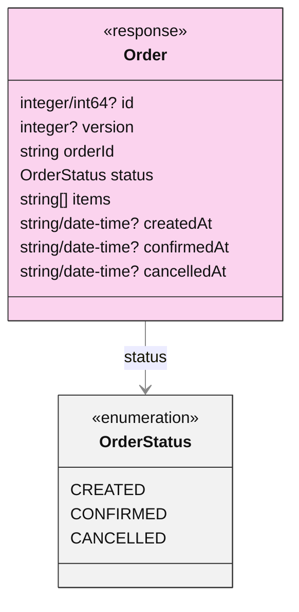
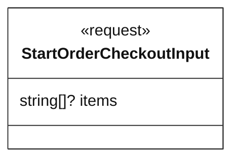

<!-- Generated by dsl-docs. Do not edit: changes are overwritten. -->
<!-- Source: openapi.yml sha256:8e772304d9e2d4e369aa212ee8736aae049a5ed1d508d26701a4384f44bd75a3 -->

# HTTP APIs

## Contents

- [Arcadia Editions - Orders Checkout 0.1.0](#arcadia-editions---orders-checkout-010)
  - [Operations](#operations)
  - [Schemas](#schemas)

## Arcadia Editions - Orders Checkout 0.1.0

Source: `openapi.yml` · OpenAPI 3.0.1

Arcadia Editions - Orders Checkout

### Operations

| Method | Path | Operation | Request | Response | Summary |
| --- | --- | --- | --- | --- | --- |
| POST | `/orders` | startOrderCheckout | [`StartOrderCheckoutInput`](#startordercheckoutinput) | [`Order`](#order) | startOrderCheckout |

### Schemas

Schemas are grouped by the response that returns them. A diagram shows the response and everything it reaches; the tables list the fields.

#### Order

Returned by `POST /orders`.

**Order**

| Field | Type | Required | Description |
| --- | --- | --- | --- |
| `id` | `integer(int64)` | no |  |
| `version` | `integer` | no | Version of the document (required in PUT for concurrency control, should be null in POSTs). |
| `orderId` | `string` | yes |  |
| `status` | `OrderStatus` | yes |  |
| `items` | `string[]` | yes |  |
| `createdAt` | `string(date-time)` | no |  |
| `confirmedAt` | `string(date-time)` | no |  |
| `cancelledAt` | `string(date-time)` | no |  |

**OrderStatus** (enumeration)

| Value |
| --- |
| `CREATED` |
| `CONFIRMED` |
| `CANCELLED` |

#### Other schemas

Schemas no response returns, such as request bodies.

##### StartOrderCheckoutInput

Sent to `POST /orders`.

**StartOrderCheckoutInput**

| Field | Type | Required | Description |
| --- | --- | --- | --- |
| `items` | `string[]` | no |  |

