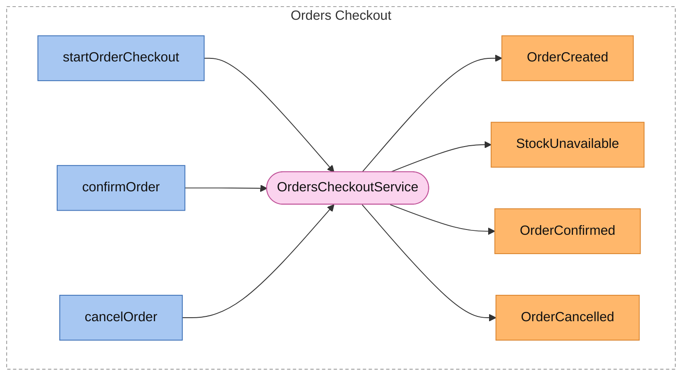
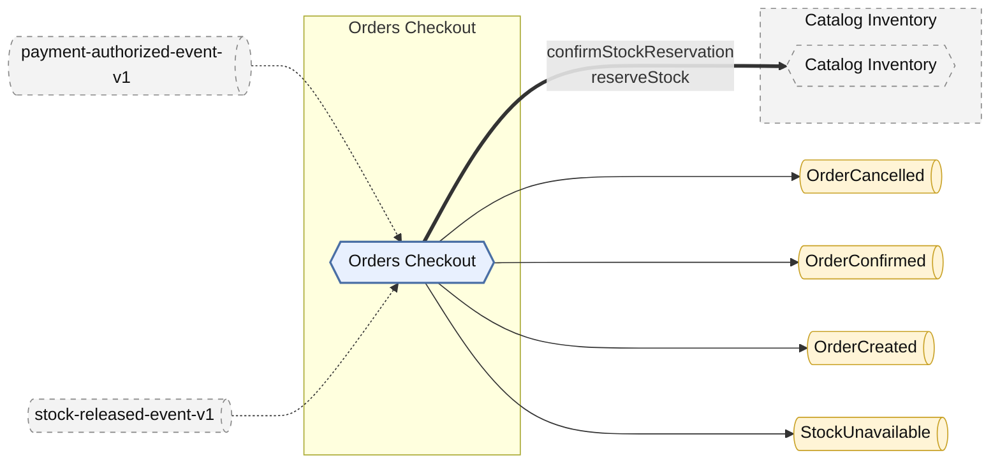
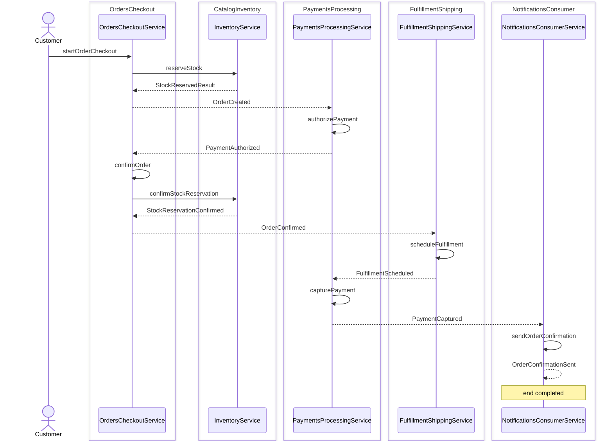

<!-- Generated by dsl-docs. Do not edit: changes are overwritten. -->
<!-- Source: domain-model.zdl sha256:4d6f7dfea4247c592e866e0ad09c819c0dda3976c6b0954e382cc8ef1dabfbc1 -->
<!-- Source: ../business-flows/place-order-flow.zfl sha256:a8ee3c90c4e6d913634545f66287720e518aebcf5bc2be4ae463d2cc61e46872 -->

# Architecture

1 module declaring 4 events (0 internal, 4 external), plus 2 events from other systems. Generated from the ZDL files: edit the models, not this page.

## Overview

Each module with its services, the commands they handle and the events they emit.

Dashed box = module. Blue = command, handled by the pink service, which emits the orange events.

## Modules

One module per ZDL file.

| Module | Package | ZDL | Page |
| --- | --- | --- | --- |
| Catalog Inventory |  | [`domain-model.zdl`](https://raw.githubusercontent.com/arcadia-editions/catalog-inventory-api/main/domain-model.zdl) (not in these files) |  |
| Orders Checkout | `com.arcadiaeditions.orders.checkout` | [`domain-model.zdl`](../domain-model.zdl) | [domain.md](domain.md) |

## Dependencies

Modules, the events they own and who consumes them, and direct calls between modules.

Hexagon = module. Rectangle inside a box = internal event owned by that module. Pipe outside boxes = external event (has a topic). Solid = published by. Dashed = consumed by. Thick = direct call.

## Direct calls

Calls from one module to a command of another, declared with `@calls`. The caller waits for the answer, unlike an event.

| Caller | Callee | Command | Called from |
| --- | --- | --- | --- |
| [Orders Checkout](domain.md) | Catalog Inventory | `confirmStockReservation` | `OrdersCheckoutService.confirmOrder` |
| [Orders Checkout](domain.md) | Catalog Inventory | `reserveStock` | `OrdersCheckoutService.startOrderCheckout` |

## Events

Every event with the module that owns it and the modules that consume it. An event is external when it has an `@asyncapi` topic and internal otherwise. Consumers come from `@listener` and `@asyncapi` on service methods.

| Event | Kind | Owner | Topic | Defined in | Consumers |
| --- | --- | --- | --- | --- | --- |
| OrderCancelled | external | [Orders Checkout](domain.md) | `orders-checkout.order-cancelled.event.avro.v1` | [`domain-model.zdl`](../domain-model.zdl) |  |
| OrderConfirmed | external | [Orders Checkout](domain.md) | `orders-checkout.order-confirmed.event.avro.v1` | [`domain-model.zdl`](../domain-model.zdl) |  |
| OrderCreated | external | [Orders Checkout](domain.md) | `orders-checkout.order-created.event.avro.v1` | [`domain-model.zdl`](../domain-model.zdl) |  |
| StockUnavailable | external | [Orders Checkout](domain.md) | `orders-checkout.stock-unavailable.event.avro.v1` | [`domain-model.zdl`](../domain-model.zdl) |  |
| payment-authorized-event-v1 | external | unknown |  | `PaymentsProcessingApi` (not in these files) | [Orders Checkout](domain.md) |
| stock-released-event-v1 | external | unknown |  | `CatalogInventoryApi` (not in these files) | [Orders Checkout](domain.md) |

### Events with no consumers

No service method in these files listens to them. An external event may be an integration point for other systems.

- OrderCancelled (Orders Checkout, external)
- OrderConfirmed (Orders Checkout, external)
- OrderCreated (Orders Checkout, external)
- StockUnavailable (Orders Checkout, external)

## Sequence diagrams

The happy path of each event flow (ZFL). The page of a flow has its flowchart and every alternative path.

### PlaceOrderFlow

Starts with `StartOrderCheckout` and ends with the outcome `completed`. [All 12 paths](flows/place-order-flow.md).

