<!-- Generated by dsl-docs. Do not edit: changes are overwritten. -->
<!-- Source: domain-model.zdl sha256:4d6f7dfea4247c592e866e0ad09c819c0dda3976c6b0954e382cc8ef1dabfbc1 -->

# Domain model

## Arcadia Editions - Orders Checkout

Source: `domain-model.zdl`

### Class diagram

```mermaid
classDiagram
    class Order {
        <<aggregate>>
        String orderId
        OrderStatus status
        String[] items
        Instant createdAt
        Instant confirmedAt
        Instant cancelledAt
    }
    class OrderStatus {
        <<enumeration>>
        CREATED
        CONFIRMED
        CANCELLED
    }
    class StartOrderCheckoutInput {
        <<input>>
        String[] items
    }
    class ConfirmOrderInput {
        <<input>>
        String orderId
    }
    class CancelOrderInput {
        <<input>>
        String orderId
    }
    class OrderCreated {
        <<event>>
        String orderId
        Integer version
    }
    class StockUnavailable {
        <<event>>
        String productId
        Integer requestedQuantity
    }
    class OrderConfirmed {
        <<event>>
        String orderId
        Integer version
        Instant confirmedAt
    }
    class OrderCancelled {
        <<event>>
        String orderId
        Integer version
        Instant cancelledAt
    }
    class OrdersCheckoutService {
        <<service>>
        startOrderCheckout(StartOrderCheckoutInput) Order withEvents OrderCreated or StockUnavailable
        confirmOrder(ConfirmOrderInput) Order withEvents OrderConfirmed
        cancelOrder(CancelOrderInput) Order withEvents OrderCancelled
    }
    Order --> OrderStatus : status
    OrdersCheckoutService ..> Order
    OrdersCheckoutService ..> StartOrderCheckoutInput
    OrdersCheckoutService ..> OrderCreated
    OrdersCheckoutService ..> StockUnavailable
    OrdersCheckoutService ..> ConfirmOrderInput
    OrdersCheckoutService ..> OrderConfirmed
    OrdersCheckoutService ..> CancelOrderInput
    OrdersCheckoutService ..> OrderCancelled
```

### Glossary

| Term | Kind | Description |
| --- | --- | --- |
| CancelOrderInput | Input |  |
| ConfirmOrderInput | Input |  |
| Order | Aggregate root |  |
| OrderCancelled | Event |  |
| OrderConfirmed | Event |  |
| OrderCreated | Event |  |
| OrdersCheckoutService | Service |  |
| OrderStatus | Enum |  |
| StartOrderCheckoutInput | Input |  |
| StockUnavailable | Event |  |

### Commands

| Service | Command | Input | Returns | Events | Description |
| --- | --- | --- | --- | --- | --- |
| OrdersCheckoutService | startOrderCheckout | StartOrderCheckoutInput | Order | OrderCreated \| StockUnavailable |  |
| OrdersCheckoutService | confirmOrder | ConfirmOrderInput | Order | OrderConfirmed |  |
| OrdersCheckoutService | cancelOrder | CancelOrderInput | Order | OrderCancelled |  |

### Events

| Event | Fields | Description |
| --- | --- | --- |
| OrderCreated | orderId: String, version: Integer |  |
| StockUnavailable | productId: String, requestedQuantity: Integer |  |
| OrderConfirmed | orderId: String, version: Integer, confirmedAt: Instant |  |
| OrderCancelled | orderId: String, version: Integer, cancelledAt: Instant |  |

