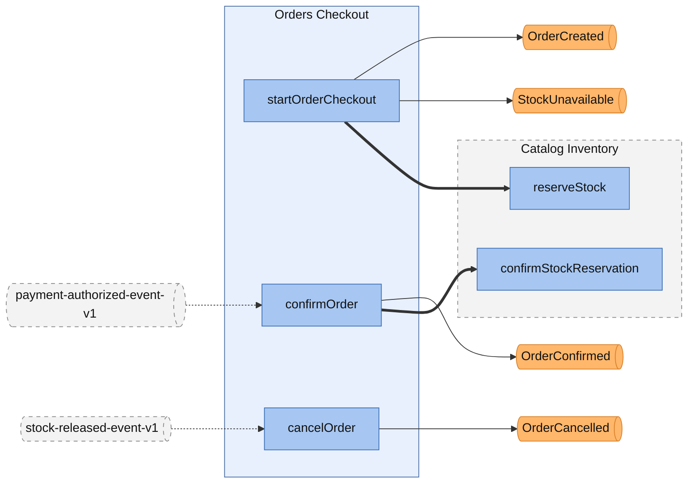
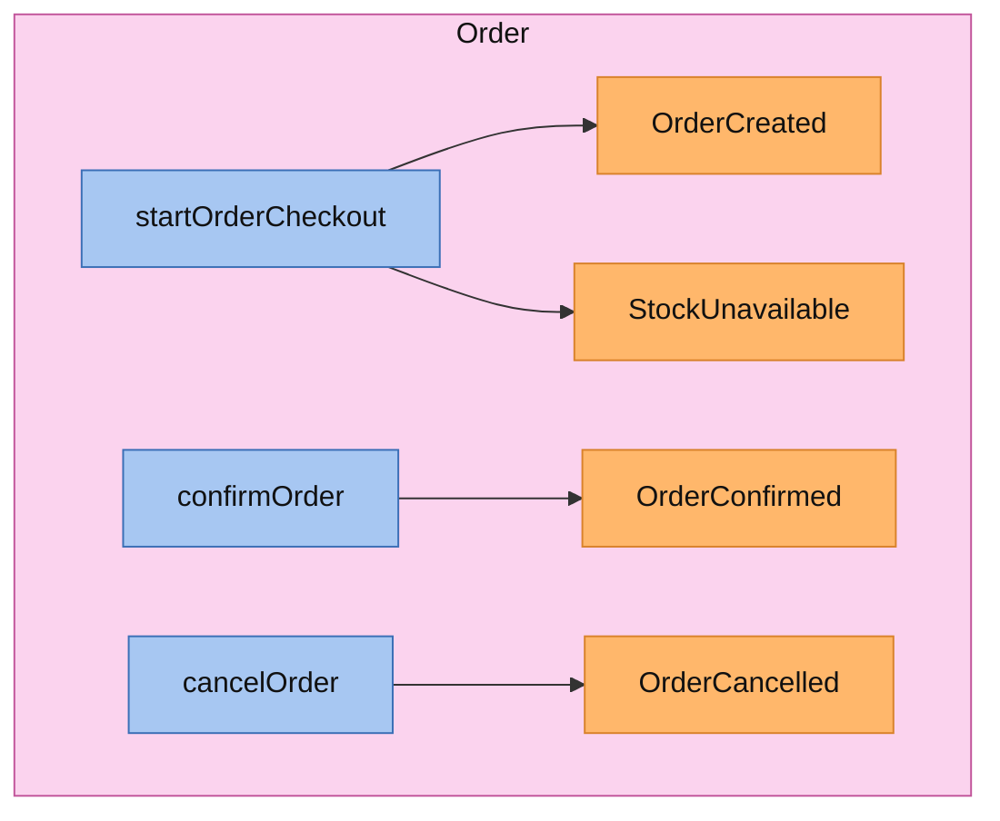
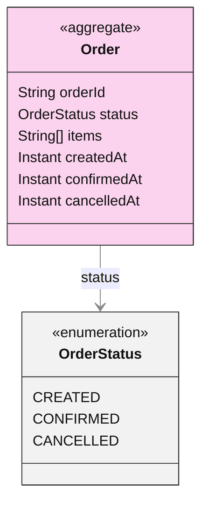
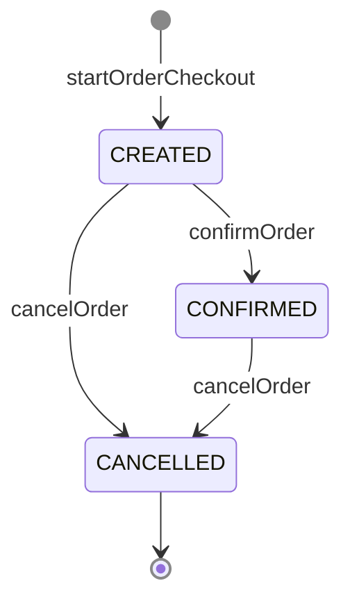
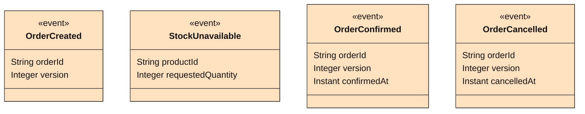

<!-- Generated by dsl-docs. Do not edit: changes are overwritten. -->
<!-- Source: domain-model.zdl sha256:4d6f7dfea4247c592e866e0ad09c819c0dda3976c6b0954e382cc8ef1dabfbc1 -->

# Domain model

Arcadia Editions - Orders Checkout

Source: `domain-model.zdl`

Back to the [architecture](architecture.md).

## Contents

- [Architecture](#architecture)
- [Services](#services)
  - [OrdersCheckoutService](#orderscheckoutservice)
- [Aggregates](#aggregates)
  - [Order](#order)
- [Domain events](#domain-events)
  - [OrdersCheckoutService](#orderscheckoutservice-1)
- [Commands](#commands)
- [Glossary](#glossary)
  - [Aggregates](#aggregates-1)
  - [Enums](#enums)
  - [Inputs](#inputs)
  - [Domain events](#domain-events-1)

## Architecture

This module's commands and events, and the commands and events of other modules that connect to them.

Box = module. Blue = command. Orange = event; a pipe outside the boxes is an external event (has a topic). Solid = emits. Dashed = consumed by. Thick = direct call.

## Services

Each service with its commands (blue) and the events they emit (orange), inside the aggregate it works on.

### OrdersCheckoutService

## Aggregates

Each aggregate root with the entities and enums it owns, and how they relate.

### Order

#### Lifecycle

Field `status`, initial `CREATED`.

## Domain events

The events each service emits, with their fields. Fields copied with `@copy` are included; field descriptions are in the glossary.

### OrdersCheckoutService

## Commands

The methods of the module's services, the events each one emits and what triggers it.

| Command | Input | Returns | Events | Triggered by | Description |
| --- | --- | --- | --- | --- | --- |
| startOrderCheckout | [StartOrderCheckoutInput](#startordercheckoutinput) | [Order](#order-1) | [OrderCreated](#ordercreated) \| [StockUnavailable](#stockunavailable) | `POST /orders` |  |
| confirmOrder | [ConfirmOrderInput](#confirmorderinput) | [Order](#order-1) | [OrderConfirmed](#orderconfirmed) | asyncapi `payment-authorized-event-v1` (PaymentsProcessingApi) |  |
| cancelOrder | [CancelOrderInput](#cancelorderinput) | [Order](#order-1) | [OrderCancelled](#ordercancelled) | asyncapi `stock-released-event-v1` (CatalogInventoryApi) |  |

## Consumes

Events from other modules or systems that this module reacts to, and the method that handles each one.

| Event | Owner | Handled by | Via |
| --- | --- | --- | --- |
| payment-authorized-event-v1 (other system) | unknown | `OrdersCheckoutService.confirmOrder` | @asyncapi |
| stock-released-event-v1 (other system) | unknown | `OrdersCheckoutService.cancelOrder` | @asyncapi |

## Calls

Direct calls this module makes to commands of other modules.

| Callee | Command | Called from |
| --- | --- | --- |
| Catalog Inventory | `confirmStockReservation` | `OrdersCheckoutService.confirmOrder` |
| Catalog Inventory | `reserveStock` | `OrdersCheckoutService.startOrderCheckout` |

## Glossary

Every named type of this module, by kind.

### Aggregates

#### Order

Aggregate root

| Field | Type | Description |
| --- | --- | --- |
| orderId | String |  |
| status | [OrderStatus](#orderstatus) |  |
| items | String[] |  |
| createdAt | Instant |  |
| confirmedAt | Instant |  |
| cancelledAt | Instant |  |

### Enums

#### OrderStatus

| Value | Description |
| --- | --- |
| CREATED |  |
| CONFIRMED |  |
| CANCELLED |  |

### Inputs

#### StartOrderCheckoutInput

| Field | Type | Description |
| --- | --- | --- |
| items | String[] |  |

#### ConfirmOrderInput

| Field | Type | Description |
| --- | --- | --- |
| orderId | String |  |

#### CancelOrderInput

| Field | Type | Description |
| --- | --- | --- |
| orderId | String |  |

### Domain events

#### OrderCreated

Channel: `order-created-event-v1`. Topic: `orders-checkout.order-created.event.avro.v1`.

| Field | Type | Description |
| --- | --- | --- |
| orderId | String |  |
| version | Integer |  |

#### StockUnavailable

Channel: `stock-unavailable-event-v1`. Topic: `orders-checkout.stock-unavailable.event.avro.v1`.

| Field | Type | Description |
| --- | --- | --- |
| productId | String |  |
| requestedQuantity | Integer |  |

#### OrderConfirmed

Channel: `order-confirmed-event-v1`. Topic: `orders-checkout.order-confirmed.event.avro.v1`.

| Field | Type | Description |
| --- | --- | --- |
| orderId | String |  |
| version | Integer |  |
| confirmedAt | Instant |  |

#### OrderCancelled

Channel: `order-cancelled-event-v1`. Topic: `orders-checkout.order-cancelled.event.avro.v1`.

| Field | Type | Description |
| --- | --- | --- |
| orderId | String |  |
| version | Integer |  |
| cancelledAt | Instant |  |

