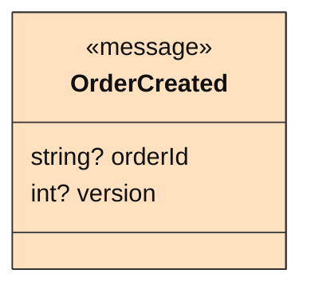
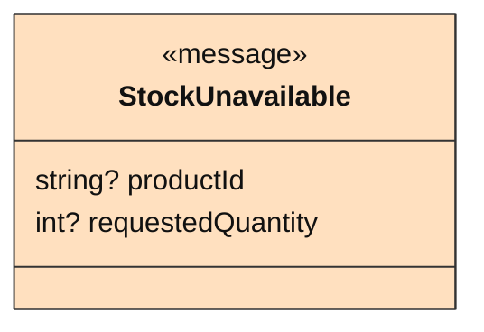
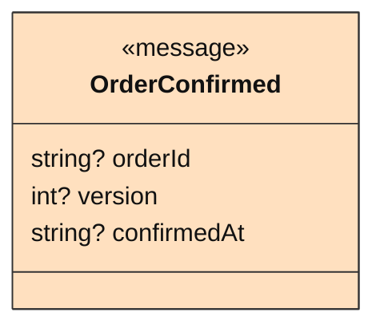
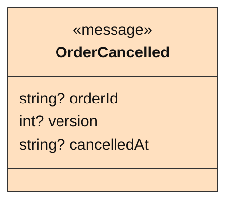

<!-- Generated by dsl-docs. Do not edit: changes are overwritten. -->
<!-- Source: asyncapi.yml sha256:d5287968214c43094e1df674ea64ec51ab64750e9decf4a0614dac2da773d4b3 -->
<!-- Source: avro/OrderCreated.avsc sha256:166c9b49848efa013bbb5f9f710d3442d0de3f64a4b59746641cba027c1df167 -->
<!-- Source: avro/StockUnavailable.avsc sha256:c58cdd52fb8680d17365bb78a93970e870e25659fe0069e4851d0bbc063b69fb -->
<!-- Source: avro/OrderConfirmed.avsc sha256:260b276270d1db7f7d0516e961edd795562e7e81fda1aa2d8eca304224b10c50 -->
<!-- Source: avro/OrderCancelled.avsc sha256:73e0291bdf0eb06a5b2ac5bc0c9846f44b272b0cbaa68956bc770338bf1a8c34 -->
<!-- Source: asyncapi-client.yml sha256:a54fe73d15dc5dd0b4dfdf59e94f8f21e706bd00a688db9205314c601ce36734 -->

# Event APIs

## Contents

- [Arcadia Editions - Orders Checkout 0.0.1](#arcadia-editions---orders-checkout-001)
  - [Provided](#provided)
- [Arcadia Editions - Orders Checkout - AsyncAPI Client 0.1.1](#arcadia-editions---orders-checkout---asyncapi-client-011)
  - [Client of](#client-of)

## Arcadia Editions - Orders Checkout 0.0.1

Source: `asyncapi.yml` · AsyncAPI 3.1.0

### Provided

Channels and messages defined in this file.

#### Channels

| Channel | Address | Messages | Description |
| --- | --- | --- | --- |
| `order-created-event-v1` | `orders-checkout.order-created.event.avro.v1` | [`OrderCreatedEvent`](#ordercreatedevent) |  |
| `stock-unavailable-event-v1` | `orders-checkout.stock-unavailable.event.avro.v1` | [`StockUnavailableEvent`](#stockunavailableevent) |  |
| `order-confirmed-event-v1` | `orders-checkout.order-confirmed.event.avro.v1` | [`OrderConfirmedEvent`](#orderconfirmedevent) |  |
| `order-cancelled-event-v1` | `orders-checkout.order-cancelled.event.avro.v1` | [`OrderCancelledEvent`](#ordercancelledevent) |  |

#### Operations

| Operation | Action | Channel | Messages | Summary |
| --- | --- | --- | --- | --- |
| `onOrderCreated` | send | `order-created-event-v1` | [`OrderCreatedEvent`](#ordercreatedevent) |  |
| `onStockUnavailable` | send | `stock-unavailable-event-v1` | [`StockUnavailableEvent`](#stockunavailableevent) |  |
| `onOrderConfirmed` | send | `order-confirmed-event-v1` | [`OrderConfirmedEvent`](#orderconfirmedevent) |  |
| `onOrderCancelled` | send | `order-cancelled-event-v1` | [`OrderCancelledEvent`](#ordercancelledevent) |  |

#### Messages

##### OrderCreatedEvent

Payload `OrderCreated` · `application/vnd.apache.avro+json;version=1.9.0`

**OrderCreated**

| Field | Type | Required | Description |
| --- | --- | --- | --- |
| `orderId` | `string` | no |  |
| `version` | `int` | no |  |

##### StockUnavailableEvent

Payload `StockUnavailable` · `application/vnd.apache.avro+json;version=1.9.0`

**StockUnavailable**

| Field | Type | Required | Description |
| --- | --- | --- | --- |
| `productId` | `string` | no |  |
| `requestedQuantity` | `int` | no |  |

##### OrderConfirmedEvent

Payload `OrderConfirmed` · `application/vnd.apache.avro+json;version=1.9.0`

**OrderConfirmed**

| Field | Type | Required | Description |
| --- | --- | --- | --- |
| `orderId` | `string` | no |  |
| `version` | `int` | no |  |
| `confirmedAt` | `string` | no |  |

##### OrderCancelledEvent

Payload `OrderCancelled` · `application/vnd.apache.avro+json;version=1.9.0`

**OrderCancelled**

| Field | Type | Required | Description |
| --- | --- | --- | --- |
| `orderId` | `string` | no |  |
| `version` | `int` | no |  |
| `cancelledAt` | `string` | no |  |

## Arcadia Editions - Orders Checkout - AsyncAPI Client 0.1.1

Source: `asyncapi-client.yml` · AsyncAPI 3.0.0

Consumed AsyncAPI channels for Arcadia Editions - Orders Checkout.

### Client of

Channels this application uses that are defined in other files (`$ref`). It may receive from them and send to them. Their messages are not described here.

#### Channels

| Channel | Defined in | Address | Messages |
| --- | --- | --- | --- |
| `payment-authorized-event-v1` | `https://raw.githubusercontent.com/arcadia-editions/payments-processing-api/main/asyncapi.yml#/channels/payment-authorized-event-v1` |  |  |
| `stock-released-event-v1` | `https://raw.githubusercontent.com/arcadia-editions/catalog-inventory-api/main/asyncapi.yml#/channels/stock-released-event-v1` |  |  |

#### Operations

| Operation | Action | Channel | Messages | Summary |
| --- | --- | --- | --- | --- |
| `onPaymentAuthorizedEvent` | receive | `payment-authorized-event-v1` |  |  |
| `onStockReleasedEvent` | receive | `stock-released-event-v1` |  |  |

The channels are defined in other files that cannot be read here: `https://raw.githubusercontent.com/arcadia-editions/payments-processing-api/main/asyncapi.yml#/channels/payment-authorized-event-v1`, `https://raw.githubusercontent.com/arcadia-editions/catalog-inventory-api/main/asyncapi.yml#/channels/stock-released-event-v1`.

