<!-- Generated by dsl-docs. Do not edit: changes are overwritten. -->
<!-- Source: ../business-flows/place-order-flow.zfl sha256:a8ee3c90c4e6d913634545f66287720e518aebcf5bc2be4ae463d2cc61e46872 -->

# PlaceOrderFlow

Covers the full lifecycle of a customer order during a limited edition drop, from the moment the customer submits their intent through payment capture and shipping confirmation — or cancellation if any step fails. Stock reservation happens before payment. In a scarcity-driven drop, inventory is the binding constraint. We hold the item first and charge second. Payment runs in two phases. Authorization at checkout places a hold on the customer's funds without moving money. Capture happens later, at fulfillment time, when the order is physically ready to ship. If fulfillment fails after authorization but before capture, the hold is voided — no charge ever appears on the customer's statement. Transient payment errors are retried within the reservation window. A hard decline from the processor is not retried — it goes straight to cancellation. Reservation expiry is owned by the Scheduler, not the payment service. If payment is not resolved within ten minutes of the order being created, the Scheduler fires ReservationExpired and the stock is returned to the pool.

Source: `../business-flows/place-order-flow.zfl`

Back to the [event flows](../flows.md).

## Contents

- [Happy path](#happy-path)
- [Flowchart](#flowchart)
- [Outcomes](#outcomes)
- [Systems](#systems)
- [Alternative paths](#alternative-paths)
  - [completed](#completed)
  - [stockGone](#stockgone)
  - [orderCancelled](#ordercancelled)

## Happy path

Starts with `StartOrderCheckout` and ends with the outcome `completed`.

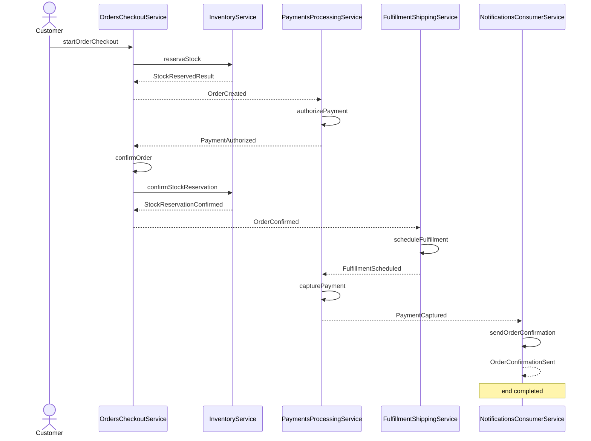

## Flowchart

Every command and event of the flow, whichever path they belong to.

```mermaid
flowchart TD
    action_authorizePayment["authorizePayment"]
    action_cancelOrder["cancelOrder"]
    action_capturePayment["capturePayment"]
    action_confirmOrder["confirmOrder"]
    action_confirmStockReservation["confirmStockReservation"]
    action_releaseStock["releaseStock"]
    action_reserveStock["reserveStock"]
    action_retryPayment["retryPayment"]
    action_scheduleFulfillment["scheduleFulfillment"]
    action_sendOrderCancelledNotification["sendOrderCancelledNotification"]
    action_sendOrderConfirmation["sendOrderConfirmation"]
    action_sendStockUnavailableNotification["sendStockUnavailableNotification"]
    action_startOrderCheckout["startOrderCheckout"]
    action_voidPayment["voidPayment"]
    event_FulfillmentFailed[/FulfillmentFailed/]
    event_FulfillmentScheduled[/FulfillmentScheduled/]
    event_OrderCancelledNotificationSent[/OrderCancelledNotificationSent/]
    event_OrderCancelled[/OrderCancelled/]
    event_OrderConfirmationSent[/OrderConfirmationSent/]
    event_OrderConfirmed[/OrderConfirmed/]
    event_OrderCreated[/OrderCreated/]
    event_PaymentAuthorized[/PaymentAuthorized/]
    event_PaymentCaptureFailed[/PaymentCaptureFailed/]
    event_PaymentCaptured[/PaymentCaptured/]
    event_PaymentDeclined[/PaymentDeclined/]
    event_PaymentFailed[/PaymentFailed/]
    event_PaymentRetried[/PaymentRetried/]
    event_PaymentRetryExhausted[/PaymentRetryExhausted/]
    event_PaymentVoided[/PaymentVoided/]
    event_StockReleased[/StockReleased/]
    event_StockReservationConfirmed[/StockReservationConfirmed/]
    event_StockUnavailableNotificationSent[/StockUnavailableNotificationSent/]
    event_StockUnavailable[/StockUnavailable/]
    outcome_authorizePayment_authorized(["authorized"])
    outcome_authorizePayment_declined(["declined"])
    outcome_authorizePayment_failed(["failed"])
    outcome_retryPayment_retried(["retried"])
    outcome_retryPayment_retry_exhausted(["retry-exhausted"])
    outcome_startOrderCheckout_StockReservedResult(["StockReservedResult"])
    outcome_startOrderCheckout_StockUnavailableResult(["StockUnavailableResult"])
    policy_when_FulfillmentFailed_PaymentCaptureFailed_do_voidPayment{{"when FulfillmentFailed,PaymentCaptureFailed do voidPayment"}}
    policy_when_FulfillmentScheduled_do_capturePayment{{"when FulfillmentScheduled do capturePayment"}}
    policy_when_OrderCancelled_do_sendOrderCancelledNotification{{"when OrderCancelled do sendOrderCancelledNotification"}}
    policy_when_OrderConfirmed_do_scheduleFulfillment{{"when OrderConfirmed do scheduleFulfillment"}}
    policy_when_OrderCreated_do_authorizePayment{{"when OrderCreated do authorizePayment"}}
    policy_when_PaymentAuthorized_do_confirmOrder{{"when PaymentAuthorized do confirmOrder"}}
    policy_when_PaymentCaptured_do_sendOrderConfirmation{{"when PaymentCaptured do sendOrderConfirmation"}}
    policy_when_PaymentDeclined_PaymentRetryExhausted_PaymentVoided_ReservationExpired_do_releaseStock{{"when PaymentDeclined,PaymentRetryExhausted,PaymentVoided,ReservationExpired do releaseStock"}}
    policy_when_PaymentFailed_do_retryPayment{{"when PaymentFailed do retryPayment"}}
    policy_when_PaymentRetried_do_authorizePayment{{"when PaymentRetried do authorizePayment"}}
    policy_when_StockReleased_do_cancelOrder{{"when StockReleased do cancelOrder"}}
    policy_when_StockUnavailable_do_sendStockUnavailableNotification{{"when StockUnavailable do sendStockUnavailableNotification"}}
    start_ReservationExpired["ReservationExpired"]
    start_ReservationExpired["Scheduler"]
    start_StartOrderCheckout["Customer"]
    start_StartOrderCheckout["StartOrderCheckout"]
    terminal_completed(("completed"))
    terminal_orderCancelled(("orderCancelled"))
    terminal_stockGone(("stockGone"))
    start_StartOrderCheckout --> action_startOrderCheckout
    start_ReservationExpired --> action_releaseStock
    action_startOrderCheckout --> action_reserveStock
    action_startOrderCheckout -->|on StockReservedResult| outcome_startOrderCheckout_StockReservedResult
    outcome_startOrderCheckout_StockReservedResult --> event_OrderCreated
    action_startOrderCheckout -->|on StockUnavailableResult| outcome_startOrderCheckout_StockUnavailableResult
    outcome_startOrderCheckout_StockUnavailableResult --> event_StockUnavailable
    action_authorizePayment --> outcome_authorizePayment_authorized
    outcome_authorizePayment_authorized --> event_PaymentAuthorized
    action_authorizePayment --> outcome_authorizePayment_declined
    outcome_authorizePayment_declined --> event_PaymentDeclined
    action_authorizePayment --> outcome_authorizePayment_failed
    outcome_authorizePayment_failed --> event_PaymentFailed
    action_retryPayment --> outcome_retryPayment_retried
    outcome_retryPayment_retried --> event_PaymentRetried
    action_retryPayment --> outcome_retryPayment_retry_exhausted
    outcome_retryPayment_retry_exhausted --> event_PaymentRetryExhausted
    action_confirmOrder --> action_confirmStockReservation
    action_confirmOrder --> event_OrderConfirmed
    action_confirmStockReservation --> event_StockReservationConfirmed
    action_scheduleFulfillment --> event_FulfillmentScheduled
    action_scheduleFulfillment --> event_FulfillmentFailed
    action_capturePayment --> event_PaymentCaptured
    action_capturePayment --> event_PaymentCaptureFailed
    action_sendOrderConfirmation --> event_OrderConfirmationSent
    action_sendStockUnavailableNotification --> event_StockUnavailableNotificationSent
    action_voidPayment --> event_PaymentVoided
    action_releaseStock --> event_StockReleased
    action_cancelOrder --> event_OrderCancelled
    action_sendOrderCancelledNotification --> event_OrderCancelledNotificationSent
    event_OrderCreated --> policy_when_OrderCreated_do_authorizePayment
    policy_when_OrderCreated_do_authorizePayment --> action_authorizePayment
    action_authorizePayment --> event_PaymentAuthorized
    action_authorizePayment --> event_PaymentDeclined
    action_authorizePayment --> event_PaymentFailed
    event_PaymentFailed --> policy_when_PaymentFailed_do_retryPayment
    policy_when_PaymentFailed_do_retryPayment --> action_retryPayment
    action_retryPayment --> event_PaymentRetried
    action_retryPayment --> event_PaymentRetryExhausted
    event_PaymentRetried --> policy_when_PaymentRetried_do_authorizePayment
    policy_when_PaymentRetried_do_authorizePayment --> action_authorizePayment
    event_PaymentAuthorized --> policy_when_PaymentAuthorized_do_confirmOrder
    policy_when_PaymentAuthorized_do_confirmOrder --> action_confirmOrder
    event_OrderConfirmed --> policy_when_OrderConfirmed_do_scheduleFulfillment
    policy_when_OrderConfirmed_do_scheduleFulfillment --> action_scheduleFulfillment
    event_FulfillmentScheduled --> policy_when_FulfillmentScheduled_do_capturePayment
    policy_when_FulfillmentScheduled_do_capturePayment --> action_capturePayment
    event_PaymentCaptured --> policy_when_PaymentCaptured_do_sendOrderConfirmation
    policy_when_PaymentCaptured_do_sendOrderConfirmation --> action_sendOrderConfirmation
    event_StockUnavailable --> policy_when_StockUnavailable_do_sendStockUnavailableNotification
    policy_when_StockUnavailable_do_sendStockUnavailableNotification --> action_sendStockUnavailableNotification
    event_FulfillmentFailed --> policy_when_FulfillmentFailed_PaymentCaptureFailed_do_voidPayment
    event_PaymentCaptureFailed --> policy_when_FulfillmentFailed_PaymentCaptureFailed_do_voidPayment
    policy_when_FulfillmentFailed_PaymentCaptureFailed_do_voidPayment --> action_voidPayment
    event_PaymentDeclined --> policy_when_PaymentDeclined_PaymentRetryExhausted_PaymentVoided_ReservationExpired_do_releaseStock
    event_PaymentRetryExhausted --> policy_when_PaymentDeclined_PaymentRetryExhausted_PaymentVoided_ReservationExpired_do_releaseStock
    event_PaymentVoided --> policy_when_PaymentDeclined_PaymentRetryExhausted_PaymentVoided_ReservationExpired_do_releaseStock
    policy_when_PaymentDeclined_PaymentRetryExhausted_PaymentVoided_ReservationExpired_do_releaseStock --> action_releaseStock
    event_StockReleased --> policy_when_StockReleased_do_cancelOrder
    policy_when_StockReleased_do_cancelOrder --> action_cancelOrder
    event_OrderCancelled --> policy_when_OrderCancelled_do_sendOrderCancelledNotification
    policy_when_OrderCancelled_do_sendOrderCancelledNotification --> action_sendOrderCancelledNotification
    event_OrderConfirmationSent --> terminal_completed
    event_StockUnavailableNotificationSent --> terminal_stockGone
    event_OrderCancelledNotificationSent --> terminal_orderCancelled

    classDef actor fill:#dbeafe,stroke:#1d4ed8,color:#0f172a
    classDef action fill:#dcfce7,stroke:#166534,color:#0f172a
    classDef event fill:#f8fafc,stroke:#475569,color:#0f172a
    classDef outcomeNode fill:#ede9fe,stroke:#6d28d9,color:#0f172a
    classDef policy fill:#fef3c7,stroke:#92400e,color:#0f172a
    classDef terminal fill:#fee2e2,stroke:#b91c1c,color:#0f172a
    class start_StartOrderCheckout actor
    class start_ReservationExpired actor
    class action_startOrderCheckout action
    class event_OrderCreated event
    class event_StockUnavailable event
    class action_reserveStock action
    class action_authorizePayment action
    class event_PaymentAuthorized event
    class event_PaymentDeclined event
    class event_PaymentFailed event
    class action_retryPayment action
    class event_PaymentRetried event
    class event_PaymentRetryExhausted event
    class action_confirmOrder action
    class event_OrderConfirmed event
    class action_confirmStockReservation action
    class event_StockReservationConfirmed event
    class action_scheduleFulfillment action
    class event_FulfillmentScheduled event
    class event_FulfillmentFailed event
    class action_capturePayment action
    class event_PaymentCaptured event
    class event_PaymentCaptureFailed event
    class action_sendOrderConfirmation action
    class event_OrderConfirmationSent event
    class action_sendStockUnavailableNotification action
    class event_StockUnavailableNotificationSent event
    class action_voidPayment action
    class event_PaymentVoided event
    class action_releaseStock action
    class event_StockReleased event
    class action_cancelOrder action
    class event_OrderCancelled event
    class action_sendOrderCancelledNotification action
    class event_OrderCancelledNotificationSent event
    class policy_when_OrderCreated_do_authorizePayment policy
    class policy_when_PaymentFailed_do_retryPayment policy
    class policy_when_PaymentRetried_do_authorizePayment policy
    class policy_when_PaymentAuthorized_do_confirmOrder policy
    class policy_when_OrderConfirmed_do_scheduleFulfillment policy
    class policy_when_FulfillmentScheduled_do_capturePayment policy
    class policy_when_PaymentCaptured_do_sendOrderConfirmation policy
    class policy_when_StockUnavailable_do_sendStockUnavailableNotification policy
    class policy_when_FulfillmentFailed_PaymentCaptureFailed_do_voidPayment policy
    class policy_when_PaymentDeclined_PaymentRetryExhausted_PaymentVoided_ReservationExpired_do_releaseStock policy
    class policy_when_StockReleased_do_cancelOrder policy
    class policy_when_OrderCancelled_do_sendOrderCancelledNotification policy
    class terminal_completed terminal
    class terminal_stockGone terminal
    class terminal_orderCancelled terminal
    class outcome_startOrderCheckout_StockReservedResult outcomeNode
    class outcome_startOrderCheckout_StockUnavailableResult outcomeNode
    class outcome_authorizePayment_authorized outcomeNode
    class outcome_authorizePayment_declined outcomeNode
    class outcome_authorizePayment_failed outcomeNode
    class outcome_retryPayment_retried outcomeNode
    class outcome_retryPayment_retry_exhausted outcomeNode
```

## Outcomes

How the flow can end, the events that end it and the paths that lead there.

| Outcome | Terminal events | Paths |
| --- | --- | --- |
| `completed` | `OrderConfirmationSent` | [Happy path](#happy-path) [completed: from StartOrderCheckout via StockReservedResult → failed → retried → authorized → FulfillmentScheduled → PaymentCaptured](#completed-from-startordercheckout-via-stockreservedresult--failed--retried--authorized--fulfillmentscheduled--paymentcaptured) |
| `stockGone` | `StockUnavailableNotificationSent` | [stockGone: from StartOrderCheckout via StockUnavailableResult](#stockgone-from-startordercheckout-via-stockunavailableresult) |
| `orderCancelled` | `OrderCancelledNotificationSent` | [orderCancelled: from StartOrderCheckout via StockReservedResult → declined](#ordercancelled-from-startordercheckout-via-stockreservedresult--declined) [orderCancelled: from StartOrderCheckout via StockReservedResult → authorized → FulfillmentFailed](#ordercancelled-from-startordercheckout-via-stockreservedresult--authorized--fulfillmentfailed) [orderCancelled: from StartOrderCheckout via StockReservedResult → failed → retry-exhausted](#ordercancelled-from-startordercheckout-via-stockreservedresult--failed--retry-exhausted) [orderCancelled: from StartOrderCheckout via StockReservedResult → authorized → FulfillmentScheduled → PaymentCaptureFailed](#ordercancelled-from-startordercheckout-via-stockreservedresult--authorized--fulfillmentscheduled--paymentcapturefailed) [orderCancelled: from StartOrderCheckout via StockReservedResult → failed → retried → declined](#ordercancelled-from-startordercheckout-via-stockreservedresult--failed--retried--declined) [orderCancelled: from StartOrderCheckout via StockReservedResult → failed → retried → authorized → FulfillmentFailed](#ordercancelled-from-startordercheckout-via-stockreservedresult--failed--retried--authorized--fulfillmentfailed) [orderCancelled: from StartOrderCheckout via StockReservedResult → failed → retried → failed → retry-exhausted](#ordercancelled-from-startordercheckout-via-stockreservedresult--failed--retried--failed--retry-exhausted) [orderCancelled: from StartOrderCheckout via StockReservedResult → failed → retried → authorized → FulfillmentScheduled → PaymentCaptureFailed](#ordercancelled-from-startordercheckout-via-stockreservedresult--failed--retried--authorized--fulfillmentscheduled--paymentcapturefailed) [orderCancelled: from ReservationExpired](#ordercancelled-from-reservationexpired) |

## Systems

The systems that take part, the services they expose in this flow and the commands they run. A system with the name of a module links to the page of that module.

| System | Services | Commands | Module |
| --- | --- | --- | --- |
| `OrdersCheckout` | `OrdersCheckoutService` | `startOrderCheckout`, `confirmOrder`, `cancelOrder` | [Orders Checkout](../domain.md) |
| `CatalogInventory` | `InventoryService` | `reserveStock`, `confirmStockReservation`, `releaseStock` |  |
| `PaymentsProcessing` | `PaymentsProcessingService` | `authorizePayment`, `retryPayment`, `capturePayment`, `voidPayment` |  |
| `FulfillmentShipping` | `FulfillmentShippingService` | `scheduleFulfillment` |  |
| `NotificationsConsumer` | `NotificationsConsumerService` | `sendOrderConfirmation`, `sendStockUnavailableNotification`, `sendOrderCancelledNotification` |  |

## Alternative paths

Every other way through the flow, one diagram per path, grouped by the outcome where it ends. The title of a path lists the choices it takes.

### completed

#### completed: from StartOrderCheckout via StockReservedResult → failed → retried → authorized → FulfillmentScheduled → PaymentCaptured

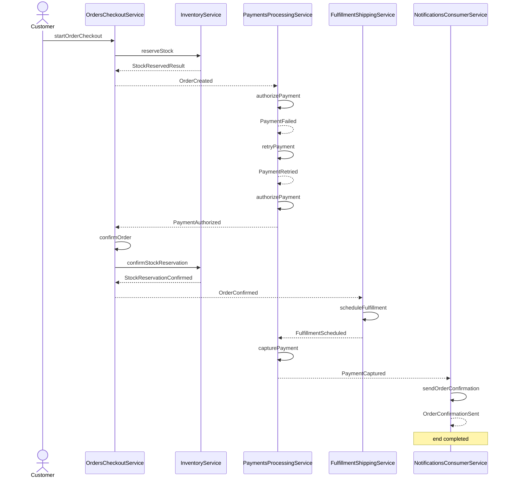

### stockGone

#### stockGone: from StartOrderCheckout via StockUnavailableResult

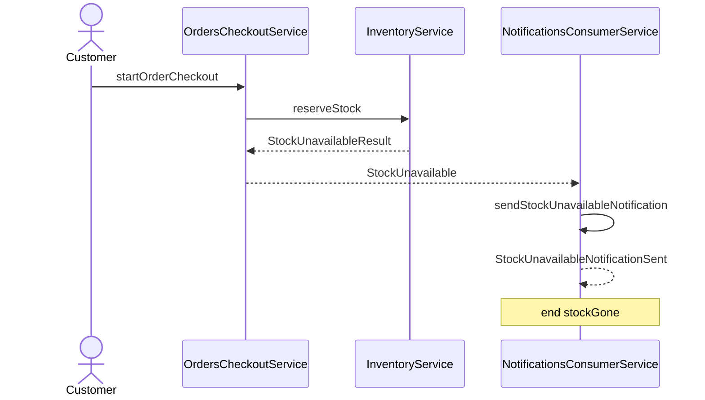

### orderCancelled

#### orderCancelled: from StartOrderCheckout via StockReservedResult → declined

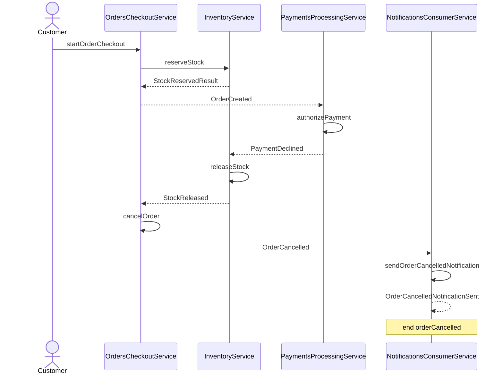

#### orderCancelled: from StartOrderCheckout via StockReservedResult → authorized → FulfillmentFailed

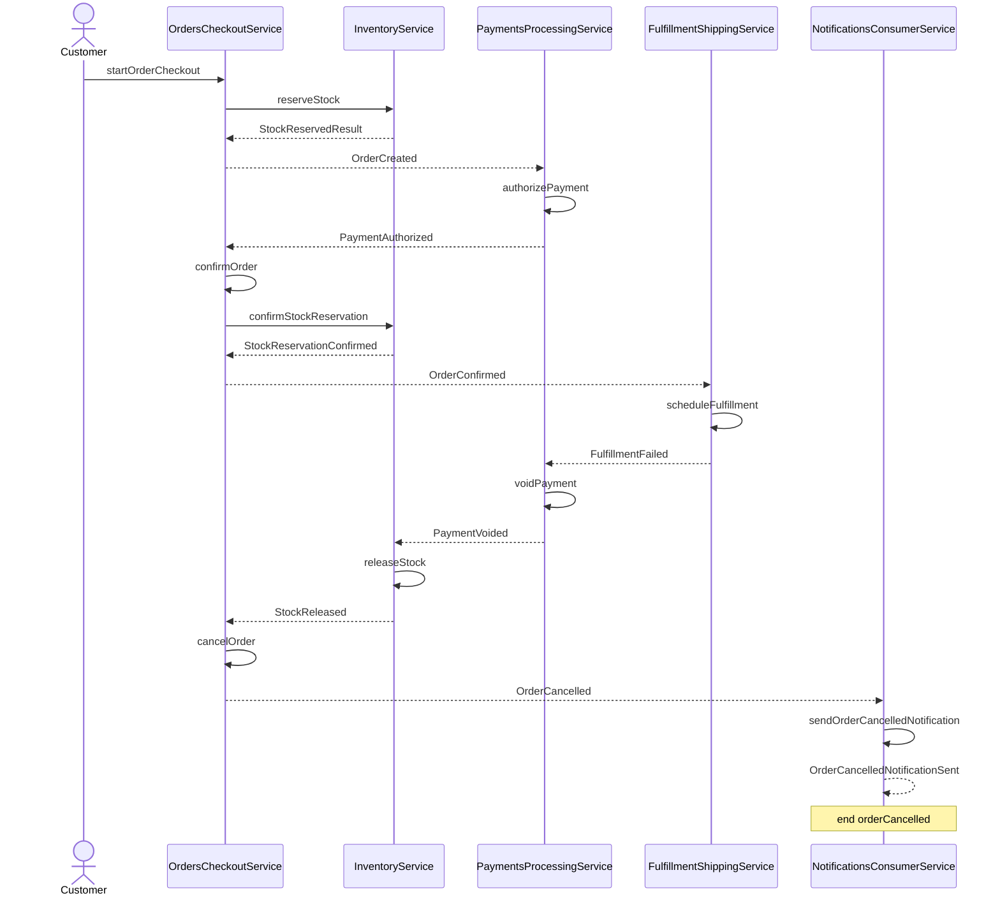

#### orderCancelled: from StartOrderCheckout via StockReservedResult → failed → retry-exhausted

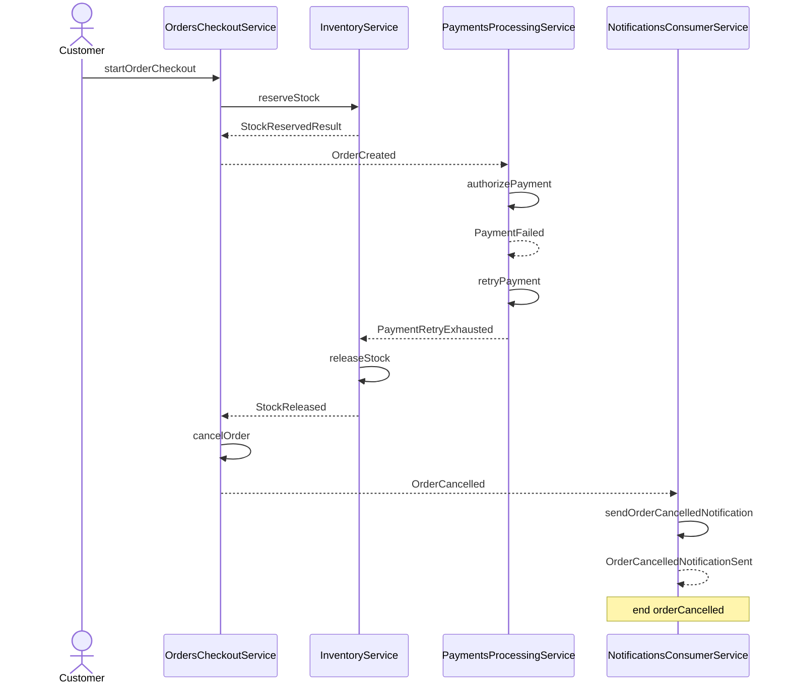

#### orderCancelled: from StartOrderCheckout via StockReservedResult → authorized → FulfillmentScheduled → PaymentCaptureFailed

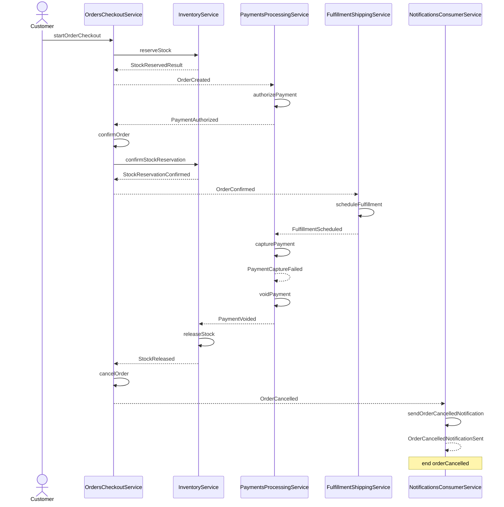

#### orderCancelled: from StartOrderCheckout via StockReservedResult → failed → retried → declined

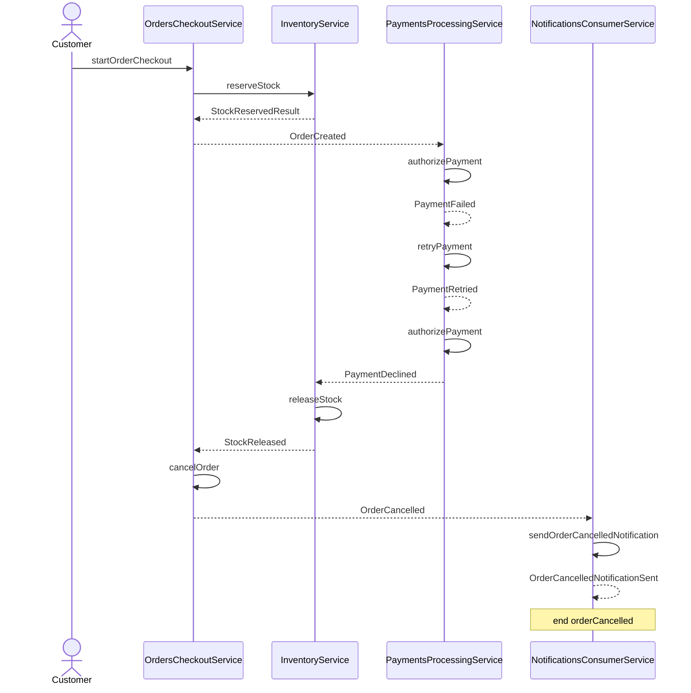

#### orderCancelled: from StartOrderCheckout via StockReservedResult → failed → retried → authorized → FulfillmentFailed

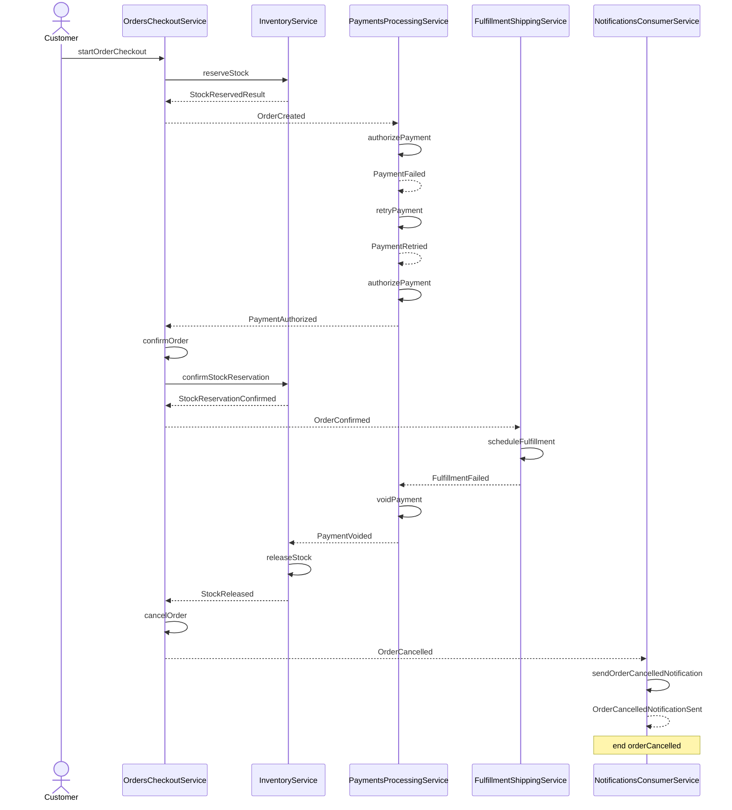

#### orderCancelled: from StartOrderCheckout via StockReservedResult → failed → retried → failed → retry-exhausted

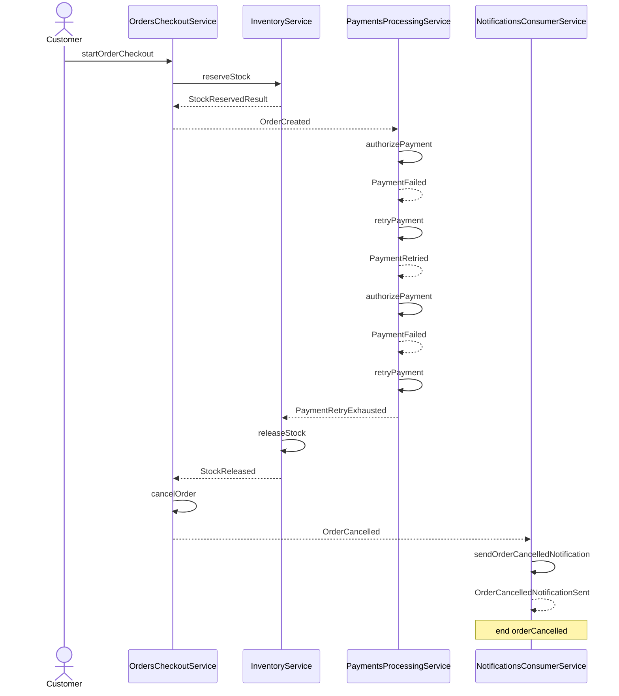

#### orderCancelled: from StartOrderCheckout via StockReservedResult → failed → retried → authorized → FulfillmentScheduled → PaymentCaptureFailed

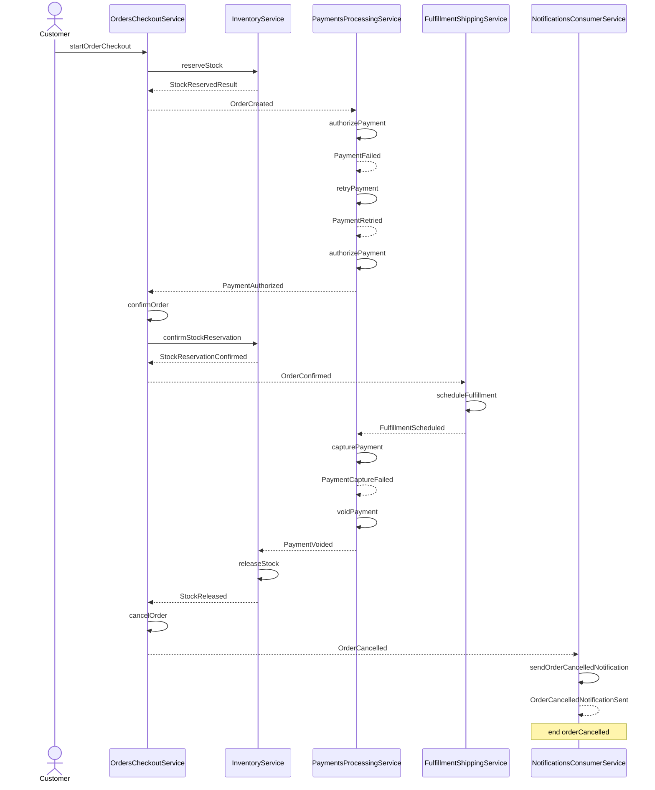

#### orderCancelled: from ReservationExpired

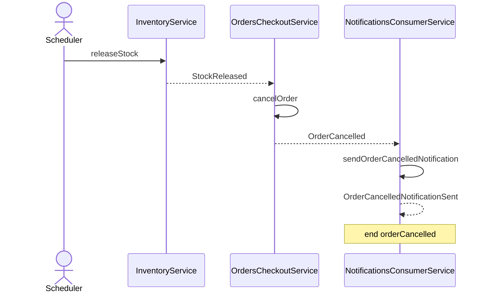

